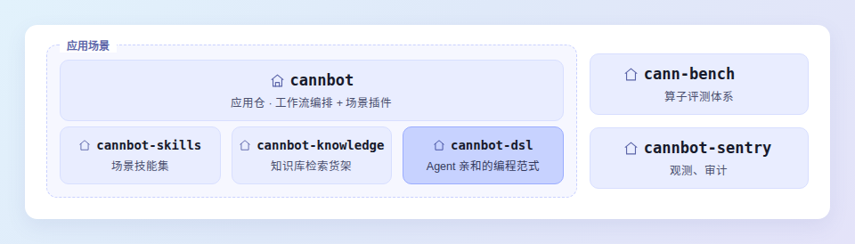

# CANNBot-DSL

> 基于 CANNBot-DSL 的 Huawei Ascend NPU 复杂算子样例集合，配套完整的文档站与精度测试。

[📖 概述](docs/zh/guide/overview.md) · [💻 软硬件配套](docs/zh/guide/hardware-model.md) · [⚡️ 快速上手](docs/zh/install/source-build.md) · [📦 算子列表](samples/) · [📚 文档导航](docs/zh/api/index.md) · [📂 目录结构](docs/zh/guide/repository.md) · [🔥 更新日志](CHANGELOG.md) · [📜 许可证](LICENSE)


---

## 🔥 最新动态

> **2026-10-30**
>
> - **📦 发布 CANNBot-DSL 0.8.0 wheel 包**：`master` 分支配套 `cannbot-dsl==0.8.0`，可直接通过 pip 安装。
>
> **2026-09-30**
>
> - **DeepSeek V4.1 相关算子**：本仓提供以下算子： [`indexer_prologue_qw`](samples/attention/indexer_prologue_qw)、[`indexer_prologue_k`](samples/attention/indexer_prologue_k)、[`attn_epilogue`](samples/attention/attn_epilogue)、[`quant_lightning_indexer`](samples/attention/quant_lightning_indexer)、[`quant_sparse_lightning_indexer`](samples/attention/quant_sparse_lightning_indexer)、[`mixed_quant_sparse_flash_mla`](samples/attention/mixed_quant_sparse_flash_mla)。
>

## 📌 概述

CANNBot 是 [CANN](https://hiascend.com/software/cann) 社区的 Infra 智能体层，用 Agent 完成 AscendC/PyPTO/TileLang/Triton 等各类语言的算子开发、模型迁移与推理优化，并延伸至图模式、Runtime 等更多 CANN 开发场景。

本仓（cannbot-dsl）是其 DSL 仓，提供 Agent 亲和的编程范式；仓群还包括 [cannbot](https://gitcode.com/cann/cannbot)、[cannbot-skills](https://gitcode.com/cann/cannbot-skills)、[cannbot-knowledge](https://gitcode.com/cann/cannbot-knowledge)、[cann-bench](https://gitcode.com/cann/cann-bench)、[cannbot-sentry](https://gitcode.com/cann/cannbot-sentry) 等仓库，结构如下。



## 💻 软硬件配套说明

| 维度 | 支持的版本 |
| :--- | :--- |
| 昇腾产品 | Ascend 950PR / Ascend 950DT（NPU ARCH 3510），见[硬件兼容性查询](https://www.hiascend.com/hardware/compatibility) |
| CPU 架构 | x86_64 / aarch64 |
| 操作系统 | CANN 支持的 Linux 发行版，见[硬件兼容性查询](https://www.hiascend.com/hardware/compatibility) |
| Python | 3.10、3.11、3.12 |
| CANN | 9.2.1，见 [CANN 安装部署](https://www.hiascend.com/zh/cann/download?versionId=813&ids=d806%2Ch0501%2Ch0601%2Ch0703&currentTab=0) |
| CANNBot-DSL | 0.8.0 |
| torch | 2.7.1 / 2.9.0 / 2.10.0 / 2.11.0 / 2.12.0 |

> 上表口径截至 2026-10-29。CANN 软件包请以 [CANN 安装部署](https://www.hiascend.com/zh/cann/download?versionId=813&ids=d806%2Ch0501%2Ch0601%2Ch0703&currentTab=0)页面提供的产品和架构匹配版本为准。


## ⚡️ 快速上手

### 1. 安装 CANN

版本要求见[软硬件配套说明](docs/zh/guide/hardware-model.md)。CANN 软件包为 Linux 版本，分 `x86_64` 与 `aarch64` 两种架构。请从 [CANN 安装部署](https://www.hiascend.com/zh/cann/download?versionId=813&ids=d806%2Ch0501%2Ch0601%2Ch0703&currentTab=0)页面选择 CANN 9.2.1 以及与目标产品、操作系统架构匹配的 Toolkit 和算子包。

`${install_path}` 为安装路径，默认 `/usr/local/Ascend`：

```bash
bash ./Ascend-cann_9.2.1_linux-x86_64.run --install --force --install-path=${install_path}
bash ./Ascend-cann-950-ops_9.2.1_linux-x86_64.run --install --force --install-path=${install_path}

source ${install_path}/ascend-toolkit/set_env.sh
```

### 2. 安装 CANNBot-DSL

CANNBot-DSL 0.8.0 已发布到 pip 源。发行包名为 `cannbot-dsl`，导入名为 `cannbotdsl`：

```bash
python -m pip install cannbot-dsl==0.8.0
```


安装完成后验证版本：

```bash
python -c 'import cannbotdsl; print(cannbotdsl.__version__)'
```

### 3. 运行一个算子

以 `flash_kda` 为例。该样例依赖 CANNBot-DSL 0.8.0，先生成 metadata，再执行 FlashKDA：

```python
import math

import torch
import torch_npu

from flash_kda.flash_kda import flash_kda
from flash_kda.flash_kda_metadata import flash_kda_metadata

B, NQK, NV, S, D = 1, 3, 3, 8192, 128
q = torch.randn(B, NQK, S, D, device="npu", dtype=torch.bfloat16)
k = torch.randn_like(q)
v = torch.randn(B, NV, S, D, device="npu", dtype=torch.bfloat16)
g = torch.randn_like(v)
beta = torch.randn(B, NV, S, device="npu", dtype=torch.bfloat16)
initial_state = torch.zeros(B, NV, D, D, device="npu", dtype=torch.float32)
A_log = torch.randn(NV, device="npu", dtype=torch.float32)
dt_bias = torch.randn(NV, D, device="npu", dtype=torch.float32)

metadata = flash_kda_metadata(q, v, initial_state, "BNSD")
out, final_state = flash_kda(
    q, k, v, g, beta, 1 / math.sqrt(D), initial_state,
    A_log, dt_bias, -5.0, "BNSD", metadata,
)

print("out", tuple(out.shape))
print("final_state", tuple(final_state.shape))
```

样例以目录为单位组织，运行前请在仓库根目录将 `samples/attention` 加入 `PYTHONPATH`：

```bash
export PYTHONPATH="$PWD/samples/attention:$PYTHONPATH"
python3 your_script.py
```

运行成功时打印：

```text
out (1, 3, 8192, 128)
final_state (1, 3, 128, 128)
```

各算子的接口参数、数据类型约束与返回值说明，见[算子列表](#算子列表)中对应样例的 README。

### 4. 运行精度测试

```bash
python3 -m pytest test/attention/flash_kda/test_flash_kda.py -v
```


## 📦 算子列表

本仓算子持续合入中，当前已开源算子如下：

| 样例 | 接口 | 说明 |
| :--- | :--- | :--- |
| [matmul/matmul](samples/matmul/matmul) | `matmul()` | A16W16 矩阵乘，`C[M,N] = A[M,K] × B[N,K]^T` |
| [matmul/matmul](samples/matmul/matmul) | `matmul_streamk()` | 同目录的 Stream-K（DPSK）实现，DP + SK 混合调度，适合小 M/N、大 K |
| [matmul/batch_matmul](samples/matmul/batch_matmul) | `batch_matmul()` | 批量矩阵乘，batch 维右对齐广播，支持 rank 2~6 |
| [matmul/fused_matmul](samples/matmul/fused_matmul) | `fused_matmul()` | 矩阵乘融合逐列 Add / Mul 和 GELU / ReLU，支持 FP16 / BF16 输入及 FP32 输出 |
| [matmul/dual_level_quant_matmul](samples/matmul/dual_level_quant_matmul) | `npu_dual_level_quant_matmul()` | MXFP4 双层 Scale 矩阵乘，使用 NZ 权重，支持 FP16 / BF16 输出和 Bias |
| [matmul/quant_matmul](samples/matmul/quant_matmul) | `npu_quant_matmul()` | MXFP8 / MXFP4 全量化矩阵乘（`quant_batch_matmul_mx.py`） |
| [matmul/quant_matmul](samples/matmul/quant_matmul) | `npu_quant_matmul()` | per-tensor（TT）量化矩阵乘，支持 HiFloat8 / INT8 / FP8（`quant_batch_matmul_hif8_tt.py`） |
| [matmul/quant_matmul](samples/matmul/quant_matmul) | `matmul_mix_quant()` | MXA8W4：MXFP8 激活 × MXFP4 权重（`quant_batch_matmul_mxa8w4.py`） |
| [matmul/quant_matmul](samples/matmul/quant_matmul) | `quant_batch_matmul_inplace_add()` | MX 全量化矩阵乘原地累加（`y += dequant_mm(x1, x2)`），输出恒 FP32（`quant_batch_matmul_inplace_add.py`） |
| [matmul/weight_quant_batchmatmul](samples/matmul/weight_quant_batchmatmul) | `npu_weight_quant_batchmatmul()` | A16W4 权重量化矩阵乘：FP16 激活 × MXFP4 权重（E2M1 + E8M0 per-32-group scale），WeightNZ 布局 |
| [grouped_matmul](samples/matmul/grouped_matmul) | `group_matmul()` | 分组矩阵乘，支持 M 轴 / K 轴分组 |
| [flash_attn](samples/attention/flash_attn) | `flash_attn()`、`flash_attn_metadata()` | Flash Attention，支持 GQA、变长序列和分页 KV cache |
| [flash_mla_with_kvcache](samples/attention/flash_mla_with_kvcache) | `flash_mla_with_kvcache()`、`flash_mla_with_kvcache_metadata()` | Flash MLA 推理，Query 为 TND、KV 为分页 cache |
| [qwen_sparse_attn](samples/attention/qwen_sparse_attn) | `qwen_sparse_attn()` | 固定 `block_size=128` 的分块稀疏注意力，含 AICPU metadata 规划 |
| [quant_block_sparse_attn](samples/attention/quant_block_sparse_attn) | `quant_block_sparse_attn()`、`quant_block_sparse_attn_metadata()` | FP8 量化块稀疏注意力，面向分页 prefill |
| [mixed_quant_sparse_flash_mla](samples/attention/mixed_quant_sparse_flash_mla) | `mixed_quant_sparse_flash_mla()` | 混合量化稀疏 MLA：BF16 Q + FP8 原始 KV + 可选 FP4 压缩 KV |
| [mixed_quant_sparse_flash_mla_metadata](samples/attention/mixed_quant_sparse_flash_mla/mixed_quant_sparse_flash_mla_metadata.py) | `mixed_quant_sparse_flash_mla_metadata()` | MQSMLA 的 AICPU 分核调度，输出整行 / FlashDecode 分片计划 |
| [flash_kda](samples/attention/flash_kda) | `flash_kda()`、`flash_kda_metadata()` | Kimi Delta Attention prefill 融合算子，含 AICPU 调度 metadata |
| [fused_recurrent_kda_replayssm](samples/attention/fused_recurrent_kda_replayssm) | `fused_recurrent_kda_replayssm()` | 独立 ReplaySSM verify，读取 FP32 checkpoint，写出 FP16 U/K 和 FP32 decay；支持 BSND/BNSD/TND 和 8/24/28/32 控核 |
| [attn_epilogue](samples/attention/attn_epilogue) | `attn_epilogue()` | Attention 输出投影：inverse RoPE、两次 MXFP8 激活量化与 WoA/WoB 两级矩阵乘；BF16 输入/输出，E4M3FN 权重与 E8M0 scale |
| [indexer_prologue_qw](samples/attention/indexer_prologue_qw) | `indexer_prologue_qw()` | MXFP8 Q GEMM、尾部 RoPE、MXFP4 量化，以及 BF16 W GEMM |
| [indexer_prologue_k](samples/attention/indexer_prologue_k) | `indexer_prologue_k()` | Indexer K 路前处理：BF16 投影、RMSNorm、RoPE、MXFP4 量化与分页 cache 写入 |
| [mega_full_index](samples/attention/mega_full_index) | `mega_full_index()` | DeepSeek V4.1 第 20 层融合：Indexer Prologue QW/K 前处理与 Quant Lightning Indexer 单 kernel 启动，输出 Top-512 token 索引与候选块 |
| [qsa_indexer](samples/attention/qsa_indexer) | `qsa_indexer()`、`qsa_indexer_metadata()` | 压缩 Key 稀疏索引，选高分压缩块并展开为 token 索引 |
| [stem_indexer](samples/attention/stem_indexer) | `stem_indexer()`、`stem_indexer_metadata()` | 块级特征打分 + 动态 TopK 选择 Key Block |
| [quant_lightning_indexer](samples/attention/quant_lightning_indexer) | `quant_lightning_indexer()` | MXFP4 Lightning Indexer（QLI），遍历上下文选 TopK token |
| [quant_lightning_indexer_metadata](samples/attention/quant_lightning_indexer_metadata) | `quant_lightning_indexer_metadata()` | QLI 配套的 AICPU 调度算子 |
| [quant_sparse_lightning_indexer](samples/attention/quant_sparse_lightning_indexer) | `quant_sparse_lightning_indexer()` | MXFP4 Sparse Lightning Indexer（QSLI），仅访问候选 Key 块 |
| [quant_sparse_lightning_indexer_metadata](samples/attention/quant_sparse_lightning_indexer_metadata) | `quant_sparse_lightning_indexer_metadata()` | QSLI 配套的 AICPU 调度算子 |
| [dynamic_mx_quant_sr](samples/vector/dynamic_mx_quant_sr/README.md) | `dynamic_mx_quant_sr()` | block32 MXFP8 随机舍入量化，FP32/BF16 → E4M3FN/E5M2；依赖 CANNBot-DSL 0.8.0，环境要求见样例文档 |
| [moonep](samples/mc2/moonep) | `prefetch_weight()` | 专家并行场景的跨卡权重预取 |
| [engram_gate](samples/vector/engram_gate) | `engram_gate()` | Engram 残差门：双路 RMS、加权点积与 signed-sqrt sigmoid 门控 |
| [fused_norm_rope_attn_rope_cast_fwd](samples/attention/fused_norm_rope_attn_rope_cast_fwd) | `fused_norm_rope_attn_rope_cast_fwd()` | Q RMSNorm、Q RoPE、Sparse Attention、O 共轭 RoPE 与 MXFP8 量化（含 SF 打包）的融合算子，其中 Q RMSNorm 为可选融合 |

## 📚 文档导航

接口文档的入口是 [API 参考](docs/zh/api/index.md)；算子样例、测试与仓库结构不另设站点页面，直接阅读仓内文件。

| 内容 | 说明 | 入口 |
| :--- | :--- | :--- |
| API 总览 | 按语言、数据结构、操作、执行、编译发布和 AI CPU 组织的 API 参考 | [docs/zh/api/index.md](docs/zh/api/index.md) |
| 语言 API | 装饰器、控制流、VF、编译期表达式和 Kernel 启动 | [docs/zh/api/language/index.md](docs/zh/api/language/index.md) |
| 数据结构 | 数据类型、Tensor、布局、片上存储、Buffer、RingBuffer 和数组 | [docs/zh/api/data-structures/index.md](docs/zh/api/data-structures/index.md) |
| 操作 API | 数据搬运、标量、矢量、矩阵、原子和张量操作 | [docs/zh/api/compute/index.md](docs/zh/api/compute/index.md) |
| 设备执行 | 设备执行上下文、流水类型、调试和已公开的同步接口 | [docs/zh/api/execution/index.md](docs/zh/api/execution/index.md) |
| 编译与发布 | Host 参数规格、JIT/AOT 编译、Native 发布和 ACLNN 工程接入 | [docs/zh/api/compilation/index.md](docs/zh/api/compilation/index.md) |
| AI CPU API | AI CPU Kernel 的声明、参数、编译、验证和启动 | [docs/zh/api/aicpu/index.md](docs/zh/api/aicpu/index.md) |
| 算子样例 | 各样例目录下的 README：接口签名、数据类型约束与运行方式 | [samples/](samples/README.md) |
| 精度测试 | 与样例一一对应的 pytest 用例 | [test/](test/) |
| Native 打包 | 把 `samples/` 下的算子编译打包为 Native wheel | [packaging/native/README.md](packaging/native/README.md) |
| 更新日志 | 版本与算子变更记录 | [CHANGELOG.md](CHANGELOG.md) |

## 📂 目录结构

关键目录如下，详细目录参见[仓库结构](docs/zh/guide/repository.md)。

```bash
cannbot-dsl/
├── docs/          # 文档站源码（VitePress）
├── samples/       # 按 attention、matmul、vector、mc2、moe、spatial 分类的算子样例
├── test/          # 按相同类别组织的测试代码
├── figures/       # 样例 README 使用的性能对比图
├── catalog/       # 算子身份、路径与构建依赖的统一清单
├── net/           # 网络依赖与接入
├── packaging/native/ # 公共 Native 编译与 wheel 打包
└── scripts/       # CI 与合规检查脚本
```

## 📝 相关信息

- [更新日志](CHANGELOG.md)
- [文档贡献指南](CONTRIBUTION_DOC.md)
- [许可证](LICENSE)：CANN Open Software License Agreement Version 2.0

---

欢迎通过 Issue 与合并请求参与项目建设。问题反馈与交流请使用 [GitCode 仓库](https://gitcode.com/cann/cannbot-dsl)的 Issues 与 Discussions。
