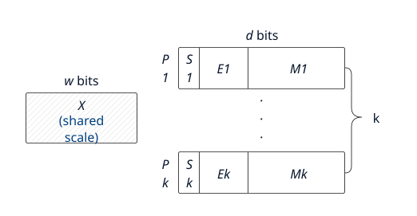
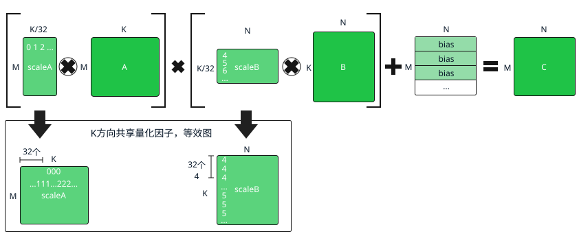
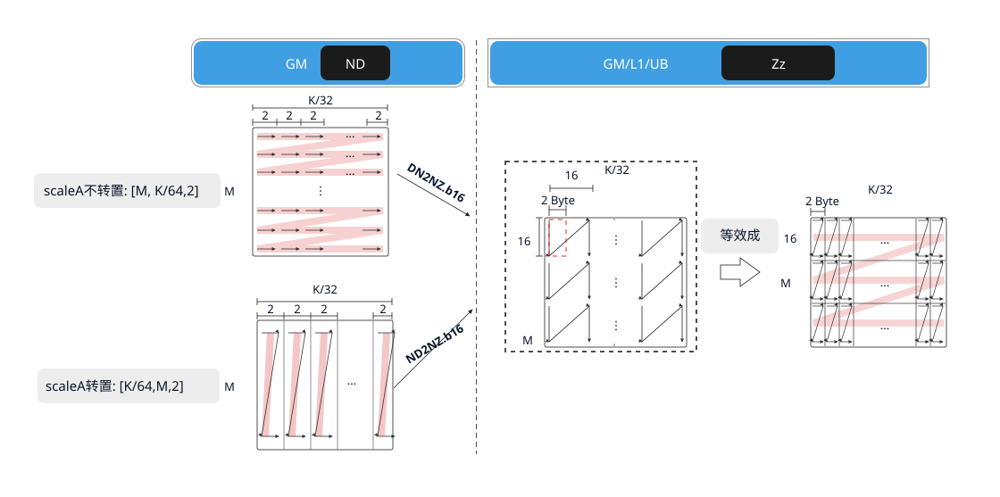
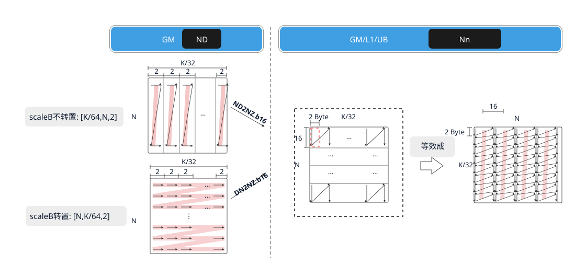

# 辅助矩阵分形格式详解

## MX系数矩阵

针对Ascend 950PR&950DT系列产品：

浮点数在科学计算、图像处理、神经网络等领域应用广泛。以AI训练为例，现有的浮点数格式或数值范围不足，或精度不高，这影响了模型的收敛速度和性能。如果要同时满足数值范围和精度的要求，将会导致内存占用过大，从而增加数据存储和传输的成本。基于此种情况，业内提出了一种新的浮点数格式——微缩放（Microscaling，MX）格式。MX格式的浮点数可以支持更低比特位宽的AI训练和推理，并且占用的内存更少。符合MX标准的数据格式在使用8位或更低比特位的情况下，能够实现稳健的AI训练和推理模型精度。

MX格式是一种块数据格式，若干个数据可以组成一个块（或者一个组），数据以块为单位。MX格式的数据由三部分构成：

- 共享量化系数X，位宽为w bits；
- 私有元素Pi，位宽为d bits；
- 块大小k，表示多少个低比特数据形成一个块。

所有k个元素Pi有相同的位宽和数据类型，并且共享一个量化系数X，每个包含k个元素的块可以使用`w + k × d`位进行编码。元素的数据类型和量化系数可以独立选择。

下图为MX格式的浮点数的数据结构，S、E和M分别用于表示浮点数的符号、指数和尾数字段的值。其中，共享量化系数X是一个用于整个数据块的缩放比例因子，它决定了数据块中所有元素的动态范围。通过引入共享量化系数，MX格式的数据能够在保持低位宽的同时，灵活地表示不同范围的数据。块大小k指的是组成一个数据块（或组）的低比特数据的数量。私有元素Pi是指数据块中的每个低比特数据元素。这些元素经过量化系数X的调整后，共同表示了一个高精度的浮点数或整数。

**图1** MX格式组成示意图



MX矩阵乘法为带有量化系数X的矩阵乘法，即左矩阵和右矩阵均有对应的量化系数矩阵，分别为左量化系数矩阵scaleA和右量化系数矩阵scaleB。下图以Bias作为初始累加矩阵为例，计算公式为`C = (scaleA ⊗ A) × (scaleB ⊗ B) + Bias`，其中“⊗”表示广播乘法，K方向上每32个元素共享一个量化系数。A的形状为`[M, K]`，scaleA为`[M, K/32]`；B的形状为`[K, N]`，scaleB为`[K/32, N]`。

**图2** MX矩阵乘示意图



### MX scaleA系数矩阵分形介绍

- **物理位置：** Global Memory/L1 Buffer/Unified Buffer（UB）：保存离线或在线生成的左矩阵量化系数数据。
- **设计原理：** MX矩阵乘法中A矩阵与scaleA矩阵的物理地址一一映射。系数从L1 Buffer搬入计算单元时需满足行读取需求，因此scaleA矩阵在L1 Buffer中按行存储，采用大Z小z排布（[Zz](./fractal-formats.md#zz格式)）。
- **格式转换过程：** 假设原始A矩阵大小为`(M, K)`，则对应的scaleA矩阵大小为`(M, K/32)`。scaleA被分为`M1 × K1`个分形，分形之间按row major（行主序）排布；每个分形内部有`M0 × K0`个元素，也按row major排布，因此称为Zz格式。本节中`(M0, K0) = (16, 2)`，分形需与L0A_MX Buffer的物理内存排布保持一致。

通过公式表达转换过程如下：

```text
(…, B, M, K/32)
  → pad       → (…, B, M1 × M0, K1 × K0)
  → reshape   → (…, B, M1, M0, K1, K0)
  → transpose → (…, B, M1, K1, M0, K0)
```

- **分形大小约束：** 数据类型为`dtypes.float8_e8m0`，分形大小为`16×2`（M0，K0）。

如下图所示，若GM上的scaleA矩阵为ND排布，搬入L1 Buffer时通过ND2Nz.b16或DN2Nz.b16格式转换，将每两个相邻K分组的量化系数作为16位数据搬运，得到满足系数加载要求的Zz分形。DSL通过[`mem_copy`](../../data-movement/mem-copy.md)及源、目标视图的布局表达这一转换。

**图3** scaleA矩阵在不同位置上的排布格式



### MX scaleB系数矩阵分形介绍

- **物理位置：** Global Memory/L1 Buffer/UB：保存离线或在线生成的右矩阵量化系数数据。
- **设计原理：** MX矩阵乘法中B矩阵与scaleB矩阵的物理地址一一映射。系数从L1 Buffer搬入计算单元时需满足列读取需求，因此scaleB矩阵在L1 Buffer中按列存储，采用大N小n排布（Nn）。
- **格式转换过程：** 假设原始B矩阵大小为`(K, N)`，则对应的scaleB矩阵大小为`(K/32, N)`。scaleB被分为`K1 × N1`个分形，分形之间按column major（列主序）排布；每个分形内部有`K0 × N0`个元素，也按column major排布，因此称为Nn格式。本节中`(K0, N0) = (2, 16)`，分形需与L0B_MX Buffer的物理内存排布保持一致。

通过公式表达转换过程如下：

```text
(…, B, K/32, N)
  → pad       → (…, B, K1 × K0, N1 × N0)
  → reshape   → (…, B, K1, K0, N1, N0)
  → transpose → (…, B, N1, K1, N0, K0)
```

- **分形大小约束：** 数据类型为`dtypes.float8_e8m0`，分形大小为`2×16`（K0，N0）。

如下图所示，若GM上的scaleB矩阵为ND排布，搬入L1 Buffer时通过ND2Nz.b16或DN2Nz.b16格式转换，得到满足系数加载要求的Nn分形。DSL通过`mem_copy`及源、目标视图的布局表达这一转换。

**图4** scaleB矩阵在不同位置上的排布格式



ScaleA、ScaleB随对应输入从L1搬入计算单元时，使用[`copy_options`的`mx_scale`参数](../../data-movement/copy-options.md#参数说明)提供量化系数视图。Bias矩阵的准备及初始累加值的配置见[初始化与累加](./matmul.md#初始化与累加)；完整的数据准备和结果校验示例见[matmul（MX模式）](./matmul-mx.md#调用示例)。
