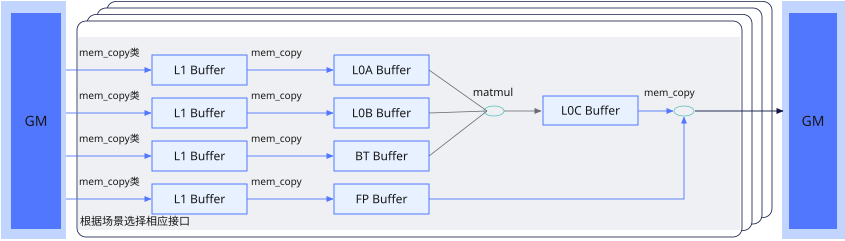
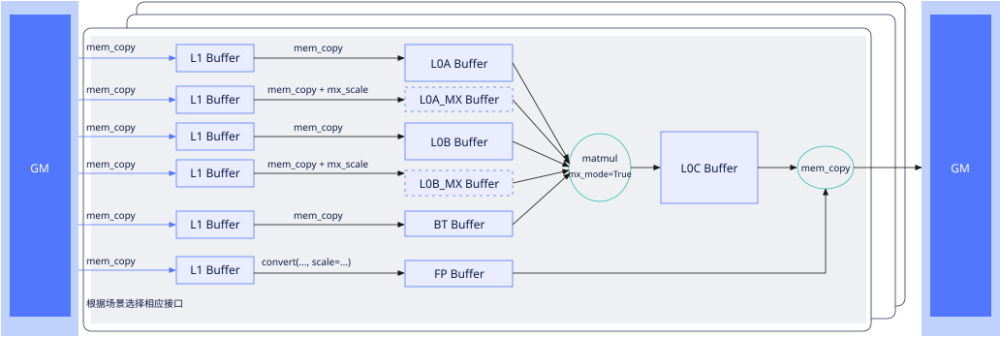

# 普通矩阵计算流程

矩阵计算接口针对矩阵计算编程模型提供了数据搬入、矩阵计算和结果搬出接口，分别承载Cube核中各个通路的搬运能力和计算能力，如下图所示：

**图1** 普通矩阵基础计算流程图

1. 通过[`mem_copy`](../../data-movement/mem-copy.md)搬入已排布好的A、B矩阵；对于ND输入，使用[`mem_copy`](../../data-movement/mem-copy.md)的ND2Nz随路转换完成分形转换。Bias和随路量化系数也先搬入L1 Buffer。

2. 通过[`mem_copy`](../../data-movement/mem-copy.md)将A、B分别搬入L0A Buffer、L0B Buffer；根据输入布局选择是否转置。Bias和量化系数通过[`mem_copy`](../../data-movement/mem-copy.md)搬入对应Buffer。

3. 通过[`matmul`](./matmul.md)计算，输出至L0C Buffer。矩阵的M、K、N由入参Tensor的shape决定，初次从零计算时设置`init=True`；后续K块累加时设置`init=False`。Bias初始化的参数说明见[`matmul`](./matmul.md)。

4. 通过[`mem_copy`](../../data-movement/mem-copy.md)搬出结果，配置随路量化、激活和输出格式，也可搬到L1 Buffer。

## MX矩阵计算流程

MX矩阵计算仅在Ascend 950PR&950DT系列产品型号支持。

MX矩阵乘法（Microscaling矩阵乘加）为带有量化系数的矩阵乘法，即左矩阵和右矩阵均有对应的量化系数矩阵，分别为左量化系数矩阵scaleA和右量化系数矩阵scaleB。先将左、右量化系数矩阵分别与对应输入矩阵相乘，再对两个乘积的结果做矩阵乘法，如下图所示：

**图2** MX矩阵基础计算流程图

图中的`mem_copy + mx_scale`表示一次带`copy_options(mx_scale=...)`的搬运调用；对应输入数据和量化系数由同一次调用准备，不需要直接操作L0A_MX/L0B_MX Buffer。图中FP Buffer用于结果搬出的随路量化，与输入矩阵的MX量化系数用途不同；随路量化由`convert(..., scale=...)`及结果搬运表达。

1. 将A、B和[scaleA/scaleB系数矩阵](./aux-fractal-formats.md)从GM搬到L1 Buffer。A/B数据分形与系数分形不同，分别通过各自视图描述布局、大小和步长。
2. 通过[`mem_copy`](../../data-movement/mem-copy.md)将A、B搬入L0A/L0B，并分别使用`copy_options(mx_scale=ScaleA)`、`copy_options(mx_scale=ScaleB)`将对应量化系数加载到L0A_MX/L0B_MX。数据和系数需满足各自的布局要求。
3. 数据、系数及可选Bias就绪后，通过[`matmul(..., mx_mode=True)`](./matmul-mx.md)计算并输出至L0C Buffer。初次计算和后续K块累加时，分别按初始化规则配置`init`。
4. 通过`mem_copy`处理并搬出结果；需要类型转换、随路量化或激活时，使用搬运接口支持的表达式配置。
