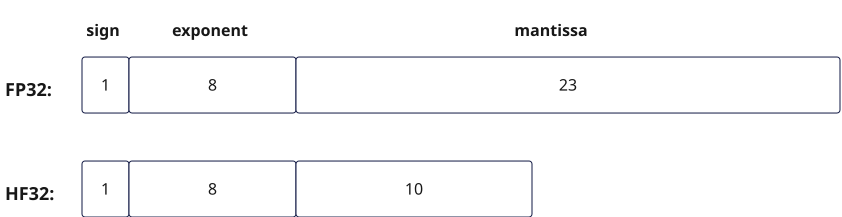

# HF32

**特性说明：**

HF32的核心功能体现为：用户在输入矩阵A、B矩阵都为fp32数据类型的场景下，当配置开启HF32开关后，fp32数据在执行矩阵乘法运算前会被转换并舍入为HF32（half-fp32）格式。这种做法可使Mmad类（f322f32）接口的计算性能得到提升，但会带来一定的精度损失。需要注意的是，尽管中间计算使用HF32格式，最终的运算结果仍以fp32格式输出，以保证后续处理的兼容性。

开启HF32对性能的影响如下：

- 开启HF32可使Mmad（f322f32）接口的计算性能提升至原来的八倍。

舍入模式说明：fp32至HF32转换过程中的舍入模式由[`cb.cube.set_hf32_round_mode`](./set-hf32-round-mode.md)接口配置。当HF32模式开启且设置`cb.cube.HF32RoundingMode.NEAREST_AWAY`时，FP32将以向最接近的值舍入，平局时远离零的方式舍入为HF32；若设置`cb.cube.HF32RoundingMode.NEAREST_EVEN`时，FP32将以向最接近的值舍入，平局时向偶数舍入的方式舍入为HF32。

**`enable_hf32_trans`接口已废弃。请使用[`cb.cube.set_hf32_round_mode`](./set-hf32-round-mode.md)接口替代。** 该接口自cannbotdsl 0.7.0起已从`cannbotdsl.ops.cube`中移除：原先`mode`取`0`（平局时向偶数舍入）改用`cb.cube.HF32RoundingMode.NEAREST_EVEN`，取`1`（平局时远离零）改用`cb.cube.HF32RoundingMode.NEAREST_AWAY`。

注意，其HF32格式的尾数位为10位，示意图如图1所示：

**图1** HF32数值精度示意图



**配置片段：**

```python
# 开启HF32模式
cb.cube.enable_hf32()
cb.cube.set_hf32_round_mode(cb.cube.HF32RoundingMode.NEAREST_AWAY)
cb.matmul(c, a, b)
# 在HF32仍开启时恢复舍入配置，再关闭HF32模式
cb.cube.set_hf32_round_mode(cb.cube.HF32RoundingMode.NEAREST_EVEN)
cb.cube.set_fp32_mode()
```

完整可运行示例请参见[`matmul`](./matmul.md)的调用示例。
