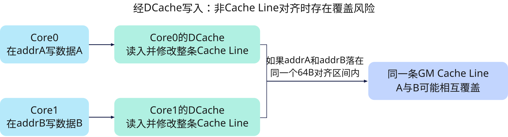

# cube_store_bypass
## 产品支持情况

- Ascend 950PR&950DT系列产品：支持

## 功能说明

将整型标量`value`写入`ptr`指向的GM元素，写入过程绕过DCache；设置`atomic_add=True`时，改为将`value`与目标元素原子相加并写回，不返回旧值。

当多核操作GM地址时，如果数据无法对齐到Cache Line，经过DCache的方式下，由于按照Cache Line大小进行读写，会导致多核数据随机覆盖的问题。此时，可以采用不经过DCache直接读写GM地址的方式，从而避免上述随机覆盖的问题。



本接口在Mix模式下由Cube Core（AIC）执行，仅用于指定执行侧，不建立任何顺序、可见性、栅栏或Mix级同步协议。

## 函数原型

```python
cube_store_bypass(ptr, value, *, atomic_add: bool = False) -> None
```

## 参数说明

| 参数 | 输入/输出 | 说明 |
| --- | --- | --- |
| `ptr` | 输入 | 指向GM中待写入元素的指针，类型为`Pointer`，由`tensor.ptr(...)`形成。本接口更新其所指元素，指针值保持不变。`atomic_add=False`时覆盖所指元素，不读取其原值；`atomic_add=True`时读取原值参与原子累加。 |
| `value` | 输入 | 待写入的整型标量或原子累加的加数，数值类型须与`ptr`所指元素一致。支持的元素数值类型见下文。 |
| `atomic_add` | 输入 | 编译期Python布尔值，默认值为`False`。为`False`时直接写入`value`；为`True`时原子执行目标元素加`value`并写回。不能传入运行时布尔标量。 |

**支持的元素数据类型：**

- `atomic_add=False`：`dtypes.int8`、`dtypes.uint8`、`dtypes.int16`、`dtypes.uint16`、`dtypes.int32`、`dtypes.uint32`、`dtypes.int64`、`dtypes.uint64`。
- `atomic_add=True`：`dtypes.int32`、`dtypes.uint32`、`dtypes.int64`、`dtypes.uint64`；不支持8位、16位整型或浮点类型。

## 返回值说明

返回`None`。写入结果保存在`ptr`指向的GM元素中，`ptr`的指针值保持不变；原子累加模式同样丢弃旧值。需要返回更新前的值时，使用在AIV执行的[`atomic_add`](../../atomic/scalar_atomic/atomic-add.md)。

## 约束说明

- **执行流水**：本接口运行在标量流水（`[PIPE](../../../execution/pipeline.md).S`）上。同一标量流水内的标量数据依赖由指令执行顺序保证。
- **执行侧**：本接口在Mix模式下由Cube Core（AIC）执行。执行侧的指定不建立执行顺序、数据可见性、栅栏或Mix级同步协议。
- **地址要求**：`ptr`须落在GM可访问地址空间内，起始地址须按所指元素的字节数对齐。
- **访存同步**：后续指令若依赖本次写入结果，须通过同步指令建立访存依赖顺序。同一标量流水的顺序执行不保证后续访存指令能观察到写入结果。
- **缓存一致性**：本接口写入GM时绕过DCache，不维护缓存一致性。若其他核或其他通路通过缓存访问同一GM地址，调用方需使用[`dcci_single`](../../../execution/synchronization/cache/dcci-single.md) / [`dci`](../../../execution/synchronization/cache/dci.md)清理或失效对应Cache Line，并保证相关访存操作的执行顺序和数据可见性。

## 调用示例

以下示例演示`cube_store_bypass`的调用，并在Host侧校验结果。

```python
import torch
import torch_npu

from cannbotdsl import host
from cannbotdsl.lang.kernel import kernel
from cannbotdsl.ops.scalar import cube_store_bypass

@kernel
def _cube_store_bypass_kernel(dst):
    cube_store_bypass(dst.ptr(0), 42)

@host
def run(dst):
    _cube_store_bypass_kernel[1](dst)

def main():
    dst = torch.zeros((1,), dtype=torch.int32, device="npu:0")

    run(dst)
    torch.npu.synchronize()

    result = int(dst.cpu()[0])
    assert result == 42, result
    print("cube_store_bypass example passed")
    print(f"stored={result}")

if __name__ == "__main__":
    main()
```

预期结果：

```text
cube_store_bypass example passed
stored=42
```
