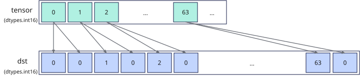

# vload_unpack
## 产品支持情况

- Ascend 950PR&950DT系列产品：支持

## 功能说明

从Unified Buffer（UB）中32字节对齐的起始地址读取VL/2长度的连续数据，在每个源元素后补1个值为0的元素，并将得到的VL长度数据通过函数返回值返回。本接口提供两种功能模式：

- **对齐搬入模式**：将UB源地址的数据解包后搬入到矢量数据寄存器，由用户自行更新源地址。
- **立即数偏移搬入模式**：从相对源起始地址偏移指定距离的位置搬入数据。本接口不会自动更新源地址。

**图1** 解包搬入矢量数据寄存器



## 函数原型

```python
vload_unpack(tensor, offset = 0, *, unpack_mode, post_update: bool = False) -> RawVReg
```

## 参数说明

| 参数 | 输入/输出 | 说明 |
| --- | --- | --- |
| `tensor` | 输入 | 源UB地址，实际读取地址必须按32字节对齐。 |
| `offset` | 输入 | 相对`tensor`起始地址的偏移，单位为元素个数。默认值为`0`。 |
| `unpack_mode` | 输入 | 解包搬入模式，类型为`UnpackMode`或对应的字符串，必选。源位宽必须与模式匹配，按指定扩展倍数在源数据槽后补零。 |
| `post_update` | 输入 | 是否采用Post Update模式。取值为`True`或`False`，默认值为`False`。取值为`True`时，`offset`仍作为源地址偏移使用，本接口不更新源地址指针。 |

**支持的元素数据类型：**

dtype支持的数据类型为`dtypes.int4x2`、`dtypes.int8`、`dtypes.uint8`、`dtypes.fp4x2_e2m1`、`dtypes.fp4x2_e1m2`、`dtypes.hifloat8`、`dtypes.float8_e8m0`、`dtypes.float8_e5m2`、`dtypes.float8_e4m3fn`、`dtypes.int16`、`dtypes.uint16`、`dtypes.float16`、`dtypes.bfloat16`、`dtypes.int32`、`dtypes.uint32`、`dtypes.float32`。

## 返回值说明

返回保存解包搬入结果的矢量数据寄存器值，类型为`RawVReg`。元素类型由源元素类型和`unpack_mode`决定：

- `UNPACK2`用于16位源元素时，整型源元素的返回类型为`dtypes.int32`，浮点源元素保持原元素类型。
- `UNPACK2`用于8位源元素时，返回元素类型为`dtypes.uint16`。
- `UNPACK4`用于8位源元素时，返回元素类型为`dtypes.uint32`。

这些规则描述返回对象的元素类型；数据槽中的补零布局仍按功能说明解释，不等同于普通数值类型转换。

## 约束说明

### 通用约束

- 本接口需在VF作用域内调用。
- 各功能模式下的实际读取地址必须按32字节对齐，且实际读取范围必须在UB地址空间内且不越界，否则会报错。
- UB容量上限为256KB，用户可用容量随编译选项与编程场景变化（默认预留6KB SIMD VF栈 + 2KB框架预留，可用248KB；SIMD+SIMT混编时再划分32KB～128KB作Data Cache，可用容量进一步减少）。UB地址偏移后不可超过实际可用容量，否则会报错。
- 如果本指令与其他指令存在UB地址重叠，需要插入同步指令[`vmem_bar`](../reg_sync/vmem-bar.md)，保证多个指令串行化，防止出现异常数据。

## 调用示例

以下示例演示`vload_unpack`的调用，并在Host侧校验结果。

```python
import torch
import torch_npu

from cannbotdsl import Buffer, host, make_layout, mem_copy
from cannbotdsl.lang.kernel import kernel
from cannbotdsl.lang.vf import vf
from cannbotdsl.ops.reg import UnpackMode, full_mask, vload_unpack, vstore
from cannbotdsl.tensor import MemLoc

@kernel
def _vload_unpack_kernel(src0, dst):
    buf = Buffer(MemLoc.UB, src0.dtype, make_layout((64,)))
    out = Buffer(MemLoc.UB, dst.dtype, make_layout((64,)))

    mem_copy(buf, src0)

    in0 = buf
    res = out
    with vf(mode="simd"):
        mask = full_mask()
        r = vload_unpack(in0, 0, unpack_mode=UnpackMode.UNPACK2)
        vstore(res, 0, r, mask)

    mem_copy(dst, out)

@host
def run(src0, dst):
    _vload_unpack_kernel[1](src0, dst)

def main():
    src0 = torch.arange(64, dtype=torch.int32).to(torch.int16).npu()
    dst = torch.empty((64,), dtype=torch.int32, device="npu:0")

    run(src0, dst)
    torch.npu.synchronize()

    assert bool((dst.cpu() == src0.cpu().to(torch.int32)).all()), f"unpack mismatch: head={dst.cpu()[:4].tolist()}, tail={dst.cpu()[-4:].tolist()}"
    print("vload_unpack example passed")
    print(f"first={int(dst.cpu()[0])}, last={int(dst.cpu()[-1])}")

if __name__ == "__main__":
    main()
```

预期结果：

```text
vload_unpack example passed
first=0, last=63
```
