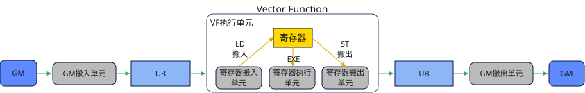

# Reg 矢量计算

Reg 矢量计算接口提供面向Reg 矢量计算架构的寄存器级矢量计算能力，用户可以通过该接口直接对芯片中涉及Vector计算的寄存器进行操作，实现更大的灵活性和更好的性能。Reg 矢量计算接口的输入或输出数据使用矢量数据寄存器`RawVReg`和掩码寄存器`Mask`，而不是Unified Buffer（UB）。对于计算类接口，其功能是从给定的寄存器获取数据，进行计算，并将结果保存在给定的寄存器。对于搬运类接口，其功能是实现UB和寄存器之间的数据搬运。由此可见，Reg 矢量计算接口将数据搬运和Reg 计算过程交给用户自主控制，从而实现更大的开发自由度。

## 如何使用Reg 矢量计算接口

基于寄存器的编程模型是指将数据从UB通过Reg 搬运指令（[Reg 数据搬入](./load/overview.md)）加载到寄存器中，进行复杂的数学计算后通过Reg 搬运指令（[Reg 数据搬出](./store/overview.md)）搬出到UB中，所有的计算逻辑均在寄存器中完成，从而减少UB中间数据的反复读写，大大提升整体性能，具体流程如下所示：

**图1** Reg 矢量计算



以调用示例为例，完整的Vector Function计算过程由以下几部分组成：

- 编写和调用Vector Function。Vector Function在VF作用域中定义，可在核函数中调用；
- 定义矢量数据寄存器（`RawVReg`）、掩码寄存器（`Mask`）；
- 编写循环处理多个VL长度的数据；[`update_mask`](./reg_mask/update-mask.md)系列接口用于更新参与计算的mask，每次循环都会消耗一个VL长度的元素；
- 循环内调用Reg 数据搬入接口连续对齐搬入（[`vload`](./load/vload.md)）从UB中搬入单个VL长度数据；
- 循环内调用Reg 计算接口 [`vadd`](./reg_arith/vadd.md)完成单次Repeat计算；
- 循环内调用Reg 数据搬出接口连续对齐搬出（[`vstore`](./store/vstore.md)）往UB中搬出计算后的数据。

## 调用示例

```python
import torch
import torch_npu

from cannbotdsl import Buffer, host, make_layout, mem_copy
from cannbotdsl.lang.kernel import kernel
from cannbotdsl.lang.vf import vf
from cannbotdsl.ops.reg import update_mask, vadd, vload, vstore
from cannbotdsl.tensor import MemLoc

@kernel
def _reg_add_kernel(src0, src1, dst):
    buf0 = Buffer(MemLoc.UB, src0.dtype, make_layout((64,)))
    buf1 = Buffer(MemLoc.UB, src1.dtype, make_layout((64,)))
    out = Buffer(MemLoc.UB, dst.dtype, make_layout((64,)))

    # GM 数据搬运至 UB
    mem_copy(buf0, src0)
    mem_copy(buf1, src1)

    in0 = buf0
    in1 = buf1
    res = out
    # Vector Function：更新 mask、搬入、计算、搬出
    with vf(mode="simd"):
        mask, _ = update_mask(64, 32)
        acc = vadd(vload(in0, 0), vload(in1, 0), mask=mask)
        vstore(res, 0, acc, mask)

    # UB 数据搬运至 GM
    mem_copy(dst, out)

@host
def run(src0, src1, dst):
    _reg_add_kernel[1](src0, src1, dst)

def main():
    src0 = torch.arange(64, dtype=torch.float32, device="npu:0")
    src1 = torch.arange(64, dtype=torch.float32, device="npu:0") + 1.0
    dst = torch.empty_like(src0)

    run(src0, src1, dst)
    torch.npu.synchronize()

    torch.testing.assert_close(dst.cpu(), (src0 + src1).cpu())
    print("reg compute example passed")
    print(f"first={float(dst.cpu()[0]):.4f}, last={float(dst.cpu()[-1]):.4f}")

if __name__ == "__main__":
    main()
```

预期结果：

```text
reg compute example passed
first=1.0000, last=127.0000
```

## 通用约束

- GM与UB间的数据搬运需通过 [`mem_copy`](../../data-movement/mem-copy.md)完成。
- Vector Function的流水类型为`[PIPE](../../execution/pipeline.md).V`，Vector Function内部如存在UB地址重叠或跨流水依赖，需要根据具体接口约束插入 [`vmem_bar`](./reg_sync/vmem-bar.md)。
- Reg 矢量计算接口仅在AIV上生效，在非AIV上调用时不执行计算。
- Reg 矢量计算接口需要在VF作用域内调用，不支持在核函数中直接调用。
- 对于支持配置`mask`参数的Reg 矢量计算接口，`mask`需通过[掩码寄存器操作](./reg_mask/create-mask.md)接口预先赋值后再传入，未赋值的掩码寄存器内容不确定，会导致有效元素位置错误。
