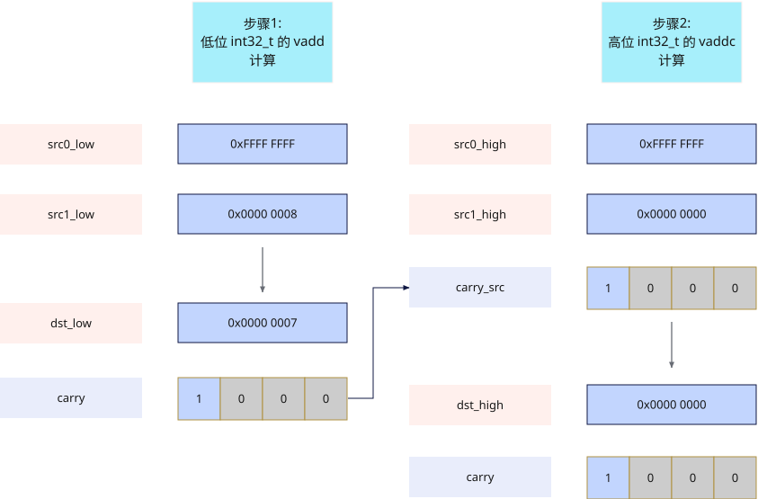

# vaddco
## 产品支持情况

- Ascend 950PR&950DT系列产品：支持

## 功能说明

该接口根据`mask`，对源操作数`src0`、`src1`进行按元素求和操作，将加法和作为返回值返回，同时将每个元素的进位结果写入`carry`（存放进位标志的掩码寄存器）。

Carry flag（进位/借位标志）用于表示加法进位或者减法无借位。该接口可以在`carry`（掩码寄存器）中标记每次加法是否产生进位，若`src0`，`src1`输入按位相加后最高位有进位，在`carry`中对应位置每4bit的最低位写1，否则写0。

**带进位输出加法**：双目的操作数，硬件计算时按照32位无符号数处理，将加法和的低32位作为返回值中的`dst`返回，同时将每个元素加法产生的进位输出写入返回值中的`carry`，计算公式如下：

$$
\{carry_i, dst_i\} = \{1'b0, src0_i\} + \{1'b0, src1_i\}
$$

### 关键特性

以`dtypes.uint64`类型数据计算`0xFFFFFFFF FFFFFFFF` + `0x00000000 00000008` = `0x00000000 00000007`为例，`vadd`/`vaddc`接口的适用场景如下图：



## 函数原型

```python
vaddco(src0: RawVReg, src1: RawVReg, *, mask: Mask) -> tuple[Mask, RawVReg]
```

## 参数说明

| 参数 | 输入/输出 | 说明 |
| --- | --- | --- |
| `src0` | 输入 | 源操作数（矢量数据寄存器）。 |
| `src1` | 输入 | 源操作数（矢量数据寄存器）。 |
| `mask` | 输入 | 源操作数掩码（掩码寄存器），用于指示在计算过程中哪些元素参与计算。对应位置为1时参与计算，为0时不参与计算。mask未筛选的元素在输出中置零。 |

**支持的元素数据类型：**

`dtypes.int32`、`dtypes.uint32`。

## 返回值说明

- 返回`(carry, dst)`：`dst`为矢量数据寄存器，存储加法和的低32位，数据类型与`src0`一致；`carry`为掩码寄存器，存储加法计算后的进位数据。

## 约束说明

- 本接口需在 `vf(mode="simd")` 作用域内调用。

- 运算输出完整计算结果（包含进位位），硬件不会对输出进行饱和或截断。

## 调用示例

以下示例演示`vaddco`的调用，并在Host侧校验结果。

```python
import torch
import torch_npu

from cannbotdsl import Buffer, host, make_layout, mem_copy
from cannbotdsl.lang.kernel import kernel
from cannbotdsl.lang.vf import vf
from cannbotdsl.ops.reg import full_mask, vaddco, vload, vmask_store, vstore
from cannbotdsl.tensor import MemLoc

@kernel
def _vaddco_kernel(src0, src1, dst, carry_out):
    buf0 = Buffer(MemLoc.UB, src0.dtype, make_layout((64,)))
    buf1 = Buffer(MemLoc.UB, src1.dtype, make_layout((64,)))
    out = Buffer(MemLoc.UB, dst.dtype, make_layout((64,)))
    cbuf = Buffer(MemLoc.UB, carry_out.dtype, make_layout((8,)))

    mem_copy(buf0, src0)
    mem_copy(buf1, src1)

    in0 = buf0
    in1 = buf1
    res = out
    cout = cbuf
    with vf(mode="simd"):
        mask = full_mask()
        carry, acc = vaddco(vload(in0, 0), vload(in1, 0), mask=mask)
        vstore(res, 0, acc, mask)
        vmask_store(cout, 0, carry)

    mem_copy(dst, out)
    mem_copy(carry_out, cbuf)

@host
def run(src0, src1, dst, carry_out):
    _vaddco_kernel[1](src0, src1, dst, carry_out)

def main():
    src0 = torch.full((64,), -1, dtype=torch.int32, device="npu:0")
    src1 = torch.full((64,), 2, dtype=torch.int32, device="npu:0")
    dst = torch.zeros_like(src0)
    carry_out = torch.zeros((8,), dtype=torch.int32, device="npu:0")

    run(src0, src1, dst, carry_out)
    torch.npu.synchronize()

    torch.testing.assert_close(dst.cpu(), torch.ones_like(src0.cpu()))
    carry_words = carry_out.cpu()
    print("vaddco example passed")
    print(f"first={int(dst.cpu()[0])}, last={int(dst.cpu()[-1])}, "
          f"carry_ok={bool((carry_words != 0).any())}")

if __name__ == "__main__":
    main()
```

预期结果：

```text
vaddco example passed
first=1, last=1, carry_ok=True
```
