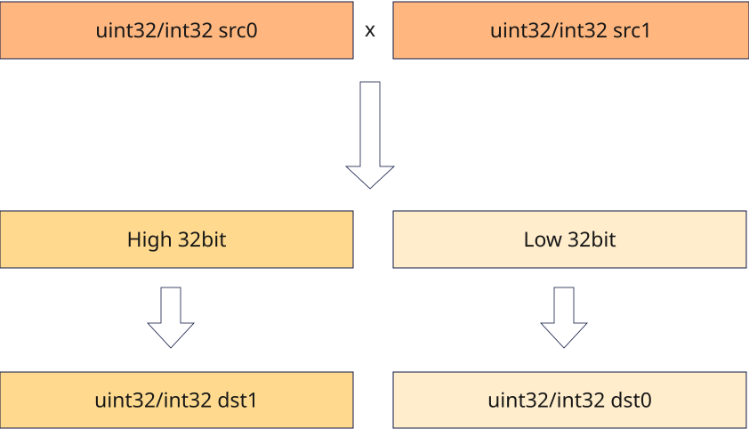

# vmull
## 产品支持情况

- Ascend 950PR&950DT系列产品：支持

## 功能说明

根据`mask`将两个源矢量数据寄存器中的有效元素相乘，数据类型位宽为32位的元素相乘得到64位乘积，拆分为低32位与高32位分别作为返回值返回。`mask`对应位置为1的元素参与计算，为0的元素在返回值中置零。计算公式如下：

$$
dst0_i = (src0_i \times src1_i) \& ((1 \ll bit) - 1)
$$

$$
dst1_i = (src0_i \times src1_i) \gg bit
$$

其中，`bit`表示`src0`和`src1`的数据类型位宽。

**图1** `vmull`计算示意图



## 函数原型

```python
vmull(src0: RawVReg, src1: RawVReg, dtype, *, mask: Mask) -> tuple[RawVReg, RawVReg]
```

## 参数说明

| 参数 | 输入/输出 | 说明 |
| --- | --- | --- |
| `src0` | 输入 | 源操作数（矢量数据寄存器）。 |
| `src1` | 输入 | 源操作数（矢量数据寄存器）。数据类型须与`src0`一致。 |
| `dtype` | 输入 | 返回结果的数据类型，须与`src0`的数据类型一致。 |
| `mask` | 输入 | 源操作数掩码（掩码寄存器），用于指示参与计算的元素。对应位置为1时参与计算，为0时不参与计算且`dst0`、`dst1`对应元素置零。 |

**支持的元素数据类型：**

`dtypes.int32`、`dtypes.uint32`。

## 返回值说明

- 返回由两个`RawVReg`组成的元组`(dst0, dst1)`：64位乘积拆分为低32位`dst0`与高32位`dst1`，两个返回寄存器值的元素数据类型均由`dtype`指定。

## 约束说明

### 通用约束

- 本接口需在VF作用域内调用。
- 掩码位为0的元素位置不参与乘法运算，`dst0`和`dst1`对应位置写0。

### 计算约束

- `dst0`与`dst1`必须为不同的矢量数据寄存器，否则存在未定义行为。
- 源操作数和返回值可以是相同的矢量数据寄存器。

## 调用示例

以下示例演示`vmull`的调用，并在Host侧校验结果。

```python
import torch
import torch_npu

from cannbotdsl import Buffer, dtypes, host, make_layout, mem_copy
from cannbotdsl.lang.kernel import kernel
from cannbotdsl.lang.vf import vf
from cannbotdsl.ops.reg import full_mask, vload, vmull, vstore
from cannbotdsl.tensor import MemLoc

@kernel
def _vmull_kernel(src0, src1, low, high):
    buf0 = Buffer(MemLoc.UB, src0.dtype, make_layout((64,)))
    buf1 = Buffer(MemLoc.UB, src1.dtype, make_layout((64,)))
    lo = Buffer(MemLoc.UB, low.dtype, make_layout((64,)))
    hi = Buffer(MemLoc.UB, high.dtype, make_layout((64,)))

    mem_copy(buf0, src0)
    mem_copy(buf1, src1)

    in0 = buf0
    in1 = buf1
    res_lo = lo
    res_hi = hi
    with vf(mode="simd"):
        mask = full_mask()
        dst0, dst1 = vmull(vload(in0, 0), vload(in1, 0),
                                  dtypes.int32, mask=mask)
        vstore(res_lo, 0, dst0, mask)
        vstore(res_hi, 0, dst1, mask)

    mem_copy(low, lo)
    mem_copy(high, hi)

@host
def run(src0, src1, low, high):
    _vmull_kernel[1](src0, src1, low, high)

def main():
    src0 = torch.full((64,), 65536, dtype=torch.int32, device="npu:0")
    src1 = torch.full((64,), 65536, dtype=torch.int32, device="npu:0")
    low = torch.zeros_like(src0)
    high = torch.zeros_like(src0)

    run(src0, src1, low, high)
    torch.npu.synchronize()

    # 65536 * 65536 = 0x0000000100000000
    torch.testing.assert_close(low.cpu(), torch.zeros_like(src0.cpu()))
    torch.testing.assert_close(high.cpu(), torch.ones_like(src0.cpu()))
    print("vmull example passed")
    print(f"low={int(low.cpu()[0])}, high={int(high.cpu()[0])}")

if __name__ == "__main__":
    main()
```

预期结果：

```text
vmull example passed
low=0, high=1
```
