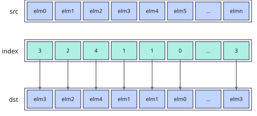

# vgather_reg
## 产品支持情况

- Ascend 950PR&950DT系列产品：支持

## 功能说明

根据索引位置`index`将源操作数`src`按元素收集，将结果作为返回值返回。

**寄存器源收集模式**：源操作数与收集结果均为矢量数据寄存器。按`index`矢量寄存器中保存的逐元素索引，从`src`矢量数据寄存器中选择对应位置的元素，将结果作为返回值返回，不使用掩码。

**图1** 寄存器源收集模式



## 函数原型

```python
vgather_reg(src: RawVReg, index: RawVReg) -> RawVReg
```

## 参数说明

| 参数 | 输入/输出 | 说明 |
| --- | --- | --- |
| `src` | 输入 | 源操作数（矢量数据寄存器）。 |
| `index` | 输入 | 数据索引（矢量数据寄存器）。单位是元素个数，返回值的第i个元素取自`src`中索引为`index[i]`的元素。 |

**支持的元素数据类型：**

支持数据类型列表
**表1** 寄存器源收集模式支持数据类型列表

| dtype | index_dtype |
| :---------- | :-------------- |
| `dtypes.int8` | `dtypes.uint8` |
| `dtypes.uint8` | `dtypes.uint8` |
| `dtypes.hifloat8` | `dtypes.uint8` |
| `dtypes.float8_e8m0` | `dtypes.uint8` |
| `dtypes.float8_e5m2` | `dtypes.uint8` |
| `dtypes.float8_e4m3fn` | `dtypes.uint8` |
| `dtypes.int16` | `dtypes.uint16` |
| `dtypes.uint16` | `dtypes.uint16` |
| `dtypes.float16` | `dtypes.uint16` |
| `dtypes.bfloat16` | `dtypes.uint16` |
| `dtypes.int32` | `dtypes.uint32` |
| `dtypes.uint32` | `dtypes.uint32` |
| `dtypes.float32` | `dtypes.uint32` |

## 返回值说明

返回保存寄存器源收集结果的矢量数据寄存器值，类型为`RawVReg`，其中元素的数据类型与`src`、`index`一致。

## 约束说明

### 通用约束

- 本接口需在VF作用域内调用，源操作数与收集结果均为矢量数据寄存器。

### 寄存器源收集模式约束

- `src`为矢量数据寄存器类型，位宽是固定的`Vector Length (VL)`，存储的元素个数固定。如果`index`中索引值超出当前矢量数据寄存器中能存储的最大元素个数时，按照如下方式处理：设定当前矢量数据寄存器所能存储的最大数据元素个数为`VL_T`, `index`中索引值为`i`，索引值更新为`i % VL_T`。

## 调用示例

以下示例演示`vgather_reg`的调用，并在Host侧校验结果。

```python
import torch
import torch_npu

from cannbotdsl import Buffer, dtypes, host, make_layout, mem_copy
from cannbotdsl.lang.kernel import kernel
from cannbotdsl.lang.vf import vf
from cannbotdsl.ops.reg import full_mask, vgather_reg, vload, vstore
from cannbotdsl.tensor import MemLoc

@kernel
def _vgather_reg_kernel(src0, index, dst):
    buf = Buffer(MemLoc.UB, src0.dtype, make_layout((64,)))
    idx = Buffer(MemLoc.UB, dtypes.uint32, make_layout((64,)))
    out = Buffer(MemLoc.UB, dst.dtype, make_layout((64,)))

    mem_copy(buf, src0)
    mem_copy(idx, index)

    src = buf
    ind = idx
    res = out
    with vf(mode="simd"):
        mask = full_mask()
        vstore(res, 0, vgather_reg(vload(src, 0), vload(ind, 0)), mask)

    mem_copy(dst, out)

@host
def run(src0, index, dst):
    _vgather_reg_kernel[1](src0, index, dst)

def main():
    src0 = torch.arange(64, dtype=torch.int32, device="npu:0") * 10
    index = torch.arange(63, -1, -1, dtype=torch.int32, device="npu:0").view(torch.uint32)
    dst = torch.empty_like(src0)

    run(src0, index, dst)
    torch.npu.synchronize()

    torch.testing.assert_close(dst.cpu(), src0.cpu()[index.cpu().to(torch.int32)])
    print("vgather_reg example passed")
    print(f"first={int(dst.cpu()[0])}, last={int(dst.cpu()[-1])}")

if __name__ == "__main__":
    main()
```

预期结果：

```text
vgather_reg example passed
first=630, last=0
```
