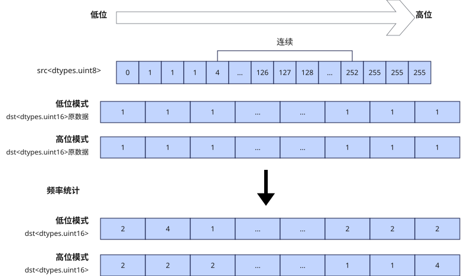

# vhistogram_frequency
## 产品支持情况

- Ascend 950PR&950DT系列产品：支持

## 功能说明

对输入矢量数据寄存器中的元素进行频率统计，生成直方图，统计结果作为返回值返回。支持配置掩码用于指示参与统计的元素，掩码为1的元素参与统计，掩码为0的元素不统计。本接口需在VF作用域内调用。

由于源矢量数据寄存器`src`数据类型为`dtypes.uint8`（取值范围0~255），而目的矢量数据寄存器每个元素为`dtypes.uint16`，且一个Vector Length可存储128个`dtypes.uint16`数据，因此本接口支持两种模式：

- **低位模式（`BIN0`）**：统计`src`中数值在[0, 127]范围内的出现次数。返回值的第0个元素表示数值0的出现次数，第127个元素表示数值127的出现次数。
- **高位模式（`BIN1`）**：统计`src`中数值在[128, 255]范围内的出现次数。返回值的第0个元素表示数值128的出现次数，第127个元素表示数值255的出现次数。

示例如下图所示：



## 函数原型

```python
vhistogram_frequency(src: RawVReg, *, mask: Mask, bin: int = 0) -> RawVReg
```

## 参数说明

| 参数 | 输入/输出 | 说明 |
| --- | --- | --- |
| `src` | 输入 | 源操作数（矢量数据寄存器）。 |
| `mask` | 输入 | 源操作数掩码（掩码寄存器），用于指示在计算过程中哪些元素参与计算。对应位置为1时参与计算，为0时不参与计算。 |
| `bin` | 输入 | 统计模式，取值为0时使用低位模式（`BIN0`），取值为1时使用高位模式（`BIN1`）。默认值为0。 |

## 返回值说明

返回保存频率统计结果的矢量数据寄存器值，类型为`RawVReg`，其中元素的数据类型为`dtypes.uint16`。

## 约束说明

### 通用约束

- 本接口需在VF作用域内调用。

### 计算约束

- `mask`用于筛选源操作数：掩码位为0时，源操作数`src`对应位置的数值将被忽略，返回值对应位置数值为忽略该位置`src`后统计得到的值。
- 本接口每次调用都从零开始计数，不累加前一次调用的结果；需要在上一次统计结果的基础上累加时，请使用[`vhistogram_accumulate`](./vhistogram-accumulate.md)。

## 调用示例

以下示例演示`vhistogram_frequency`的调用，并在Host侧校验结果。

```python
import torch
import torch_npu

from cannbotdsl import Buffer, dtypes, host, make_layout, mem_copy
from cannbotdsl.lang.kernel import kernel
from cannbotdsl.lang.vf import vf
from cannbotdsl.ops.reg import create_mask, vhistogram_frequency, vload, vstore
from cannbotdsl.tensor import MemLoc

@kernel
def _vhistogram_frequency_kernel(src0, dst):
    buf = Buffer(MemLoc.UB, src0.dtype, make_layout((256,)))
    out = Buffer(MemLoc.UB, dtypes.uint16, make_layout((128,)))

    mem_copy(buf, src0)

    src = buf
    res = out
    with vf(mode="simd"):
        src_mask = create_mask(pattern="all", elem_bits=8)
        dst_mask = create_mask(pattern="all", elem_bits=16)
        hist = vhistogram_frequency(vload(src, 0), mask=src_mask)
        vstore(res, 0, hist, dst_mask)

    mem_copy(dst, out)

@host
def run(src0, dst):
    _vhistogram_frequency_kernel[1](src0, dst)

def main():
    src0 = (torch.arange(256, dtype=torch.int64) % 32).to(torch.uint8).to("npu:0")
    dst = torch.empty((128,), dtype=torch.uint16).to("npu:0")

    run(src0, dst)
    torch.npu.synchronize()

    expected = torch.zeros(128, dtype=torch.int32)
    expected[:32] = 8
    torch.testing.assert_close(dst.cpu().to(torch.int32), expected)
    print("vhistogram_frequency example passed")
    print(f"first={int(dst.cpu()[0])}, last={int(dst.cpu()[-1])}")

if __name__ == "__main__":
    main()
```

预期结果：

```text
vhistogram_frequency example passed
first=8, last=0
```
