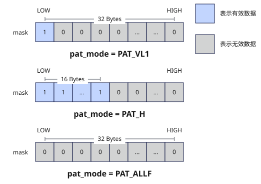

# full_mask
## 产品支持情况

- Ascend 950PR&950DT系列产品：支持

## 功能说明

生成所有元素均为有效数据的掩码寄存器，支持b8、b16、b32三种位宽模式。

位宽模式说明：
- b8模式：每个bit对应一个8bit元素（共256元素），用于8bit数据类型的矢量计算。
- b16模式：每2个bit为一组对应一个16bit元素（共128元素），用于16bit数据类型的矢量计算。
- b32模式：每4个bit为一组对应一个32bit元素（共64元素），用于32bit数据类型的矢量计算。

**图1** `full_mask`原理



## 函数原型

```python
full_mask(elem_bits: int = 32) -> Mask
```

## 参数说明

| 参数 | 输入/输出 | 说明 |
| --- | --- | --- |
| `elem_bits` | 输入 | 掩码元素位宽，支持`8`、`16`、`32`，对应b8、b16、b32模式。默认值为`32`。 |

## 返回值说明

返回掩码寄存器，类型为`Mask`。

## 约束说明

- 本接口需在VF作用域内调用。
- 掩码寄存器的数量上限为8，超过上限的掩码寄存器会写入预留的8K Unified Buffer（UB）内存中，可能引起性能劣化。编译器会自动复用生命周期结束的寄存器和预留内存，若两者均可用，优先复用寄存器。

## 调用示例

以下示例演示`full_mask`的调用，并在Host侧校验结果。

```python
import torch
import torch_npu

from cannbotdsl import Buffer, dtypes, host, make_layout, mem_copy
from cannbotdsl.lang.kernel import kernel
from cannbotdsl.lang.vf import vf
from cannbotdsl.ops.reg import full_mask, vdups, vload, vselect, vstore
from cannbotdsl.tensor import MemLoc

@kernel
def _full_mask_kernel(src0, dst):
    buf = Buffer(MemLoc.UB, src0.dtype, make_layout((64,)))
    out = Buffer(MemLoc.UB, dst.dtype, make_layout((64,)))
    mem_copy(buf, src0)

    in0 = buf
    res = out
    with vf(mode="simd"):
        full = full_mask()
        zero = vdups(0.0, dtypes.float32)
        acc = vselect(vload(in0, 0), zero, cond_mask=full)
        vstore(res, 0, acc, full)

    mem_copy(dst, out)

@host
def run(src0, dst):
    _full_mask_kernel[1](src0, dst)

def main():
    src0 = torch.arange(64, dtype=torch.float32, device="npu:0")
    dst = torch.empty_like(src0)

    run(src0, dst)
    torch.npu.synchronize()

    torch.testing.assert_close(dst.cpu(), src0.cpu())
    print(f"first={float(dst.cpu()[0]):.4f}, last={float(dst.cpu()[-1]):.4f}")

if __name__ == "__main__":
    main()
```

预期结果：

```text
first=0.0000, last=63.0000
```
