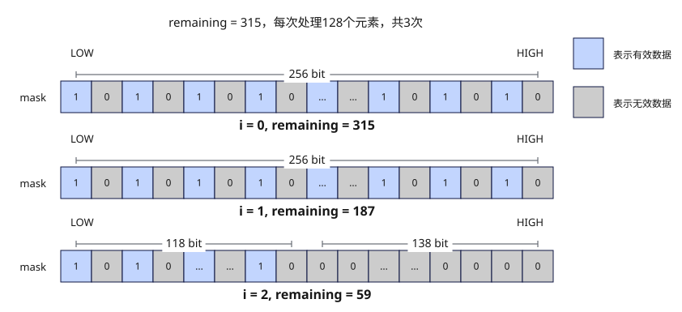

# update_mask
## 产品支持情况

- Ascend 950PR&950DT系列产品：支持

## 功能说明

根据元素个数`remaining`生成mask，并自动将`remaining`减去当前向量处理单元的元素个数。支持b8、b16、b32三种位宽模式，由于VL=256B，各模式的向量处理单元元素个数为：

- b8模式：每次处理256个元素，用于8 bit数据类型的矢量计算。
- b16模式：每次处理128个元素，用于16 bit数据类型的矢量计算。
- b32模式：每次处理64个元素，用于32 bit数据类型的矢量计算。

**图1** `update_mask`更新流程



## 函数原型

```python
update_mask(remaining, elem_bits: int = 32) -> tuple[Mask, ScalarValue | MaskCounter]
```

## 参数说明

| 参数 | 输入/输出 | 说明 |
| --- | --- | --- |
| `remaining` | 输入 | 剩余逻辑元素个数，可以传入整数常量、`ScalarValue`或`MaskCounter`，应为非负值。更新后的计数通过第二个返回值返回，需显式接收。 |
| `elem_bits` | 输入 | 掩码元素位宽，支持`8`、`16`、`32`，对应b8、b16、b32模式，默认值为`32`。 |

## 返回值说明

返回二元组`(mask, remaining_out)`：`mask`的类型为`Mask`；传入`MaskCounter`时，`remaining_out`也是`MaskCounter`，否则为数值类型是`dtypes.int32`的`ScalarValue`。更新后的元素个数为`max(remaining - VL_T, 0)`，其中`VL_T`为当前元素位宽下一个寄存器可容纳的元素个数。

## 约束说明

- 本接口需在VF作用域内调用。
- 掩码寄存器的数量上限为8，超过上限的掩码寄存器会写入预留的8K Unified Buffer（UB）内存中，可能引起性能劣化。编译器会自动复用生命周期结束的寄存器和预留内存，若两者均可用，优先复用寄存器。

## 调用示例

以下示例演示`update_mask`的调用，并在Host侧校验结果。

```python
import torch
import torch_npu

from cannbotdsl import Buffer, dtypes, host, make_layout, mem_copy
from cannbotdsl.lang.kernel import kernel
from cannbotdsl.lang.vf import vf
from cannbotdsl.ops.reg import full_mask, update_mask, vdups, vload, vselect, vstore
from cannbotdsl.tensor import MemLoc

@kernel
def _update_mask_kernel(src0, dst):
    buf = Buffer(MemLoc.UB, src0.dtype, make_layout((64,)))
    out = Buffer(MemLoc.UB, dst.dtype, make_layout((64,)))
    mem_copy(buf, src0)

    in0 = buf
    res = out
    with vf(mode="simd"):
        m, _ = update_mask(20, elem_bits=32)
        zero = vdups(0.0, dtypes.float32)
        acc = vselect(vload(in0, 0), zero, cond_mask=m)
        vstore(res, 0, acc, full_mask())

    mem_copy(dst, out)

@host
def run(src0, dst):
    _update_mask_kernel[1](src0, dst)

def main():
    src0 = torch.arange(64, dtype=torch.float32, device="npu:0")
    dst = torch.empty_like(src0)

    run(src0, dst)
    torch.npu.synchronize()

    expected = torch.cat([src0.cpu()[:20], torch.zeros(44)])
    torch.testing.assert_close(dst.cpu(), expected)
    print(f"first={float(dst.cpu()[0]):.4f}, last={float(dst.cpu()[-1]):.4f}")

if __name__ == "__main__":
    main()
```

预期结果：

```text
first=0.0000, last=0.0000
```
