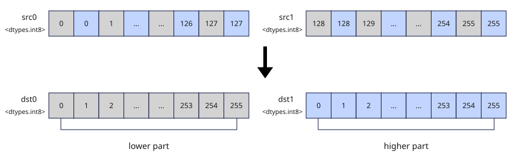

# vdeinterleave
## 产品支持情况

- Ascend 950PR&950DT系列产品：支持

## 功能说明

将`src0`和`src1`中的元素解交织，结果作为返回值返回，本接口提供矢量数据解交织和掩码解交织两种功能模式：

- **矢量数据解交织**：对两个源矢量数据寄存器中的有效元素逐对解交织。`src0`的偶数索引元素写入`dst0`前半部分，奇数索引元素写入`dst1`前半部分。`src1`的偶数索引元素写入`dst0`后半部分，奇数索引元素写入`dst1`后半部分。
- **掩码解交织**：对两个源掩码寄存器中的比特位按指定位宽解交织。`src0`的偶数索引位写入`dst0`前半部分，奇数索引位写入`dst1`前半部分。`src1`的偶数索引位写入`dst0`后半部分，奇数索引位写入`dst1`后半部分。

以`dtypes.int8`数据类型为例，`vdeinterleave`的实现流程如图1所示：

**图1** 解交织实现流程



## 函数原型

```python
vdeinterleave(src0, src1) -> tuple[RawVReg, RawVReg] | tuple[Mask, Mask]
```

## 参数说明

| 参数 | 输入/输出 | 说明 |
| --- | --- | --- |
| `src0` | 输入 | 源操作数（矢量数据寄存器或掩码寄存器），参与解交织的操作数。其偶数索引元素（位）写入`dst0`前半部分，奇数索引元素（位）写入`dst1`前半部分。 |
| `src1` | 输入 | 源操作数（矢量数据寄存器或掩码寄存器），参与解交织的操作数。其偶数索引元素（位）写入`dst0`后半部分，奇数索引元素（位）写入`dst1`后半部分。 |

**支持的元素数据类型：**

`dtypes.int8`、`dtypes.uint8`、`dtypes.hifloat8`、`dtypes.float8_e8m0`、`dtypes.float8_e5m2`、`dtypes.float8_e4m3fn`、`dtypes.int16`、`dtypes.uint16`、`dtypes.float16`、`dtypes.bfloat16`、`dtypes.int32`、`dtypes.uint32`、`dtypes.float32`。

## 返回值说明

- 返回元组`(dst0, dst1)`，为解交织得到的两个结果寄存器。源操作数为矢量数据寄存器时，两个返回值均为`RawVReg`，元素数据类型与`src0`、`src1`一致；源操作数为掩码寄存器时，两个返回值均为`Mask`，掩码粒度`elem_bits`与`src0`、`src1`一致。

## 约束说明

- 本接口需在VF作用域内调用。
- `src0`和`src1`的数据类型需要保持一致。
- `src0`和`src1`可以为同一个矢量数据寄存器或掩码寄存器。

## 调用示例

以下示例演示`vdeinterleave`的调用，并在Host侧校验结果。

```python
import torch
import torch_npu

from cannbotdsl import Buffer, host, make_layout, mem_copy
from cannbotdsl.lang.kernel import kernel
from cannbotdsl.lang.vf import vf
from cannbotdsl.ops.reg import full_mask, vdeinterleave, vload, vstore
from cannbotdsl.tensor import MemLoc

@kernel
def _vdeinterleave_kernel(src0, src1, dst):
    buf0 = Buffer(MemLoc.UB, src0.dtype, make_layout((64,)))
    buf1 = Buffer(MemLoc.UB, src1.dtype, make_layout((64,)))
    out = Buffer(MemLoc.UB, dst.dtype, make_layout((128,)))

    mem_copy(buf0, src0)
    mem_copy(buf1, src1)

    in0 = buf0
    in1 = buf1
    res = out
    with vf(mode="simd"):
        mask = full_mask()
        even, odd = vdeinterleave(vload(in0, 0), vload(in1, 0))
        vstore(res, 0, even, mask)
        vstore(res, 64, odd, mask)

    mem_copy(dst, out)

@host
def run(src0, src1, dst):
    _vdeinterleave_kernel[1](src0, src1, dst)

def main():
    src0 = torch.arange(64, dtype=torch.float32, device="npu:0")
    src1 = src0 + 100.0
    dst = torch.empty((128,), dtype=torch.float32, device="npu:0")

    run(src0, src1, dst)
    torch.npu.synchronize()

    a, b = src0.cpu(), src1.cpu()
    expected = torch.cat([torch.cat([a[0::2], b[0::2]]), torch.cat([a[1::2], b[1::2]])])
    torch.testing.assert_close(dst.cpu(), expected)
    print("vdeinterleave example passed")
    print(f"first={float(dst.cpu()[0]):.1f}, last={float(dst.cpu()[-1]):.1f}")

if __name__ == "__main__":
    main()
```

预期结果：

```text
vdeinterleave example passed
first=0.0, last=163.0
```
