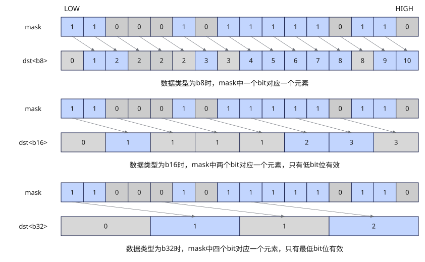

# vsqueeze
## 产品支持情况

- Ascend 950PR&950DT系列产品：支持

## 功能说明

根据`mask`进行解压缩，并通过函数返回值返回结果。解压缩方式：第0个元素置为0，第i个元素等于`mask`中从第0个到第(i-1)个元素中1的数量。`mask`最高位被忽略，不参与统计。

具体算法如图1所示，返回值的首位为0。对于后续元素，与返回值[i-1]对应的有效`mask`位为1时，返回值[i]的值为返回值[i-1] + 1；对应的有效`mask`位为0时，返回值[i]的值为返回值[i-1]。

**图1** unsqueeze流程



## 函数原型

```python
vsqueeze(mask: Mask, dtype) -> RawVReg
```

## 参数说明

| 参数 | 输入/输出 | 说明 |
| --- | --- | --- |
| `mask` | 输入 | 源掩码寄存器，提供有效元素位置；返回值统计每个位置之前的有效元素个数。 |
| `dtype` | 输入 | 指定返回寄存器值的元素数据类型，支持的类型见本节的元素数据类型列表。 |

**支持的元素数据类型：**

参数`dtype`支持`dtypes.int8`、`dtypes.uint8`、`dtypes.int16`、`dtypes.uint16`、`dtypes.int32`、`dtypes.uint32`。

## 返回值说明

返回保存掩码前缀有效元素计数的矢量数据寄存器值，类型为`RawVReg`，其中元素的数据类型由`dtype`指定。

## 约束说明

- 本接口需在`vf(mode="simd")`作用域内调用。
- `mask`为掩码寄存器。

## 调用示例

以下示例调用`vsqueeze`统计每个位置之前的有效掩码元素个数，并在Host侧校验结果。

```python
import torch
import torch_npu

from cannbotdsl import Buffer, dtypes, host, make_layout, mem_copy
from cannbotdsl.lang.kernel import kernel
from cannbotdsl.lang.vf import vf
from cannbotdsl.ops.reg import create_mask, full_mask, vsqueeze, vstore
from cannbotdsl.tensor import MemLoc

@kernel
def _vsqueeze_kernel(dst):
    out = Buffer(MemLoc.UB, dst.dtype, make_layout((128,)))

    res = out
    with vf(mode="simd"):
        mask = create_mask(pattern="vl32", elem_bits=16)
        vstore(res, 0, vsqueeze(mask, dtypes.uint16), full_mask(elem_bits=16))

    mem_copy(dst, out)

@host
def run(dst):
    _vsqueeze_kernel[1](dst)

def main():
    dst = torch.empty((128,), dtype=torch.uint16, device="npu:0")

    run(dst)
    torch.npu.synchronize()

    expected = torch.tensor([min(i, 32) for i in range(128)], dtype=torch.int32)
    torch.testing.assert_close(dst.cpu().to(torch.int32), expected)
    print("vsqueeze example passed")
    print(f"first={int(dst.cpu()[0])}, last={int(dst.cpu()[-1])}")

if __name__ == "__main__":
    main()
```

预期结果：

```text
vsqueeze example passed
first=0, last=32
```
