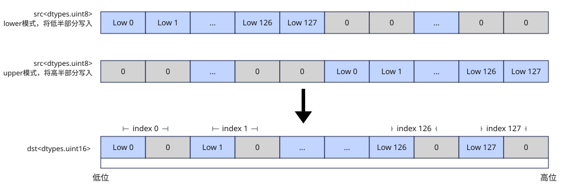

# vunpack
## 产品支持情况

- Ascend 950PR&950DT系列产品：支持

## 功能说明

将`src`中低半部分或高半部分的元素以扩充位宽的方式作为返回值返回，支持以下两种源元素选择方式：

- `part="lower"`：选择源寄存器`src`的低半部分元素，按`dtype`指定的目标类型扩展位宽，并返回结果。
- `part="upper"`：选择源寄存器`src`的高半部分元素，按`dtype`指定的目标类型扩展位宽，并返回结果。

不同数据类型的扩充方式：

- 无符号整型：高位填0扩充。例如`dtypes.uint8`到`dtypes.uint16`，`src`中每个`dtypes.uint8`元素高位补0扩展为`dtypes.uint16`。
- 有符号整型：保持符号位扩充。例如`dtypes.int8`到`dtypes.int16`，`src`中每个`dtypes.int8`元素按符号位扩展为`dtypes.int16`。

矢量数据寄存器unpack流程如图1所示：

**图1** 矢量数据寄存器unpack流程



## 函数原型

```python
vunpack(src: RawVReg, dtype, *, part: str = 'lower') -> RawVReg
```

## 参数说明

| 参数 | 输入/输出 | 说明 |
| --- | --- | --- |
| `src` | 输入 | 源操作数（矢量数据寄存器），取低半段或高半段元素扩展位宽后作为返回值返回。 |
| `dtype` | 输入 | 返回值的数据类型，支持的类型对参见本节的对应关系表。 |
| `part` | 输入 | 指定`src`中参与解包扩展的半部分，取值为`'lower'`（低半部分）或`'upper'`（高半部分），默认为`'lower'`。 |

**支持的元素数据类型：**

dtype_src与dtype_dst支持的数据类型对如下：

| dtype_src | dtype_dst |
|---|---|
| `dtypes.uint8` | `dtypes.uint16` |
| `dtypes.int8` | `dtypes.int16` |
| `dtypes.uint16` | `dtypes.uint32` |
| `dtypes.int16` | `dtypes.int32` |

## 返回值说明

返回保存所选源半段扩位结果的矢量数据寄存器值，类型为`RawVReg`，其中元素的数据类型由`dtype`指定。

## 约束说明

- 本接口需在VF作用域内调用。
- `src`必须为`RawVReg`，不接受`Mask`输入。
- 低半段解包与高半段解包配合可分别解包源寄存器前半段与后半段，两次调用即可将整个源寄存器的窄类型数据全部扩展为宽类型写入两个目的寄存器。

## 调用示例

以下示例演示`vunpack`的调用，并在Host侧校验结果。

```python
import torch
import torch_npu

from cannbotdsl import Buffer, dtypes, host, make_layout, mem_copy
from cannbotdsl.lang.kernel import kernel
from cannbotdsl.lang.vf import vf
from cannbotdsl.ops.reg import full_mask, vload, vstore, vunpack
from cannbotdsl.tensor import MemLoc

@kernel
def _vunpack_kernel(src0, dst):
    buf = Buffer(MemLoc.UB, src0.dtype, make_layout((256,)))
    out = Buffer(MemLoc.UB, dst.dtype, make_layout((128,)))

    mem_copy(buf, src0)

    in0 = buf
    res = out
    with vf(mode="simd"):
        mask = full_mask(elem_bits=16)
        vstore(res, 0, vunpack(vload(in0, 0), dtypes.uint16), mask)

    mem_copy(dst, out)

@host
def run(src0, dst):
    _vunpack_kernel[1](src0, dst)

def main():
    src0 = torch.arange(256, dtype=torch.int32).to(torch.uint8).to("npu:0")
    dst = torch.empty((128,), dtype=torch.uint16, device="npu:0")

    run(src0, dst)
    torch.npu.synchronize()

    torch.testing.assert_close(dst.cpu().to(torch.int32), src0.cpu()[:128].to(torch.int32))
    print("vunpack example passed")
    print(f"first={int(dst.cpu()[0])}, last={int(dst.cpu()[-1])}")

if __name__ == "__main__":
    main()
```

预期结果：

```text
vunpack example passed
first=0, last=127
```
