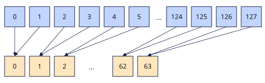

# vpair_reduce_sum
## 产品支持情况

- Ascend 950PR&950DT系列产品：支持

## 功能说明

根据`mask`将源操作数`src`中每两个相邻元素相加，得到计算结果。结果连续保存在返回值的低半部分，返回值的高半部分置0。以`dtypes.float16`数据类型为例，相加示意图如下：



计算公式如下：

$$
dst_i = src_{2i} + src_{2i+1} \quad (0 \le i < \frac{N}{2})
$$

其中，$N$为矢量数据寄存器的元素个数。

## 函数原型

```python
vpair_reduce_sum(src: RawVReg, *, mask: Mask) -> RawVReg
```

## 参数说明

| 参数 | 输入/输出 | 说明 |
| --- | --- | --- |
| `src` | 输入 | 源操作数（矢量数据寄存器）。 |
| `mask` | 输入 | 掩码寄存器，用于控制各元素是否参与计算。`mask`中与元素对应的比特位为1时，该元素参与计算；为0时，该元素不参与计算。 |

**支持的元素数据类型：**

`dtypes.float16`、`dtypes.float32`。

## 返回值说明

返回保存成对归约求和结果的矢量数据寄存器值，类型为`RawVReg`，其中元素的数据类型与`src`一致。

## 约束说明

- 本接口需在`vf(mode="simd")`作用域内调用。

- 返回值与`src`的数据类型需要保持一致。
- `mask`指定源操作数是否参与计算，不参与计算的元素被当作0进行累加。例如：
  - 若连续两个元素a、b均不参与计算，目的操作数结果为0。
  - 若连续两个元素a、b仅元素a参与计算，目的操作数结果为a。
  - 若连续两个元素a、b仅元素b参与计算，目的操作数结果为b。
- 求和后，返回值中仅前一半元素为有效数据，后一半填充为0。搬出至Unified Buffer（UB）时需要避免数据踩踏。

## 调用示例

以下示例演示`vpair_reduce_sum`的调用，并在Host侧校验结果。

```python
import torch
import torch_npu

from cannbotdsl import Buffer, host, make_layout, mem_copy
from cannbotdsl.lang.kernel import kernel
from cannbotdsl.lang.vf import vf
from cannbotdsl.ops.reg import full_mask, vload, vpair_reduce_sum, vstore
from cannbotdsl.tensor import MemLoc

@kernel
def _vpair_reduce_sum_kernel(src0, dst):
    buf = Buffer(MemLoc.UB, src0.dtype, make_layout((64,)))
    out = Buffer(MemLoc.UB, dst.dtype, make_layout((64,)))
    mem_copy(buf, src0)

    in0 = buf
    res = out
    with vf(mode="simd"):
        full = full_mask()
        acc = vpair_reduce_sum(vload(in0, 0), mask=full)
        vstore(res, 0, acc, full)

    mem_copy(dst, out)

@host
def run(src0, dst):
    _vpair_reduce_sum_kernel[1](src0, dst)

def main():
    src0 = torch.arange(1, 65, dtype=torch.float32, device="npu:0")
    dst = torch.empty_like(src0)

    run(src0, dst)
    torch.npu.synchronize()

    expected = torch.zeros(64)
    expected[:32] = src0.cpu().view(32, 2).sum(dim=1)
    torch.testing.assert_close(dst.cpu(), expected)
    print(f"first={float(dst.cpu()[0]):.4f}, lane31={float(dst.cpu()[31]):.4f}")

if __name__ == "__main__":
    main()
```

预期结果：

```text
first=3.0000, lane31=127.0000
```
