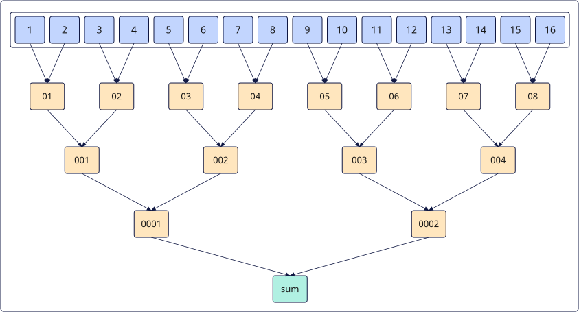

# vreduce_sum_datablock
## 产品支持情况

- Ascend 950PR&950DT系列产品：支持

## 功能说明

根据`mask`将每个`DataBlock`（32B）中参与计算的元素相加，得到各`DataBlock`的归约结果。结果依次保存在返回值的最低位。参考伪代码：

```python
def vreduce_sum_datablock(dst, src, mask):
    num_blocks = 8                      # 128元素 / 16元素每块 = 8块
    elems_per_block = 16                # 32B / 2B(dtypes.float16) = 16
    for b in range(num_blocks):
        values = []
        for j in range(elems_per_block):
            i = b * elems_per_block + j
            values.append(src[i] if mask[i] else 0)
        while len(values) > 1:
            values = [values[j] + values[j + 1]
                      for j in range(0, len(values), 2)]
        dst[b] = values[0]              # 每块求和值连续写入dst低位
    for i in range(num_blocks, 128):
        dst[i] = 0                      # 其余位置置0
```

### 关键特性

**`vreduce_sum_datablock` 累加顺序**：

以二叉树累加的方式计算每个`DataBlock`内的数据总和。

以`dtypes.float16`类型的数据求和为例，在每个`DataBlock`内有16个数，通过二叉树的方式，两两相加，计算过程如下图所示：

1. data1和data2相加得到data01，data3和data4相加得到data02，……，data13和data14相加得到data07，data15和data16相加得到data08；
2. data01和data02相加得到data001，data03和data04相加得到data002，……，data07和data08相加得到data004；
3. 以此类推，得到目的操作数为1个`dtypes.float16`类型的数据sum。



## 函数原型

```python
vreduce_sum_datablock(src: RawVReg, *, mask: Mask) -> RawVReg
```

## 参数说明

| 参数 | 输入/输出 | 说明 |
| --- | --- | --- |
| `src` | 输入 | 源操作数（矢量数据寄存器）。 |
| `mask` | 输入 | 掩码寄存器，用于控制各元素是否参与归约。 |

**支持的元素数据类型：**

| `src_dtype` | `dst_dtype` |
| ----------- | ----------- |
| `dtypes.int16` | `dtypes.int32` |
| `dtypes.uint16` | `dtypes.uint32` |
| `dtypes.float16` | `dtypes.float16` |
| `dtypes.int32` | `dtypes.int32` |
| `dtypes.uint32` | `dtypes.uint32` |
| `dtypes.float32` | `dtypes.float32` |

## 返回值说明

返回保存各数据块归约求和结果的矢量数据寄存器值，类型为`RawVReg`。源元素类型与返回元素类型的对应关系见[参数说明](#参数说明)中的`src_dtype` / `dst_dtype`表。

## 约束说明

- 本接口需在`vf(mode="simd")`作用域内调用。

- 指令内累加顺序采用二叉树累加方式，在每个`DataBlock`（32B）内两两相加逐层归约求和，结果连续写入到目的操作数，目的操作数中的其它元素置0。
- 当`DataBlock`中的元素均不参与计算（`mask`全为0）时，将0写入返回值对应位置（对于浮点数则为+0）。
- 对于输入为`dtypes.uint16`/`dtypes.int16`类型的情况，会提升精度到`dtypes.uint32`/`dtypes.int32`进行计算。

## 调用示例

以下示例演示`vreduce_sum_datablock`的调用，并在Host侧校验结果。

```python
import torch
import torch_npu

from cannbotdsl import Buffer, host, make_layout, mem_copy
from cannbotdsl.lang.kernel import kernel
from cannbotdsl.lang.vf import vf
from cannbotdsl.ops.reg import full_mask, vload, vreduce_sum_datablock, vstore
from cannbotdsl.tensor import MemLoc

@kernel
def _vreduce_sum_datablock_kernel(src0, dst):
    buf = Buffer(MemLoc.UB, src0.dtype, make_layout((64,)))
    out = Buffer(MemLoc.UB, dst.dtype, make_layout((64,)))
    mem_copy(buf, src0)

    in0 = buf
    res = out
    with vf(mode="simd"):
        full = full_mask()
        acc = vreduce_sum_datablock(vload(in0, 0), mask=full)
        vstore(res, 0, acc, full)

    mem_copy(dst, out)

@host
def run(src0, dst):
    _vreduce_sum_datablock_kernel[1](src0, dst)

def main():
    src0 = torch.arange(64, dtype=torch.float32, device="npu:0")
    dst = torch.empty_like(src0)

    run(src0, dst)
    torch.npu.synchronize()

    expected = torch.zeros(64)
    expected[:8] = src0.cpu().view(8, 8).sum(dim=1)
    torch.testing.assert_close(dst.cpu(), expected)
    print(f"first={float(dst.cpu()[0]):.4f}, block7={float(dst.cpu()[7]):.4f}")

if __name__ == "__main__":
    main()
```

预期结果：

```text
first=28.0000, block7=476.0000
```
