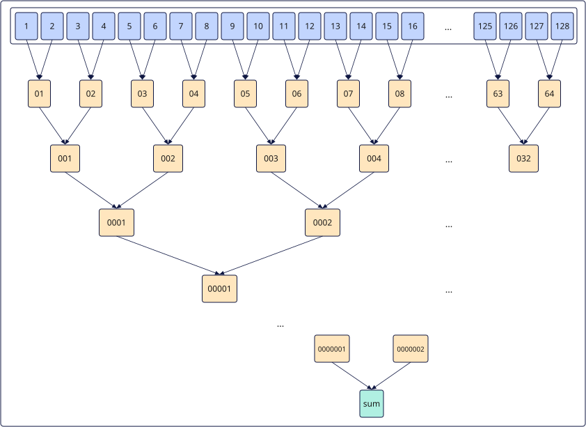

# vreduce_sum
## 产品支持情况

- Ascend 950PR&950DT系列产品：支持

## 功能说明

根据`mask`对源操作数`src`进行归约求和操作，用于将`src`中的所有参与计算的元素求和，得到归约结果。结果保存在返回值的第0个元素。参考伪代码：

```python
def vreduce_sum(dst, src, mask):
    values = [src[i] if mask[i] else 0 for i in range(len(src))]
    while len(values) > 1:
        values = [values[i] + values[i + 1]
                  for i in range(0, len(values), 2)]
    dst[0] = values[0]                  # 求和值
    for i in range(1, len(dst)):
        dst[i] = 0                      # 其余位置置0
```

### 关键特性

**`vreduce_sum` 累加顺序**：

以二叉树累加的方式计算源操作数`src`内有效元素的数据总和。

以`dtypes.float16`类型的数据求和为例，在`src`内有128个数，通过二叉树的方式，两两相加，计算过程如下图所示：

1. data1和data2相加得到data01，data3和data4相加得到data02，……，data125和data126相加得到data63，data127和data128相加得到data64；
2. data01和data02相加得到data001，data03和data04相加得到data002，……，data63和data64相加得到data032；
3. 以此类推，得到目的操作数为1个`dtypes.float16`类型的数据sum。



## 函数原型

```python
vreduce_sum(src: RawVReg, *, mask: Mask) -> RawVReg
```

## 参数说明

| 参数 | 输入/输出 | 说明 |
| --- | --- | --- |
| `src` | 输入 | 源操作数（矢量数据寄存器）。 |
| `mask` | 输入 | 掩码寄存器，用于控制各元素是否参与归约。<br>当所有元素均不参与计算（`mask`全为0）时，将0写入目的操作数对应位置（特别的，对于浮点数为+0）。 |

**支持的元素数据类型：**

| `src_dtype` | `dst_dtype` |
| ----------- | ----------- |
| `dtypes.int16` | `dtypes.int16` |
| `dtypes.uint16` | `dtypes.uint16` |
| `dtypes.float16` | `dtypes.float16` |
| `dtypes.int32` | `dtypes.int32` |
| `dtypes.uint32` | `dtypes.uint32` |
| `dtypes.float32` | `dtypes.float32` |

## 返回值说明

返回保存归约求和结果的矢量数据寄存器值，类型为`RawVReg`，元素数据类型与`src`一致。其中，`src_dtype`表示源寄存器的元素类型，`dst_dtype`表示返回寄存器的元素类型，对应关系见[参数说明](#参数说明)中的类型表。

## 约束说明

- 本接口需在`vf(mode="simd")`作用域内调用。

- 指令内累加顺序采用二叉树累加方式，结果连续写入到目的操作数，目的操作数中的其它元素置0。

## 调用示例

以下示例演示`vreduce_sum`的调用，并在Host侧校验结果。

```python
import torch
import torch_npu

from cannbotdsl import Buffer, host, make_layout, mem_copy
from cannbotdsl.lang.kernel import kernel
from cannbotdsl.lang.vf import vf
from cannbotdsl.ops.reg import full_mask, vload, vreduce_sum, vstore_first
from cannbotdsl.tensor import MemLoc

@kernel
def _vreduce_sum_kernel(src0, dst):
    buf = Buffer(MemLoc.UB, src0.dtype, make_layout((64,)))
    out = Buffer(MemLoc.UB, dst.dtype, make_layout((1,)))
    mem_copy(buf, src0)

    in0 = buf
    res = out
    with vf(mode="simd"):
        acc = vreduce_sum(vload(in0, 0), mask=full_mask())
        vstore_first(res, 0, acc)

    mem_copy(dst, out)

@host
def run(src0, dst):
    _vreduce_sum_kernel[1](src0, dst)

def main():
    src0 = torch.arange(1, 65, dtype=torch.float32, device="npu:0")
    dst = torch.empty((1,), dtype=torch.float32, device="npu:0")

    run(src0, dst)
    torch.npu.synchronize()

    torch.testing.assert_close(dst.cpu(), src0.sum().cpu().reshape(1))
    print(f"value={float(dst.cpu()[0]):.4f}")

if __name__ == "__main__":
    main()
```

预期结果：

```text
value=2080.0000
```
