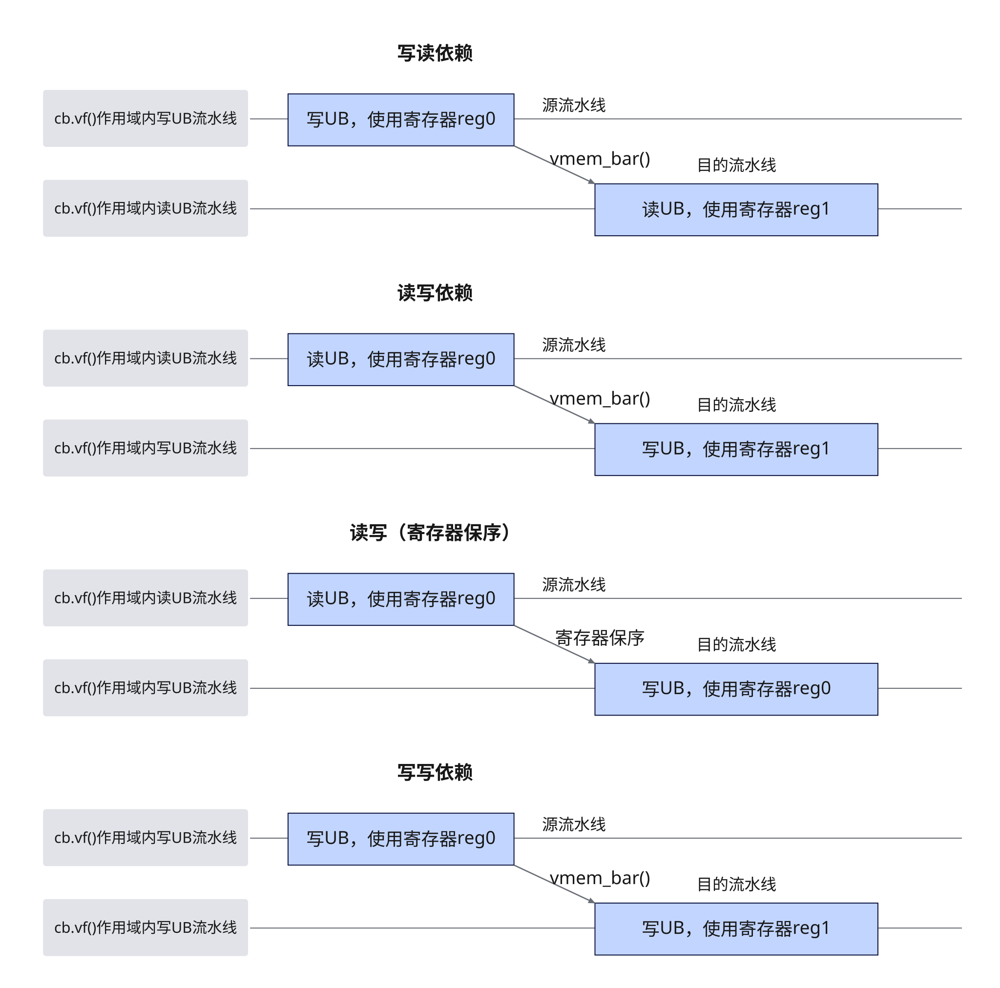

# vmem_bar
## 产品支持情况

- Ascend 950PR&950DT系列产品：支持

## 功能说明

Reg 矢量计算内UB访存操作之间的同步指令，用于不同流水线之间或矢量写流水线内部的保序。该同步指令指定源流水线和目的流水线，如下图所示，目的流水线将等待源流水线上此前的指令完成才进行执行。
读写场景下，当读指令使用的寄存器和写指令使用的寄存器相同时，可以触发寄存器保序，指令将会按照代码顺序执行，不需要插入同步指令，而当使用的寄存器不同时，如果要确保读写指令执行，则需要插入同步指令。写写场景同理。



图中写读、读写、写写依赖分别对应`vst_vld`、`vld_vst`、`vst_vst`；使用同一个寄存器的读写场景表示寄存器保序，不是第四种需要显式指定的同步模式。

## 函数原型

```python
vmem_bar(mode = 'vst_vld') -> None
```

## 参数说明

| 参数 | 输入/输出 | 说明 |
| --- | --- | --- |
| `mode` | 输入 | 同步流水线的类型，取值为`'vst_vld'`（默认）、`'vld_vst'`或`'vst_vst'`，含义见表1。本接口不接受`'vv_all'`及矢量与标量流水线之间的同步类型。 |

**表1** 本接口支持的`mode`取值说明（源流水线/目的流水线表示的含义见表2 Reg 计算流水线说明）

| 值 | 源流水线 | 目的流水线 |
| --- | --- | --- |
| `vst_vld` | `VEC_STORE` | `VEC_LOAD` |
| `vld_vst` | `VEC_LOAD` | `VEC_STORE` |
| `vst_vst` | `VEC_STORE` | `VEC_STORE` |

**表2** Reg 计算流水线说明

| 流水线 | 含义 |
| --- | --- |
| `VEC_STORE` | Reg 矢量计算内矢量写UB流水线。对应寄存器到UB的搬运指令，例如[`vstore`](../store/vstore.md)。 |
| `VEC_LOAD` | Reg 矢量计算内矢量读UB流水线。对应UB到寄存器的搬运指令，例如[`vload`](../load/vload.md)。 |

## 返回值说明

无返回值。

## 约束说明

### 通用约束

- 本接口需在`vf(mode="simd")`作用域内调用。

### 指令约束

- 读写依赖的场景下，如果读指令和写指令使用的寄存器相同，会触发寄存器保序，指令将会按照代码顺序执行，无需额外插入同步指令。
- 冗余的同步指令会导致性能下降，可以通过外提出循环或者循环切分避免多次调用同步指令。
- 当Unified Buffer（UB）数据存在依赖时，才需要插入同步，判断是否有依赖取决于指令读写的内存是否有重叠。部分搬运指令读写内存的模式如下：
    - [`vgather`](../ub_gather/vgather.md)/[`vscatter`](../scatter/vscatter.md)/[`vgather_datablock`](../ub_gather/vgather-datablock.md)等指令取决于`index`地址偏移。
    - [`vload_broadcast`](../load/vload-broadcast.md)单条指令读32B数据后将第一个元素进行广播。

## 调用示例

以下示例演示`vmem_bar`的调用，并在Host侧校验结果。

```python
import torch
import torch_npu

from cannbotdsl import Buffer, host, make_layout, mem_copy
from cannbotdsl.lang.kernel import kernel
from cannbotdsl.lang.vf import vf
from cannbotdsl.ops.reg import full_mask, vload, vmem_bar, vstore
from cannbotdsl.tensor import MemLoc

@kernel
def _vmem_bar_kernel(src0, dst):
    buf = Buffer(MemLoc.UB, src0.dtype, make_layout((64,)))
    mid = Buffer(MemLoc.UB, src0.dtype, make_layout((64,)))
    out = Buffer(MemLoc.UB, dst.dtype, make_layout((64,)))

    mem_copy(buf, src0)

    src = buf
    tmp = mid
    res = out
    with vf(mode="simd"):
        mask = full_mask()
        vstore(tmp, 0, vload(src, 0), mask)
        vmem_bar("vst_vld")
        vstore(res, 0, vload(tmp, 0), mask)

    mem_copy(dst, out)

@host
def run(src0, dst):
    _vmem_bar_kernel[1](src0, dst)

def main():
    src0 = torch.arange(64, dtype=torch.float32, device="npu:0")
    dst = torch.empty_like(src0)

    run(src0, dst)
    torch.npu.synchronize()

    torch.testing.assert_close(dst.cpu(), src0.cpu())
    print("vmem_bar example passed")
    print(f"first={float(dst.cpu()[0]):.4f}, last={float(dst.cpu()[-1]):.4f}")

if __name__ == "__main__":
    main()
```

预期结果：

```text
vmem_bar example passed
first=0.0000, last=63.0000
```
