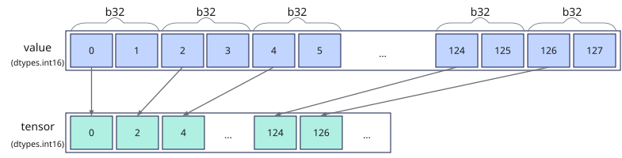

# vstore_pack
## 产品支持情况

- Ascend 950PR&950DT系列产品：支持

## 功能说明

将矢量数据寄存器中的数据压缩搬出到Unified Buffer（UB）。`mask`用于指示参与搬出的元素，`mask`对应位置为1时，将有效元素的低位bit数据写入压缩后对应的目的位置，保留的位数由`pack_mode`指定。`mask`对应位置为0时，压缩后对应的目的位置保持原值。掩码寄存器中的数据压缩搬出由[`vmask_store`](./vmask-store.md)（`dist='pack'`）提供。

矢量数据寄存器压缩搬出场景提供以下三种模式：

- **连续对齐搬出模式**：将压缩后的数据搬出到UB起始地址，由用户自行更新目的地址。
- **立即数偏移搬出模式**：通过`dtypes.int32`类型的`offset`指定相对目的起始地址的偏移，偏移单位为**元素**，用户可选择更新偏移或更新目的地址。
- **Post Update搬出模式**：压缩搬出完成后自动更新目的地址，`offset`指定每次更新的元素个数。

以**b32位宽压缩至b16位宽搬出**过程为例，示意图如下：

**图1** 压缩搬出数据



从矢量数据寄存器压缩搬出到UB的接口，根据`mask`将`value`中有效元素的低位bit数据连续存储于`tensor`中。

## 函数原型

```python
vstore_pack(tensor, offset, value: RawVReg, mask: Mask, *, pack_mode, post_update: bool = False) -> None
```

## 参数说明

| 参数 | 输入/输出 | 说明 |
| --- | --- | --- |
| `tensor` | 输出 | 目的操作数的起始地址。起始地址需32字节对齐。 |
| `offset` | 输入 | 相对`tensor`起始地址的偏移量，类型为`dtypes.int32`，单位为元素。<br>`offset`的单位为元素，通过`offset`参数偏移后的实际访问地址需落在UB地址范围内，且仍需32字节对齐，否则会报错。 |
| `value` | 输入 | 源操作数（矢量数据寄存器）。`dtype`须与`tensor`一致。 |
| `mask` | 输入 | 源操作数掩码（掩码寄存器），用于指示参与搬出的元素。对应位置为1时参与搬出，为0时不参与搬出。<br>`mask`比特位为1的源操作数元素参与搬出，并将低半部分bit数据写入压缩后对应的目的位置；为0的元素不参与搬出，压缩后对应的目的位置保持原值。 |
| `pack_mode` | 输入 | 压缩搬出模式，类型为`PackMode`或对应的字符串，必选。可用的压缩模式及其与寄存器、目的元素类型和掩码粒度的组合要求见[约束说明](#约束说明)，不能使用共享枚举的全部成员。 |
| `post_update` | 输入 | 是否采用Post Update模式。取值为`True`或`False`，默认值为`False`。取值为`True`时，`offset`仍作为目的地址偏移使用，本接口不更新目的地址指针。 |

**支持的元素数据类型：**

常用目的元素类型为`dtypes.int8`、`dtypes.uint8`、`dtypes.int16`、`dtypes.uint16`、`dtypes.float16`、`dtypes.bfloat16`。低精度浮点数转换结果也可按其位宽压缩存储；模式与元素类型、掩码粒度的组合见约束说明。

## 返回值说明

无返回值。结果写入`tensor`。

## 约束说明

压缩搬出需满足以下组合，不支持64位数据槽压缩为32位的搬出。

| 压缩模式 | `value`的元素位宽 | `tensor`的元素位宽 | `mask.elem_bits` |
| --- | --- | --- | --- |
| `PACK_HALF`或`B32_TO_B16` | 16位，转换结果位于32位数据槽的低16位 | 16位 | 32 |
| `B16_TO_B8` | 16位，或由转换得到的`dtypes.float8_e8m0` | 8位 | 16 |
| `PACK_QUARTER`或`B32_TO_B8` | 32位，或由转换得到的`dtypes.float8_e4m3fn`、`dtypes.float8_e5m2` | 8位 | 32 |

### 通用约束

- 本接口需在VF作用域内调用。
- 源操作数为矢量数据寄存器，目的操作数为UB地址。UB地址空间外的地址不可作为`tensor`传入。
- UB总容量为256KB，用户可用容量随编译选项与编程场景变化（默认预留6KB SIMD VF栈和2KB框架预留空间，可用248KB；SIMD+SIMT混编时再划分32KB~128KB作为Data Cache，可用容量进一步减少）。目的操作数地址偏移后对应的UB范围不可超过实际可用容量，否则会报错。
- 如果本指令与其他指令存在数据依赖，需要插入同步指令[`vmem_bar`](../reg_sync/vmem-bar.md)，保证多个指令串行化，防止出现异常数据。

## 调用示例

以下示例演示`vstore_pack`的调用，并在Host侧校验结果。

```python
import torch
import torch_npu

from cannbotdsl import Buffer, host, make_layout, mem_copy
from cannbotdsl.lang.kernel import kernel
from cannbotdsl.lang.vf import vf
from cannbotdsl.ops.reg import PackMode, full_mask, vload, vstore_pack
from cannbotdsl.tensor import MemLoc

@kernel
def _vstore_pack_kernel(src0, dst):
    buf = Buffer(MemLoc.UB, src0.dtype, make_layout((64,)))
    out = Buffer(MemLoc.UB, dst.dtype, make_layout((64,)))

    mem_copy(buf, src0)

    in0 = buf
    res = out
    with vf(mode="simd"):
        mask = full_mask()
        r = vload(in0, 0)
        vstore_pack(res, 0, r, mask, pack_mode=PackMode.PACK_QUARTER)

    mem_copy(dst, out)

@host
def run(src0, dst):
    _vstore_pack_kernel[1](src0, dst)

def main():
    src0 = (torch.arange(64, dtype=torch.int32, device="npu:0") + 1) * 256 + 7
    dst = torch.zeros((64,), dtype=torch.int8, device="npu:0")
    expected = torch.full((64,), 7, dtype=torch.int8)

    run(src0, dst)
    torch.npu.synchronize()

    assert bool((dst.cpu() == expected).all()), f"pack mismatch: {dst.cpu()[:4].tolist()}"
    print("vstore_pack example passed")
    print(f"first={int(dst.cpu()[0])}, last={int(dst.cpu()[-1])}")

if __name__ == "__main__":
    main()
```

预期结果：

```text
vstore_pack example passed
first=7, last=7
```
