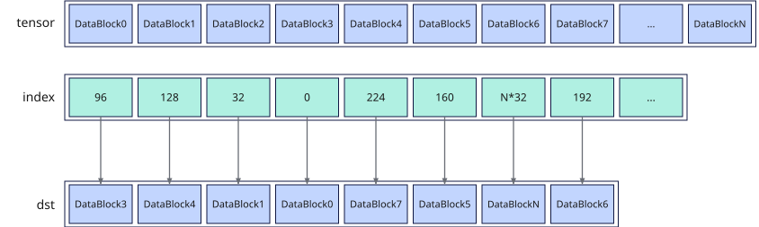

# vgather_datablock
## 产品支持情况

- Ascend 950PR&950DT系列产品：支持

## 功能说明

给定源操作数在Unified Buffer（UB）中的基地址和索引，根据索引位置将源操作数按DataBlock收集，将结果作为返回值返回。每个DataBlock长度为32B。



其中，index中仅前8个元素有效，每个元素对应一个DataBlock。例如，第一个元素为96（3 * 32），表示选取DataBlock3写入返回值中对应的位置。

## 函数原型

```python
vgather_datablock(tensor, index: RawVReg, *, mask: Mask | None = None) -> RawVReg
```

## 参数说明

| 参数 | 输入/输出 | 说明 |
| --- | --- | --- |
| `tensor` | 输入 | 源操作数（矢量）的起始地址。 |
| `index` | 输入 | 源操作数（矢量数据寄存器），表示返回值中每个DataBlock在UB中相对于`tensor`的索引位置。索引位置要大于等于0且32B对齐，索引可以存在相同的值。**index仅前8个数有效，单位是字节。** |
| `mask` | 输入 | 源操作数掩码（掩码寄存器）。**DataBlock搬运的有效指示，按b32格式解释。一个DataBlock对应4bit，仅每4bit中的最低位有效。由于index仅前8个元素有效，因此mask仅使用前8个b32元素对应的bit 0、4、8、12、16、20、24、28，分别控制返回值中DataBlock0至DataBlock7是否更新，其余bit无效。** 默认值为`None`。 |

**支持的元素数据类型：**

**表1** 支持的数据类型

| dtype | 支持情况 |
|---|---|
| `dtypes.int4x2` | 支持 |
| `dtypes.int8` | 支持 |
| `dtypes.uint8` | 支持 |
| `dtypes.fp4x2_e2m1` | 支持 |
| `dtypes.fp4x2_e1m2` | 支持 |
| `dtypes.hifloat8` | 支持 |
| `dtypes.float8_e8m0` | 支持 |
| `dtypes.float8_e5m2` | 支持 |
| `dtypes.float8_e4m3fn` | 支持 |
| `dtypes.int16` | 支持 |
| `dtypes.uint16` | 支持 |
| `dtypes.float16` | 支持 |
| `dtypes.bfloat16` | 支持 |
| `dtypes.int32` | 支持 |
| `dtypes.uint32` | 支持 |
| `dtypes.float32` | 支持 |
| `dtypes.int64` | 不支持 |
| `dtypes.uint64` | 不支持 |

## 返回值说明

返回保存数据块收集结果的矢量数据寄存器值，类型为`RawVReg`，其中元素的数据类型与`tensor`一致。

## 约束说明

- 本接口需在`vf(mode="simd")`作用域内调用。

- 本接口不支持64位元素类型。
- 源操作数在UB中的起始地址需要32B对齐。
- 索引位置要大于等于0且32B对齐，即一个索引值对应一个DataBlock。
- 索引可以存在相同的值，即可以多次读取源操作数中同一个DataBlock的数据。
- 索引值对应的数据必须在UB有效地址范围内。
- index仅前8个元素有效。

## 调用示例

以下示例演示`vgather_datablock`的调用，并在Host侧校验结果。

```python
import torch
import torch_npu

from cannbotdsl import Buffer, dtypes, host, make_layout, mem_copy
from cannbotdsl.lang.kernel import kernel
from cannbotdsl.lang.vf import vf
from cannbotdsl.ops.reg import create_mask, vgather_datablock, vload, vstore
from cannbotdsl.tensor import MemLoc

@kernel
def _vgather_datablock_kernel(src0, index, dst):
    buf = Buffer(MemLoc.UB, src0.dtype, make_layout((256,)))
    idx = Buffer(MemLoc.UB, dtypes.uint32, make_layout((64,)))
    out = Buffer(MemLoc.UB, dst.dtype, make_layout((256,)))

    mem_copy(buf, src0)
    mem_copy(idx, index)

    src = buf
    ind = idx
    res = out
    with vf(mode="simd"):
        mask = create_mask(pattern="all", elem_bits=32)
        blocks = vgather_datablock(src, vload(ind, 0), mask=mask)
        vstore(res, 0, blocks, create_mask(pattern="all", elem_bits=8))

    mem_copy(dst, out)

@host
def run(src0, index, dst):
    _vgather_datablock_kernel[1](src0, index, dst)

def main():
    src0 = torch.arange(256, dtype=torch.uint8).to("npu:0")
    index = torch.zeros(64, dtype=torch.int32, device="npu:0")
    index[:8] = torch.arange(224, -1, -32, dtype=torch.int32, device="npu:0")
    dst = torch.empty((256,), dtype=torch.uint8).to("npu:0")

    run(src0, index.view(torch.uint32), dst)
    torch.npu.synchronize()

    torch.testing.assert_close(dst.cpu(), src0.cpu().reshape(8, 32).flip(0).reshape(-1))
    print("vgather_datablock example passed")
    print(f"first={int(dst.cpu()[0])}, last={int(dst.cpu()[-1])}")

if __name__ == "__main__":
    main()
```

预期结果：

```text
vgather_datablock example passed
first=224, last=31
```
