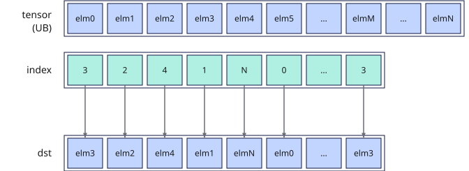
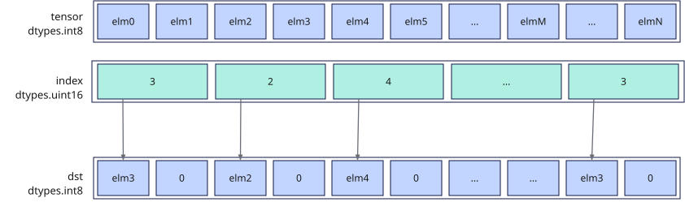

# vgather
## 产品支持情况

- Ascend 950PR&950DT系列产品：支持

## 功能说明

根据索引位置`index`将源操作数`tensor`按元素收集，将结果作为返回值返回。

**UB源收集模式**：源操作数为Unified Buffer（UB）地址，收集结果为矢量数据寄存器。按`index`矢量寄存器中保存的逐元素索引，从UB中读取对应位置的元素写入返回值对应位置，受`mask`掩码控制；`mask`比特位为0的位置对应返回值位置写0。

**图1**  UB源收集模式



## 函数原型

```python
vgather(tensor, index: RawVReg, *, mask: Mask) -> RawVReg
```

## 参数说明

| 参数 | 输入/输出 | 说明 |
| --- | --- | --- |
| `tensor` | 输入 | 源操作数（矢量）的起始地址。在UB中的起始地址需要32B对齐，须落在UB地址空间内。 |
| `index` | 输入 | 数据索引（矢量数据寄存器）。返回值中每个元素在UB中相对于`tensor`的索引位置，单位是元素个数。 |
| `mask` | 输入 | 源操作数掩码（掩码寄存器）。mask用于指示在计算过程中哪些元素参与计算。对应位置为1时参与计算，为0时不参与计算。mask未筛选的元素在输出中置零。 |

**支持的元素数据类型：**

数据类型组合列表
**表1** UB源收集模式支持数据类型组合列表

| dst_dtype | src_dtype | index_dtype |
| :---------- | :---------- | :-------------- |
| `dtypes.int8` | `dtypes.int8` | `dtypes.uint16` |
| `dtypes.uint8` | `dtypes.uint8` | `dtypes.uint16` |
| `dtypes.hifloat8` | `dtypes.hifloat8` | `dtypes.uint16` |
| `dtypes.float8_e8m0` | `dtypes.float8_e8m0` | `dtypes.uint16` |
| `dtypes.float8_e5m2` | `dtypes.float8_e5m2` | `dtypes.uint16` |
| `dtypes.float8_e4m3fn` | `dtypes.float8_e4m3fn` | `dtypes.uint16` |
| `dtypes.int16` | `dtypes.int16` | `dtypes.uint16` |
| `dtypes.int16` | `dtypes.int16` | `dtypes.uint32` |
| `dtypes.uint16` | `dtypes.uint16` | `dtypes.uint16` |
| `dtypes.uint16` | `dtypes.uint16` | `dtypes.uint32` |
| `dtypes.float16` | `dtypes.float16` | `dtypes.uint16` |
| `dtypes.float16` | `dtypes.float16` | `dtypes.uint32` |
| `dtypes.bfloat16` | `dtypes.bfloat16` | `dtypes.uint16` |
| `dtypes.bfloat16` | `dtypes.bfloat16` | `dtypes.uint32` |
| `dtypes.int32` | `dtypes.int32` | `dtypes.uint32` |
| `dtypes.uint32` | `dtypes.uint32` | `dtypes.uint32` |
| `dtypes.float32` | `dtypes.float32` | `dtypes.uint32` |

其中，`src_dtype`表示`tensor`的元素数据类型，`dst_dtype`表示返回寄存器值的元素数据类型，`index_dtype`表示索引寄存器的元素数据类型。返回元素类型与`tensor`一致；8位源元素使用16位硬件数据槽和`elem_bits=16`的掩码，不表示DSL返回元素类型提升为16位。

## 返回值说明

返回保存UB源收集结果的矢量数据寄存器值，类型为`RawVReg`，元素数据类型与`tensor`一致。源元素、索引及返回元素类型的组合见[参数说明](#参数说明)中的“UB源收集模式支持数据类型组合列表”。

## 约束说明

### 通用约束

- 本接口需在VF作用域内调用，源操作数为UB地址、收集结果为矢量数据寄存器。

### UB源收集模式约束

- 对于`mask`筛选需要搬运的元素，对应的地址需要在UB有效范围内；对于`mask`未筛选的元素，对应的地址不会触发任何地址越界异常，同时返回值中对应的元素将被置零。
- 当`tensor`为8位元素类型时，每个16位硬件数据槽的低8位保存收集到的源元素比特，高8位补0。返回寄存器仍按源元素类型解释，不能将硬件槽补零理解为返回`dtypes.int16`或`dtypes.uint16`。

- 当`tensor`与返回值数据类型一致，但是与`index`数据类型不一致时，数据写入返回值索引为偶数的位置，奇数索引位置置零。例如`tensor`为`dtypes.int8`数据类型，`index`为`dtypes.uint16`数据类型时，适用场景如下图：



## 调用示例

以下示例演示`vgather`的调用，并在Host侧校验结果。

```python
import torch
import torch_npu

from cannbotdsl import Buffer, dtypes, host, make_layout, mem_copy
from cannbotdsl.lang.kernel import kernel
from cannbotdsl.lang.vf import vf
from cannbotdsl.ops.reg import full_mask, vgather, vload, vstore
from cannbotdsl.tensor import MemLoc

@kernel
def _vgather_kernel(src0, index, dst):
    buf = Buffer(MemLoc.UB, src0.dtype, make_layout((64,)))
    idx = Buffer(MemLoc.UB, dtypes.uint32, make_layout((64,)))
    out = Buffer(MemLoc.UB, dst.dtype, make_layout((64,)))

    mem_copy(buf, src0)
    mem_copy(idx, index)

    src = buf
    ind = idx
    res = out
    with vf(mode="simd"):
        mask = full_mask()
        gathered = vgather(src, vload(ind, 0), mask=mask)
        vstore(res, 0, gathered, mask)

    mem_copy(dst, out)

@host
def run(src0, index, dst):
    _vgather_kernel[1](src0, index, dst)

def main():
    src0 = torch.arange(64, dtype=torch.int32, device="npu:0") * 10
    index = torch.arange(63, -1, -1, dtype=torch.int32, device="npu:0").view(torch.uint32)
    dst = torch.empty_like(src0)

    run(src0, index, dst)
    torch.npu.synchronize()

    torch.testing.assert_close(dst.cpu(), src0.cpu()[index.cpu().to(torch.int32)])
    print("vgather example passed")
    print(f"first={int(dst.cpu()[0])}, last={int(dst.cpu()[-1])}")

if __name__ == "__main__":
    main()
```

预期结果：

```text
vgather example passed
first=630, last=0
```
