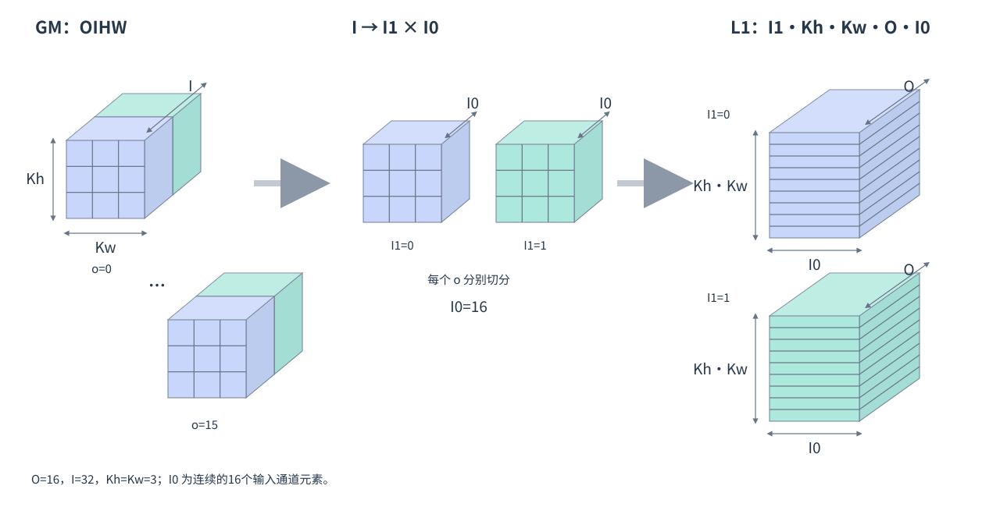

# conv2d_load_filter

## 产品支持情况

- Ascend 950PR&950DT系列产品：支持

## 功能说明

根据 `tile` 选取当前分组内的一块输出通道和输入通道对应的卷积权重，将其从 GM 搬入 L1，并重排为后续矩阵计算所需的 ZN 分形布局。本接口不执行卷积计算。

源权重按 OIHW 存放：O 为输出通道数，I 为每组输入通道数，H、W 为卷积核高、宽。随路转换排布为：**[I1, Kh, Kw, O, I0]**（输入通道组、卷积核高、卷积核宽、输出通道、组内输入通道），其中 I0=16。同一卷积核位置、同一输出通道对应的 16 个输入通道权重连续存放。如下图所示。



## 函数原型

```python
conv2d_load_filter(dst: Tensor, src: Tensor, tile: Conv2dTile, *, l2_cache_ctl: int = 0) -> None
```

## 参数说明

| 参数 | 输入/输出 | 说明 |
| --- | --- | --- |
| dst | 输出 |  L1 目标`Tensor`。<br>必填，无默认值。类型为 `Tensor`，须为 ZN 视图，可对 NZ 缓冲区使用 `permute(1, 0)` 得到；元素类型须与 `tile.spec.dtype` 相同，容量须覆盖 BN×Kh×Kw×BC 个元素。 |
| src | 输入 | 源`Tensor`，存放完整卷积权重。<br>必填，无默认值。类型为位于 GM 的 `Tensor`，按 OIHW 排布，形状须与 `tile.spec.filter_shape` 一致；元素类型须与 `tile.spec.dtype` 相同，支持 `float16`、`bfloat16`。 |
| tile | 输入 | 指定当前批次、分组及通道切块，确定权重加载的起点和有效范围。<br>必填，无默认值。类型为 [Conv2dTile](../../data-structures/convolution/conv2d-tile.md)，由 [spec.tile](../../data-structures/convolution/make-conv2d-spec/tile.md) 创建，须与源权重及目标缓冲区对应。 |
| l2_cache_ctl | 输入 | L2 读取缓存策略。<br>默认 `0`。支持编译期整数 `0`、`1`、`2`、`4`。 |

## 返回值说明

无返回值，结果写入 dst。

## 约束说明

特征图加载、权重加载和结果写回须使用相同的卷积配置，并对应同一次分块计算。输入和权重须在加载完成后参与计算；沿输入通道分块计算时，只在第一块初始化累加结果，全部分块累加完成后再写回。

## 调用示例

将形状为 `(16, 16, 3, 3)` 的 OIHW 权重加载到 L1，再经 UB 读回，校验重排结果；本例不执行卷积计算。

```python
# Copyright (c) 2026 Huawei Technologies Co., Ltd.
# Licensed under the CANN Open Software License Agreement Version 2.0.
import torch
import torch_npu
import cannbotdsl as cb


@cb.kernel
def load_filter(w: cb.Tensor, y: cb.Tensor):
    spec = cb.make_conv2d_spec(
        dtype=cb.dtypes.float16,
        input_shape=(1, 16, 4, 4),
        filter_shape=(16, 16, 3, 3),
    )
    tile = spec.tile(tile=(16, 16, 16), coord=(0, 0, 0))
    # 交换 NZ 缓冲区的逻辑轴，得到权重加载所需的 ZN 视图。
    weights = cb.Buffer(
        cb.MemLoc.L1, cb.dtypes.float16, cb.make_layout((16, 144))
    ).permute(1, 0)
    cb.conv2d_load_filter(weights, w, tile)
    # 原样读回 L1 存储，校验排布；L1→UB 默认写入 AIV0。
    ub = cb.Buffer(cb.MemLoc.UB, cb.dtypes.float16, cb.make_layout((144, 16)))
    cb.mem_copy(ub, weights)
    if cb.get_subblock_id() == 0:
        cb.mem_copy(y, ub)


@cb.host
def run(w: cb.Tensor, y: cb.Tensor):
    load_filter[1](w, y)


def main():
    w = torch.arange(2304).reshape(16, 16, 3, 3).remainder(100).half()
    y = torch.empty((144, 16), dtype=torch.float16, device="npu")
    run(w.npu(), y)
    torch.npu.synchronize()
    # 按卷积核位置、输出通道、输入通道排列。
    expected = w.permute(2, 3, 0, 1).contiguous().reshape(144, 16)
    torch.testing.assert_close(y.cpu(), expected, rtol=0, atol=0)
    print("conv2d_load_filter example passed")


if __name__ == "__main__":
    main()
```

预期结果：校验通过，输出 `conv2d_load_filter example passed`。本例只有一组 16 个输入通道，读回数据依次按卷积核位置、输出通道、输入通道排列。
