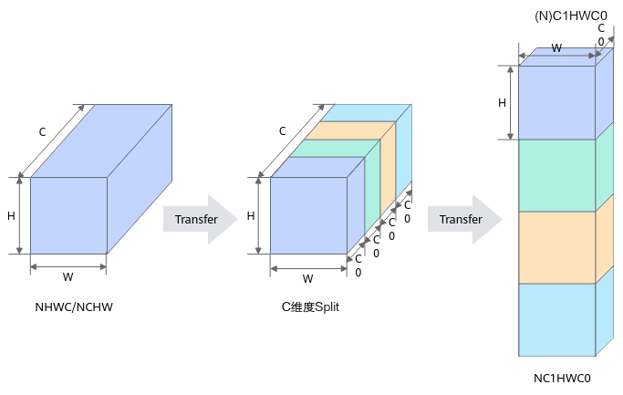

# conv2d_load_fmap

## 产品支持情况

- Ascend 950PR&950DT系列产品：支持

## 功能说明

根据 `tile` 从 NCHW 格式的 GM 输入中选取当前批次、分组及通道块所需的有效特征图行，搬入 L1，并按 NC1HWC0 排布存放，供 [conv2d_load_im2col](conv2d-load-im2col.md) 展开卷积窗口。本接口不执行窗口展开或卷积计算。

NCHW 中，同一通道内的 H×W 个元素连续存放；NC1HWC0 将通道维 C 拆为通道组 C1 和组内通道 C0，按 N、C1、H、W、C0 的顺序存放，使同一空间位置的 C0 个通道元素连续。对于本接口支持的 `float16` 和 `bfloat16`，C0 为 16。



图中省略了批次维 N，先沿 C 维分组，再将各组按 NC1HWC0 排列；本接口的 GM 输入采用其中的 NCHW 格式。

## 函数原型

```python
conv2d_load_fmap(dst: Tensor, src: Tensor, tile: Conv2dTile, *, l2_cache_ctl: int = 0) -> None
```

## 参数说明

| 参数 | 输入/输出 | 说明 |
| --- | --- | --- |
| dst | 输出 | 接收当前卷积分块所需的输入特征图，按 NC1HWC0 排布存入 L1，供后续 `conv2d_load_im2col` 使用。<br>必填，无默认值。<br>支持元素类型为 `float16` 或 `bfloat16` 的 `Tensor`，须与 `src` 和 `tile.spec.dtype` 相同；使用 ND 格式声明的 L1 缓冲区，容量至少满足 `tile.spec.fmap_l1_shape(tile=(BM, BC))` 的要求。 |
| src | 输入 | GM 上的 NCHW 输入特征图。<br>必填，无默认值。<br>支持元素类型为 `float16` 或 `bfloat16` 的 `Tensor`，须与 `tile.spec.dtype` 相同，形状及排布须与卷积规格中的输入一致。 |
| tile | 输入 | 指定当前卷积分块，决定源地址偏移、有效输入高度和实际输入通道数。<br>必填，无默认值。<br>类型为 [Conv2dTile](../../data-structures/convolution/conv2d-tile.md)，由 `spec.tile(...)` 创建，须与输入特征图及目标缓冲区使用的卷积规格和分块大小对应。 |
| l2_cache_ctl | 输入 | 搬入 L1 的缓存策略。<br>默认值为 `0`。<br>支持编译期 `int`，取值为 `0`、`1`、`2` 或 `4`。 |

## 返回值说明

无返回值，结果写入 dst。

## 约束说明

特征图加载、权重加载和结果写回须使用相同的卷积配置，并对应同一次分块计算。输入和权重须在加载完成后参与计算；沿输入通道分块计算时，只在第一块初始化累加结果，全部分块累加完成后再写回。

## 调用示例

将一块 `(1, 16, 4, 4)` 的 NCHW 特征图加载到 L1，再经 UB 读回，校验其 NC1HWC0 排布；本例不执行卷积计算。

```python
# Copyright (c) 2026 Huawei Technologies Co., Ltd.
# Licensed under the CANN Open Software License Agreement Version 2.0.
import torch
import torch_npu
import cannbotdsl as cb


@cb.kernel
def load_fmap(x: cb.Tensor, y: cb.Tensor):
    spec = cb.make_conv2d_spec(
        dtype=cb.dtypes.float16,
        input_shape=(1, 16, 4, 4),
        filter_shape=(16, 16, 1, 1),
    )
    tile = spec.tile(tile=(16, 16, 16), coord=(0, 0, 0))
    fmap = cb.make_conv2d_fmap_l1(cb.dtypes.float16, spec, tile=(16, 16))
    cb.conv2d_load_fmap(fmap, x, tile)
    # 将 L1 数据原样读回，用于校验存储排布。
    ub = cb.Buffer(cb.MemLoc.UB, cb.dtypes.float16, cb.make_layout((256,)))
    cb.mem_copy(ub, fmap)
    # L1→UB 默认写入 AIV0，仅由 AIV0 写回。
    if cb.get_subblock_id() == 0:
        cb.mem_copy(y, ub)


@cb.host
def run(x: cb.Tensor, y: cb.Tensor):
    load_fmap[1](x, y)


def main():
    x = torch.arange(256, dtype=torch.float16).reshape(1, 16, 4, 4)
    y = torch.empty(256, dtype=torch.float16, device="npu")
    run(x.npu(), y)
    torch.npu.synchronize()
    expected = x.reshape(1, 1, 16, 4, 4).permute(0, 1, 3, 4, 2).contiguous()
    torch.testing.assert_close(y.cpu(), expected.reshape(-1), rtol=0, atol=0)
    print("conv2d_load_fmap example passed")


if __name__ == "__main__":
    main()
```

预期结果：校验通过，输出 `conv2d_load_fmap example passed`。读回数据按空间位置排列，每个位置连续存放 16 个通道值。
