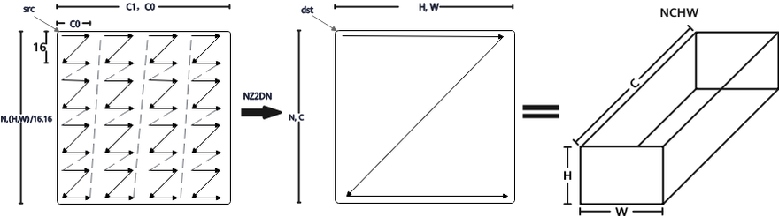

# conv2d_store_output

## 产品支持情况

- Ascend 950PR&950DT系列产品：支持

## 功能说明

将 `matmul` 在 L0C 中生成的当前卷积结果块搬到 GM，按 NCHW 顺序写入完整输出 Tensor 中的对应位置。搬运时完成 NZ2DN 排布转换，并将 `float32` 结果转换为目标的 `float16` 或 `bfloat16` 类型。

L0C 结果矩阵的行对应输出空间位置（将输出高、宽按行展开），列对应输出通道。写回 GM 后，同一输出通道的空间数据按高、宽顺序存放，再排列下一个输出通道，如下图展示排布转换关系。。



图中 C 表示输出通道，H、W 表示输出特征图的高、宽；左侧为 L0C 中按通道分块的结果，右侧为 NCHW 输出。

## 函数原型

```python
conv2d_store_output(dst: Tensor, src: Tensor, tile: Conv2dTile, *, l2_cache_ctl: int = 0) -> None
```

## 参数说明

| 参数 | 输入/输出 | 说明 |
| --- | --- | --- |
| dst | 输出 | 目标 GM 输出 `Tensor`。<br>必填，无默认值。类型为位于 GM 的 `Tensor`，按 NCHW 排布，形状为 `tile.spec.output_shape`；元素类型支持 `float16`、`bfloat16`。 |
| src | 输入 | 待写回的 L0C 结果块。<br>必填，无默认值。类型为位于 L0C 的 `Tensor`，元素类型为 `float32`；使用 `tile.l0c_view(...)` 获取当前块的有效视图。 |
| tile | 输入 | 根据 `batch`、`group`、输出位置块编号 `coord[0]` 和输出通道块编号 `coord[1]`，确定结果在完整输出中的位置及有效范围。<br>必填，无默认值。类型为 [Conv2dTile](../../data-structures/convolution/conv2d-tile.md)，由 [spec.tile](../../data-structures/convolution/make-conv2d-spec/tile.md) 创建，须与源结果块和目标输出对应。 |
| l2_cache_ctl | 输入 | L2 搬出缓存策略。<br>默认 `0`。支持编译期整数 `0`、`1`、`2`、`4`。 |

## 返回值说明

无返回值，结果写入 dst。

## 约束说明

特征图加载、权重加载和结果写回须使用相同的卷积配置，并对应同一次分块计算。输入和权重须在加载完成后参与计算；沿输入通道分块计算时，只在第一块初始化累加结果，全部分块累加完成后再写回。

## 调用示例

用矩阵乘生成一个 16×16 的 L0C 结果块，再调用 `conv2d_store_output` 写入形状为 `(1, 16, 4, 4)` 的 NCHW 输出，校验输出位置和通道的对应关系。本例不执行完整卷积。

```python
# Copyright (c) 2026 Huawei Technologies Co., Ltd.
# Licensed under the CANN Open Software License Agreement Version 2.0.
import torch
import torch_npu
import cannbotdsl as cb


@cb.kernel
def store_output(x: cb.Tensor, identity: cb.Tensor, y: cb.Tensor):
    spec = cb.make_conv2d_spec(
        dtype=cb.dtypes.float16,
        input_shape=(1, 16, 4, 4),
        filter_shape=(16, 16, 1, 1),
    )
    tile = spec.tile(tile=(16, 16, 16), coord=(0, 0, 0))
    a_l1 = cb.Buffer(cb.MemLoc.L1, cb.dtypes.float16, cb.make_layout((16, 16)))
    b_l1 = cb.Buffer(cb.MemLoc.L1, cb.dtypes.float16, cb.make_layout((16, 16)))
    a = cb.Buffer(cb.MemLoc.L0A, cb.dtypes.float16, cb.make_layout((16, 16)))
    b = cb.Buffer(cb.MemLoc.L0B, cb.dtypes.float16, cb.make_layout((16, 16)))
    c = cb.Buffer(cb.MemLoc.L0C, cb.dtypes.float32, cb.make_layout((16, 16)))
    # 乘单位矩阵，生成数值已知的 L0C 结果：行是输出位置，列是输出通道。
    cb.mem_copy(a_l1, x)
    cb.mem_copy(b_l1, identity)
    cb.mem_copy(a, a_l1)
    cb.mem_copy(b, b_l1)
    cb.matmul(c, a, b, init=True)
    cb.conv2d_store_output(y, tile.l0c_view(c), tile)


@cb.host
def run(x: cb.Tensor, identity: cb.Tensor, y: cb.Tensor):
    store_output[1](x, identity, y)


def main():
    x = torch.arange(256, dtype=torch.float16).reshape(16, 16)
    y = torch.empty((1, 16, 4, 4), dtype=torch.float16, device="npu")
    run(x.npu(), torch.eye(16, dtype=torch.float16, device="npu"), y)
    torch.npu.synchronize()
    expected = x.T.contiguous().reshape(1, 16, 4, 4)
    torch.testing.assert_close(y.cpu(), expected, rtol=0, atol=0)
    print("conv2d_store_output example passed")


if __name__ == "__main__":
    main()
```

预期结果：NCHW 输出与参考结果一致，输出 `conv2d_store_output example passed`。
