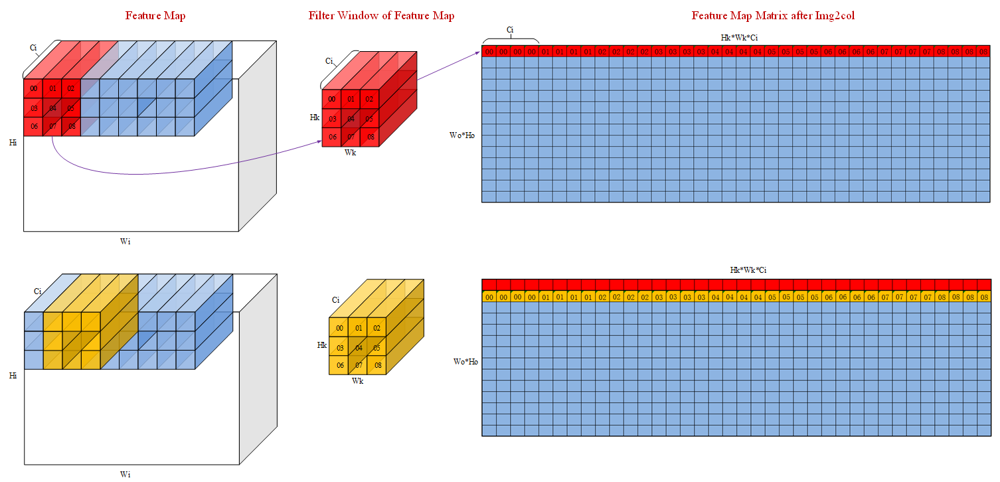

# load3d

## 产品支持情况

- Ascend 950PR&950DT系列产品：支持

## 功能说明

从 L1 中按 NC1HWC0 排布的单个样本特征图中提取卷积窗口，将每个输出位置所需的输入值展开为矩阵的一行，再把指定的矩阵区域搬入 L0A 或 L0B，供 `matmul` 使用。

窗口按 `stride` 移动，按 `dilation` 取点；超出特征图边界且位于声明填充范围内的位置使用 `padding` 指定的值。相邻窗口重叠时，同一输入值会出现在展开矩阵的不同行中。



图中红色、黄色窗口分别展开为第一行、第二行，Ci=4 仅为简化示意。此图描述逻辑展开关系，写入 L0A/L0B 时仍须采用相应的分形排布。

使用时，通过 `feature` 描述源特征图及四周填充范围，通过 `filter`、`stride`、`dilation` 描述窗口取数规则，通过 `window` 选择展开矩阵的起点和大小；`repeat`、`destination` 分别控制重复搬运和目标存放位置。`window` 的范围始终按转置前的矩阵描述：写入 L0A 时可通过 `transpose` 选择是否转置，写入 L0B 时始终转置。

令 `H=feature.height`、`W=feature.width`，`(F_h,F_w)=filter`、`(S_h,S_w)=stride`、`(D_h,D_w)=dilation`，则：

$$
H_o=\left\lfloor\frac{H+\mathrm{feature.pad\_top}+\mathrm{feature.pad\_bottom}-D_h(F_h-1)-1}{S_h}\right\rfloor+1
$$

$$
W_o=\left\lfloor\frac{W+\mathrm{feature.pad\_left}+\mathrm{feature.pad\_right}-D_w(F_w-1)-1}{S_w}\right\rfloor+1
$$

展开矩阵的 M 轴表示输出空间位置，共 `H_o*W_o` 项；K 轴表示卷积核位置及输入通道，共 `feature.channels*F_h*F_w` 项。`window` 在转置前选择这两个轴的范围。

## 函数原型

```python
load3d(
    dst: Tensor,
    src: Tensor,
    *,
    feature: Load3DFeatureMap,
    window: Load3DWindow,
    filter: tuple[int, int] = (1, 1),
    stride: tuple[int, int] = (1, 1),
    dilation: tuple[int, int] = (1, 1),
    transpose: bool = False,
    config_bank: str | int = "a",
    repeat: Load3DRepeat = Load3DRepeat(),
    destination: Load3DDestination | None = None,
    padding: Load3DPadding = Load3DPadding.value(0),
) -> None
```

核函数中计算得到的特征图尺寸、窗口大小等参数，也须满足参数说明中的取值范围和源、目标存储容量要求。

## 参数说明

| 参数 | 输入/输出 | 说明 |
| --- | --- | --- |
| dst | 输出 | L0A 或 L0B 目标 `Tensor` 。<br>必填，无默认值。类型为 `Tensor`，起点须按 512B 对齐，存储须覆盖目标偏移及全部重复写入；未写入区域保持原值。 |
| src | 输入 | 源 L1 `Tensor`，NC1HWC0 排布。<br>必填，无默认值。类型为 `Tensor`，起点须按 32B 对齐；元素类型须与 `dst` 相同，支持 `int8`、`uint8`、`int16`、`uint16`、`int32`、`uint32`、`float16`、`bfloat16`、`float32`、`float8_e4m3fn`、`float8_e5m2`、`hifloat8`。 |
| feature | 输入 | 描述源特征图的高、宽、通道数及四周填充范围，见 [Load3DFeatureMap](../../data-structures/convolution/load3d-feature-map.md)。 |
| window | 输入 | 指定转置前展开矩阵的起点及搬运范围，见 [Load3DWindow](../../data-structures/convolution/load3d-window.md)。 |
| filter | 输入 | 指定卷积核的高、宽，顺序为 `(filter_h, filter_w)`。<br>默认 `(1, 1)`。支持包含 2 个整数的 tuple/list，每项为 0～511；0 表示空搬运。 |
| stride | 输入 | 指定窗口在高、宽方向每次移动的距离，顺序为 `(stride_h, stride_w)`。<br>默认 `(1, 1)`。支持包含 2 个整数的 tuple/list，每项为 1～63。 |
| dilation | 输入 | 指定窗口内部相邻采样点在高、宽方向的距离，顺序为 `(dilation_h, dilation_w)`；1 表示连续取点。<br>默认 `(1, 1)`。支持包含 2 个整数的 tuple/list，每项为 1～255。 |
| transpose | 输入 | 指定写入 L0A 前是否转置展开矩阵；写入 L0B 时始终转置，不受此参数控制。<br>默认 `False`。支持布尔值。 |
| config_bank | 输入 | 选择本次使用的配置槽，与目标位于 L0A 还是 L0B 无关。<br>默认 `"a"`。支持字符串 `"a"`、`"b"` 或整数选择值 `0`、`1`，分别对应配置槽 A、B。 |
| repeat | 输入 | 控制重复搬运次数及源数据推进方式，见 [Load3DRepeat](../../data-structures/convolution/load3d-repeat.md)。 |
| destination | 输入 | 控制目标分形块的间距及写入起点，见 [Load3DDestination](../../data-structures/convolution/load3d-destination.md)。 |
| padding | 输入 | 指定特征图边界填充位置使用的单元素值，见 [Load3DPadding](../../data-structures/convolution/load3d-padding.md)。 |

## 返回值说明

无返回值。展开结果写入 `dst`，不创建新的 Tensor 或分配存储。

## 约束说明

- 在Kernel内使用。先初始化L1源特征图，再调用`load3d`，随后使用`matmul`等接口读取展开结果。使用自动同步时，通过同一Buffer或其共享存储的Tensor视图传递数据，不使用另外构造的裸地址代替。
- 同一批次的全部源通道平面必须在 L1 中按声明的 NC1HWC0 排列。多个 batch 由调用方分别选择源视图，不把 batch 合并到 `feature.channels`。
- 非空展开时，卷积核按`dilation`扩张后的高度、宽度不能超过填充后特征图的高度、宽度。

## 调用示例

### 二维卷积

下例用一次 `load3d` 和一次 `matmul` 完成单块 3×2 二维卷积。输入为 NHWC `(1, 2, 9, 16)`，权重为 OHWI `(32, 3, 2, 16)`。本例的 16 个输入通道恰好组成一个 C0 块，因此输入可按原有 NHWC 顺序展平后搬入 L1。多通道块输入须先按 NC1HWC0 组织。

将权重的核高、核宽和输入通道展平为 K 轴，得到权重矩阵 B，形状为 `(32, 96)`。与此同时，`load3d` 将输入窗口展开为矩阵 A，形状为 `(16, 96)`。A 的每一行对应一个输出空间位置，B 的每一行对应一个输出通道，两者都按卷积核高、宽和输入通道的顺序排列 K 轴。

`matmul(c, a, b)` 计算 A 与 B 的逻辑转置的乘积，即 `(16, 96) × (96, 32) → (16, 32)`。结果 C 的每个元素是一个输入窗口与一个输出通道权重的点积，行对应输出空间位置，列对应输出通道。用 `mem_copy` 写回 GM 后，按 NHWC `(1, 2, 8, 32)` 读取并校验。

<!-- example: conv2d_example.py -->

```python
# Copyright (c) 2026 Huawei Technologies Co., Ltd.
# Licensed under the CANN Open Software License Agreement Version 2.0.
import torch
import torch.nn.functional as F
import torch_npu
import cannbotdsl as cbd
from cannbotdsl import MemLoc, dtypes, make_layout

@cbd.kernel
def conv2d(x: cbd.Tensor, weight: cbd.Tensor, y: cbd.Tensor):
    # One NHWC batch, H=2, W=9, C=16; for C1=1 its payload is NC1HWC0.
    feature = cbd.Buffer(MemLoc.L1, dtypes.float16, make_layout((288,)), data_format="nd")
    weights = cbd.Buffer(MemLoc.L1, dtypes.float16, make_layout((32, 96)))
    a = cbd.Buffer(MemLoc.L0A, dtypes.float16, make_layout((16, 96)))
    b = cbd.Buffer(MemLoc.L0B, dtypes.float16, make_layout((32, 96)))
    c = cbd.Buffer(MemLoc.L0C, dtypes.float32, make_layout((16, 32)))
    cbd.mem_copy(feature, x)
    cbd.mem_copy(weights, weight)
    cbd.mem_copy(b, weights)
    cbd.load3d(a, feature,
        feature=cbd.Load3DFeatureMap(height=2, width=9, channels=16,
            pad_top=1, pad_bottom=1, pad_left=0, pad_right=0),
        window=cbd.Load3DWindow(m_extent=16, k_extent=96), filter=(3, 2))
    cbd.matmul(c, a, b)
    cbd.mem_copy(y, c)

@cbd.host
def run(x: cbd.Tensor, weight: cbd.Tensor, y: cbd.Tensor):
    conv2d[1](x, weight, y)

def main():
    assert torch.npu.is_available(), "NPU is required"
    x = ((torch.arange(288).reshape(1, 2, 9, 16) % 13 - 6).float() / 8).half()
    w = ((torch.arange(32 * 3 * 2 * 16).reshape(32, 3, 2, 16) % 11 - 5).float() / 8).half()
    expected = F.conv2d(x.permute(0, 3, 1, 2).float(), w.permute(0, 3, 1, 2).float(), padding=(1, 0))
    y = torch.empty((16, 32), dtype=torch.float32, device="npu")
    run(x.flatten().npu(), w.reshape(32, 96).npu(), y)
    torch.npu.synchronize()
    torch.testing.assert_close(y.cpu().reshape(1, 2, 8, 32), expected.permute(0, 2, 3, 1), rtol=0, atol=0)
    print("conv2d example passed")

if __name__ == "__main__":
    main()
```
<!-- end-example -->

预期结果：输出 `conv2d example passed`。

### 三维卷积

输入采用 NCDHW，形状为 `(1, 16, 4, 2, 9)`。权重采用 `[O, I, Kd, Kh, Kw]`，形状为 `(32, 16, 2, 3, 2)`。步长均为 1，仅在高度方向上下各补 1。输出有 3 个深度平面，每个平面包含 16 个空间位置和 32 个输出通道。

Host 先将输入和权重按深度分片整理为连续存储。kernel 对每个输出深度位置依次加载两张输入平面及对应权重，展开高、宽方向的窗口，累加到同一个 L0C 结果块。两次矩阵乘完成后写回该深度平面，Host 将结果整理为 NCDHW 后进行校验。

```python
# Copyright (c) 2026 Huawei Technologies Co., Ltd.
# Licensed under the CANN Open Software License Agreement Version 2.0.
import cannbotdsl as cb
import torch
import torch_npu


@cb.kernel
def conv3d(x: cb.Tensor, weight: cb.Tensor, y: cb.Tensor):
    dtype = cb.dtypes.float16
    fmap = cb.Buffer(cb.MemLoc.L1, dtype, cb.make_layout((288,)), data_format="nd")
    w_l1 = cb.Buffer(cb.MemLoc.L1, dtype, cb.make_layout((32, 96)))
    a = cb.Buffer(cb.MemLoc.L0A, dtype, cb.make_layout((16, 96)))
    b = cb.Buffer(cb.MemLoc.L0B, dtype, cb.make_layout((32, 96)))
    c = cb.Buffer(cb.MemLoc.L0C, cb.dtypes.float32, cb.make_layout((16, 32)))

    # 输入深度为 4，核深度为 2，深度步长为 1，无深度填充
    # 输出深度为 (4 - 2) // 1 + 1 = 3
    for od in range(3):
        # 核深度为 2，每个输出深度位置累加两张输入平面的贡献
        for kd in range(2):
            # 深度步长为 1。每次加载一张输入平面和一片核权重
            depth = od + kd
            cb.mem_copy(fmap, x[depth * 288:(depth + 1) * 288])
            cb.mem_copy(w_l1, weight[kd * 32:(kd + 1) * 32, None])
            cb.mem_copy(b, w_l1)
            cb.load3d(
                a, fmap,
                feature=cb.Load3DFeatureMap(
                    height=2, width=9, channels=16, pad_top=1, pad_bottom=1
                ),
                window=cb.Load3DWindow(m_extent=16, k_extent=96),
                filter=(3, 2),
            )
            # 第一片初始化 L0C，第二片累加到同一块。
            cb.matmul(c, a, b, init=(kd == 0))
        cb.mem_copy(y[od * 16:(od + 1) * 16, None], c)


@cb.host
def run(x: cb.Tensor, weight: cb.Tensor, y: cb.Tensor):
    conv3d[1](x, weight, y)


if __name__ == "__main__":
    # x: (1, 16, 4, 2, 9)，依次为批次、输入通道、深度、高、宽
    x = ((torch.arange(1152).reshape(1, 16, 4, 2, 9) % 13 - 6) / 8).half()
    # w: (32, 16, 2, 3, 2)，依次为输出通道、输入通道、核深度、核高、核宽
    w = ((torch.arange(6144).reshape(32, 16, 2, 3, 2) % 7 - 3) / 8).half()
    # planes: (1152,)，由 (1, 4, 2, 9, 16) 按批次、深度、高、宽、输入通道顺序展平；每 2 × 9 × 16 = 288 个连续元素对应一个深度平面
    planes = x.permute(0, 2, 3, 4, 1).contiguous().view(-1)
    # weights: (64, 96)，行由核深度和输出通道合并（2 × 32），列由核高、核宽和输入通道合并（3 × 2 × 16）
    weights = w.permute(2, 0, 3, 4, 1).contiguous().view(64, 96)
    out = torch.empty((48, 32), dtype=torch.float32, device="npu")
    run(planes.npu(), weights.npu(), out)
    torch.npu.synchronize()
    y = out.cpu().reshape(1, 3, 2, 8, 32).permute(0, 4, 1, 2, 3)
    expected = torch.nn.functional.conv3d(x.float(), w.float(), padding=(0, 1, 0))
    torch.testing.assert_close(y, expected, rtol=0, atol=0)
    print("conv3d example passed")
```

预期输出形状为 `(1, 32, 3, 2, 8)`。逐元素校验通过后打印 `conv3d example passed`。
