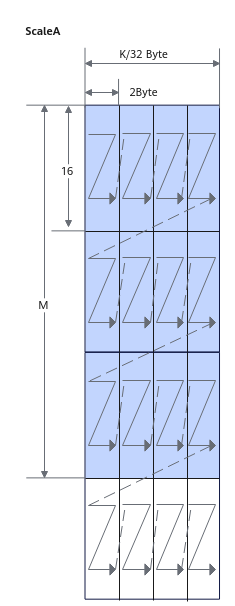
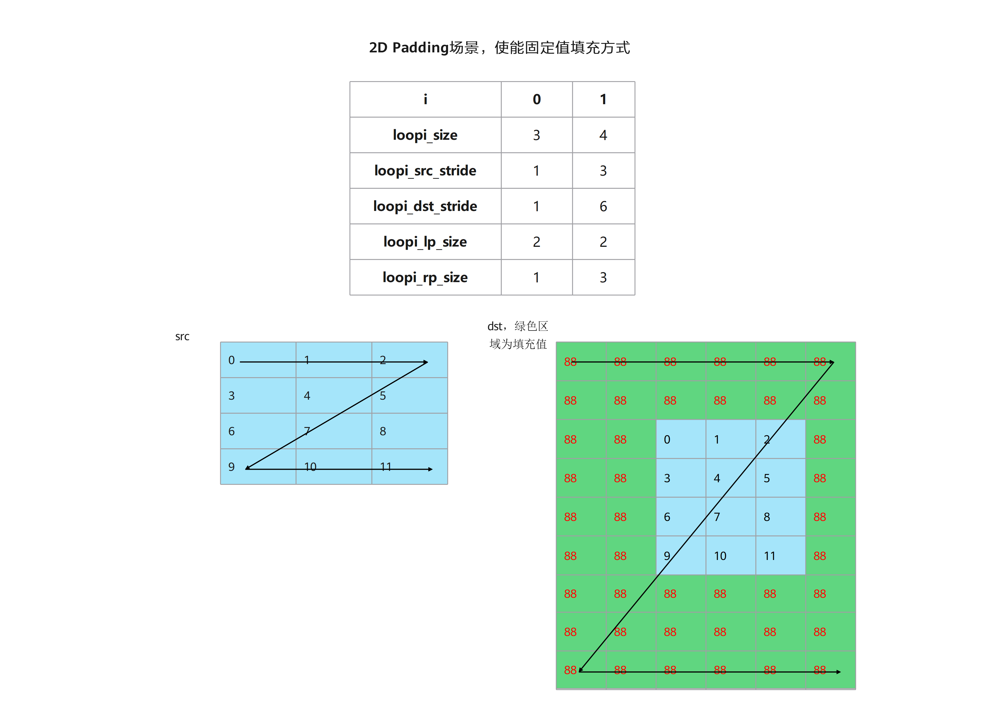
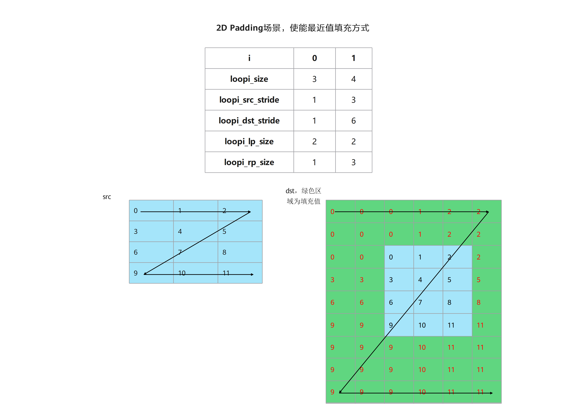
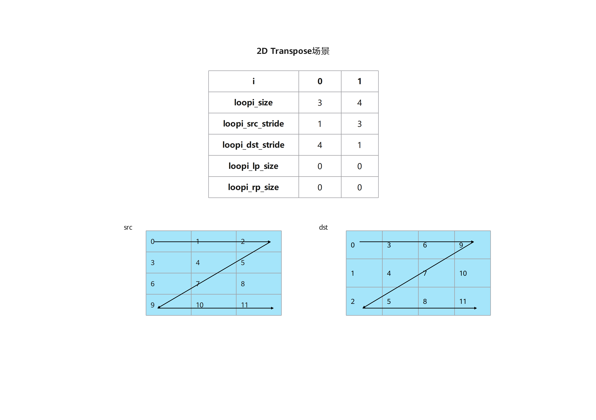
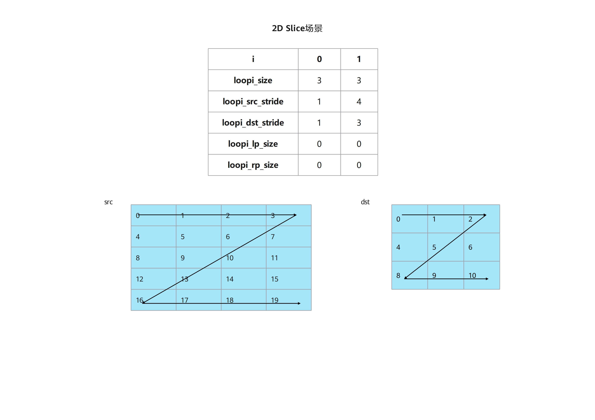
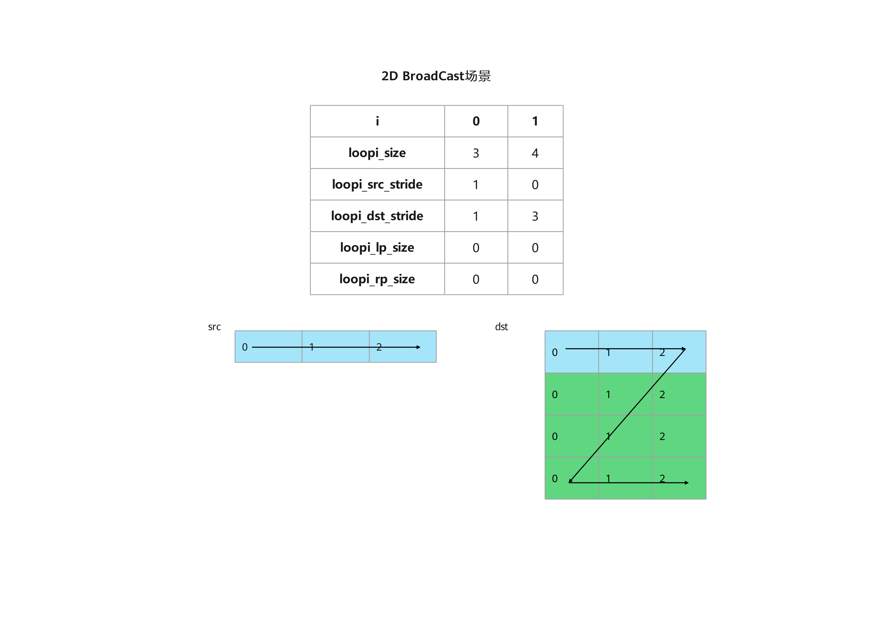
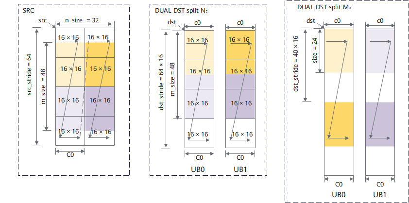
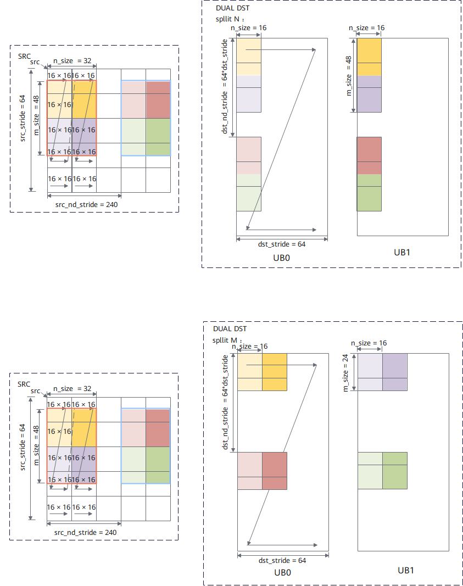
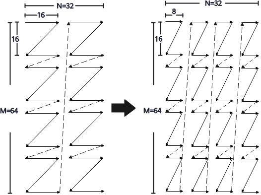
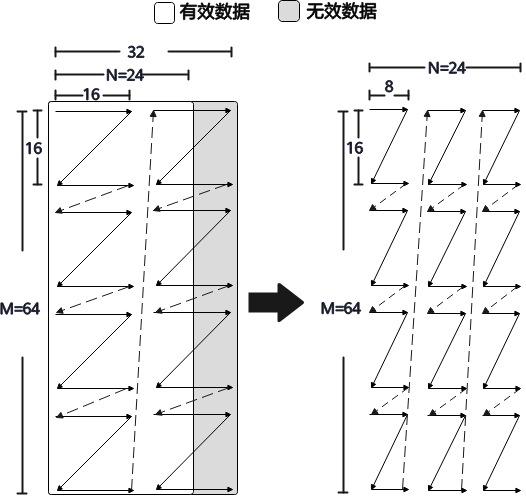

# copy_options

## 产品支持情况

- Ascend 950PR&950DT系列产品：支持

## 功能说明

创建不可变的搬运配置，供 [mem_copy](mem-copy.md) 的 `options` 参数使用。

传入已有配置 `base` 时，仅覆盖显式指定的选项，其余选项继承自 `base`，原配置保持不变。

## 函数原型

```python
copy_options(
    base: CopyOptions | None = None,
    *,
    engine: Literal["auto", "nddma"] | None = ...,
    dst_subblock: int | ScalarValue | None = ...,
    unit_flag: int | ScalarValue = ...,
    mx_scale: Tensor | None = ...,
    l2_cache_ctl: int | ScalarValue = ...,
    atomic: str = ...,
    atomic_add: bool | ScalarValue = ...,
    pad_val: object = ...,
    channel_split: bool | None = ...,
) -> CopyOptions
```

除 `base` 外，参数均须以关键字传入。对于须以关键字传入的参数，未指定时，有 `base` 则继承对应选项，没有 `base` 则使用参数说明中的默认值。显式传入 `None` 会覆盖原值，仅适用于类型允许 `None` 的参数。`ScalarValue`表示[标量值](../data-structures/data-types.md#标量值)，例如从Tensor中读取的单个元素；具体类型要求见参数说明。

## 参数说明

| 参数 | <span style="white-space: nowrap;">输入/输出</span> | 说明 |
| --- | --- | --- |
| `base` | 输入 | 已有的 `CopyOptions` 配置。默认值为 `None`，表示从默认配置创建；传入配置时，在其基础上覆盖创建新配置，原配置不变。 |
| `engine` | 输入 | 选择搬运方式，支持 `"auto"`、`"nddma"` 或 `None`，默认值是 `None`。<br>`None` 与 `"auto"` 一样，表示 GM→UB 使用普通 DMA；其他方向的搬运行为由源、目标位置及 Tensor 布局和视图变换决定，见 [mem_copy 搬运方向](mem-copy.md#搬运方向)。<br>`"nddma"` 显式选择将多维数据从Global Memory（GM）搬运到Unified Buffer（UB），用法和支持范围见 [NDDMA](#nddma)。|
| `dst_subblock` | 输入 | 启用单目标模式时，用于指示目标 UB `Tensor` 所在的 `sub_block_id` 。<br>默认值 `None`，表示不显式指定，默认选择 AIV0；取值为 0 或 1，取值为0时写入 AIV0，为1时写入 AIV1。与双目标分区搬运的关系见[单目标与双目标搬运](#单目标与双目标搬运)。 |
| `unit_flag` | 输入 | 控制 `Mmad` 和 `Fixpipe` 指令细粒度并行，接受整型标量 ，取值说明如下：<br> `0`：默认值，不使能unitFlag；<br>`1`：无效值；<br>`2` 使能unitFlag，硬件执行完指令后，不改变L0C内存块的单元标志位；<br>`3`使能unitFlag，硬件执行完指令后，改变L0C内存块的单元标志位。<br> 启用时，对应的 `matmul` 也须启用 UnitFlag；计算与搬出如何配合见 [UnitFlag 特性说明](../compute/matrix/key-features-unit-flag.md)。|
| `mx_scale` | 输入 | MX矩阵计算过程中所需的左/右矩阵对应的量化系数`Tensor`。<br>默认值为 `None`，表示只搬运左/右矩阵，不传入对应的量化`Tensor`；传入时，将量化`Tensor`搬入对应的 L0A_MX/L0B_MX。被传入 `mem_copy(dst, src, options=copy_options(mx_scale=scale))`使用时，`src` 是左/右矩阵，数据类型须为 `float8_e4m3fn`、`float8_e5m2` 或 `fp4x2_e2m1`；`mx_scale` 是对应的量化矩阵，数据类型须为 `float8_e8m0`。类型、布局和形状要求见 [MX 量化矩阵](#mx-量化矩阵)。 |
| `l2_cache_ctl` | 输入 | 读写 GM 时的 L2 Cache 管理策略。<br>默认值为 `0`，各方向的可用策略`id`及含义见 [L2 Cache 策略](#l2-cache-策略)。 |
| `atomic` | 输入 | 原子写入模式，支持 `"none"`、`"add"`、`"min"`、`"max"`，默认为 `"none"`。用于 UB 或 L0C 向 GM 搬运时的写入操作；不能与 `atomic_add` 同时指定。 |
| `atomic_add` | 输入 | 是否将源`Tensor`的数据，原子累加到目标`Tensor`的原值上。<br>默认值为 `False`，表示覆盖写入；可传入布尔值，仅 UB→GM、L0C→GM 支持启用：<br> 1. UB→GM 要求源、目标元素类型相同，可为 `int8`、`int16`、`int32`、`bfloat16`、`float16` 或 `float32`；<br> 2. L0C→GM 要求源为 `float32` 或 `int32`，目标与源同类型，或为 `float16`、`bfloat16`、`int8`。L0C→GM 的目标须为 ND 布局，NZ 直存不支持原子累加。 |
| `pad_val` | 输入 | 普通GM→UB/L1搬运时，对齐补齐使用的值。默认 `"first"` 表示使用首元素，也可指定常量或运行时标量。与 `Tensor.pad` 同时使用时，两者的常量填充值和编码必须一致。 |
| `channel_split` | 输入 | 控制 L0C→GM/UB/L1 搬出时，是否把 16×16 的 FP32 源分形拆成两个 16×8 的目标分形。默认值为 `None`；显式设置时源、目标元素类型须为 `float32`，L0C→GM/UB 要求目标采用NZ布局。各取值见 [FP32 通道拆分](#fp32-通道拆分)。 |

### NDDMA

`engine="nddma"` 显式选择 GM→UB 的多维搬运方式，最多支持5个维度，每个维度均可单独配置Stride，并支持随路Padding功能。

源、目标维数和元素数据类型须相同；支持的数据类型包括：`int8_t`、`uint8_t`、`fp4x2_e2m1_t`、`fp4x2_e1m2_t`、`fp8_e8m0_t`、`fp8_e5m2_t`、`fp8_e4m3fn_t`、`int16_t`、`uint16_t`、`half`、`bfloat16_t`、`int32_t`、`uint32_t`、`float`。此路径不支持执行 ND→NZ、DN→NZ 等格式转换。

各维元素个数及源、目标步长由本次 `mem_copy` 的 Tensor 形状和布局确定。转置、切片和填充可通过源视图表达，视图本身不搬运数据。

转置使用 [`Tensor.permute`](../data-structures/tensor/permute.md)，例如 `src.permute(1, 0)`；切片使用 `Tensor[...]` 或 [`tile_slice`](../compute/tensor/tile-slice.md)，例如 `src[0:3, 0:3]` 选取左上角的 3×3 区域。

左右填充、填充方式和值通过 `Tensor.pad` 指定；`mode="constant"` 使用给定的 `value`，`mode="replicate"` 使用边界值。

广播可通过源 Tensor 的零步长布局表达：某维步长为 0 时，该维循环重复读取同一位置。下方示例在 Host 通过 `torch.Tensor.expand` 创建零行步长的 GM 视图；当前框架的 `Tensor.expand` 逻辑视图不能直接与 NDDMA 组合。

### 单目标与双目标搬运

| <span style="white-space: nowrap;">搬运模式</span> | 行为表述 |
| --- | --- |
| <span style="white-space: nowrap;">单目标搬运</span> | L0C→UB 和 L1→UB 时，单目标搬运将源`Tensor`写入 `dst_subblock` 指定的一个 AIV 的 UB 目标`Tensor`；省略该参数时写入 AIV0。<br>L1→UB 时，不支持单次搬运同时写入两个 AIV，L0C→UB 可以支持双目标搬运。 |
| <span style="white-space: nowrap;">双目标搬运</span> | L0C→UB 如需**双目标搬运**，对 L0C 源 Tensor 调用 [`partition(dim=...)`](../data-structures/tensor/partition.md)，不指定 `part_id`。<br>`dim=0` 沿 M 轴拆分；`dim=1` 沿 N 轴拆分。前半部分写入 AIV0 的 UB，后半部分写入 AIV1 的 UB。<br>目标 UB Tensor 按每个 AIV 接收的分区大小声明。双目标搬运要求源、目标元素类型相同，且不能与随路类型转换、量化或 ReLU 组合；`dst_subblock` 不能与此模式组合。详见[单目标与双目标搬运示例](#单目标与双目标搬运示例)。 |

### MX 量化矩阵

设本次数据视图的非归约轴长度为 $O$（搬入 L0A 时为 $M$，搬入 L0B 时为 $N$），归约轴长度为 $K$。每连续 64 个归约轴数据元素对应一组两个缩放因子，因此缩放因子在归约轴上的长度为 $S = 2\lceil K/64\rceil$。

| 数据目标 | `mx_scale` 的逻辑形状 | 搬入位置 |
| --- | --- | --- |
| L0A | `(M, S)` | L0A_MX |
| L0B | `(S, N)` | L0B_MX |

如下图展示 ScaleA 在 L0A_MX 中的排布：沿 $M$ 轴每 16 个元素、沿缩放因子轴每 2 个元素组成一个 32 字节分形，其在L1中的归约轴长度则为 $S=2\lceil K/64\rceil$ 。



### L2 Cache 策略

读写 GM 时的 L2 Cache 管理策略的含义如下：

| <span style="white-space: nowrap;">策略</span> | 读取 GM 时的含义 | 写入 GM 时的含义 |
| --- | --- | --- |
| `0` | 启用L2 Cache，并且将分配的Cache Line标记为高替换优先级。 | 同左。 |
| `1` | 启用L2 Cache，并且将分配的Cache Line标记为低替换优先级。 | 同左。 |
| `2` | 启用L2 Cache。已存入L2 Cache中的数据可能被替换，若需确保特定数据始终保留在L2 Cache中，可采用驻留模式。<br>• 注意，被标记为驻留模式的Cache Line只能被其他同样被标记为驻留模式的Cache Line替换。 | 同左。 |
| `4` | 不启用L2 Cache，每次都直接从GM中读取，并且保持已有Cache Line的状态不变。 | 不启用L2 Cache，若L2 Cache中已有同地址缓存会被保留并标记为Clean，标记为Clean的Cache Line被移出L2 Cache时会被直接丢弃。 |
| `5` | 不启用L2 Cache，若L2 Cache中已有同地址缓存会被保留并标记为Clean，标记为Clean的Cache Line被移出L2 Cache时会被直接丢弃。 | 不支持。 |
| `6` | 不启用L2 Cache，若L2 Cache中已有同地址缓存，会被直接丢弃。 | 不支持。 |

读取时：GM→UB（含 NDDMA）可用 `0`、`1`、`2`、`4`、`5`、`6`；GM→L1 可用 `0`、`1`、`2`、`4`；写出时：UB→GM、L0C→GM 可用 `0`、`1`、`2`、`4`；其他方向只能使用常量 `0`。传入运行时整形标量时，其值必须在对应搬运方向的数据范围内。

### FP32 通道拆分

对 NZ 结构的 FP32 源 `Tensor` 搬出，`channel_split` 控制目标`Tensor` 的**物理分块**：开启时，每个 16×16 的 L0C 源块沿 -1 维度拆成两个 16×8 的目标块；关闭时，目标按 16×16 块存放。目标 Tensor 须预先声明与所选方式匹配的物理布局，该参数不会修改目标布局。

| `channel_split` | 行为 |
| --- | --- |
| `None` | 按目标`Tensor`的`layout`选择：内轴 C0=8 时拆分，显式声明为 C0=16 时不拆分。 |
| `True` | 每个 16×16 源块拆为两个 C0=8 的目标块，要求目标`Tensor`采用标准 FP32 NZ 布局。 |
| `False` | 按源块原样搬出，要求目标`Tensor`采用 C0=16 的布局。 |

## 返回值说明

返回新的 `CopyOptions` 对象，可复用于满足相同约束的 `mem_copy` 调用。

## 约束说明

- 复用配置对象时，所选选项仍须符合本次`mem_copy`搬运方向和Tensor布局的要求。

## 调用示例

### NDDMA 二维典型场景

以2维的例子，介绍几个典型使用场景示例。

**常量填充（`constant`）**

输入为 `(4, 3)`，左补 2 列、右补 1 列、上补 2 行、下补 3 行，得到 `(9, 6)`。`src.pad((2, 1, 2, 3), value=88)` 中的填充宽度从最后一维开始，按左右、上下排列；绿色区域填入 88。



**边界值填充（`replicate`）**

形状和填充宽度与上一场景相同，使用 `src.pad((2, 1, 2, 3), mode="replicate")`。绿色区域复制最近的边界元素，例如左上角为 0，右下角为 11。



**转置（`transpose`）**

`src.permute(1, 0)` 将 `(4, 3)` 输入转置后写入连续的 `(3, 4)` UB。输出第一行为 `[0, 3, 6, 9]`。



**切片（`slice`）**

`src[0:3, 0:3]` 从 `(5, 4)` 输入中选取左上角 `(3, 3)` 区域，连续写入 UB。源行步长保留为 4，目标行步长为 3；输出为 `[[0, 1, 2], [4, 5, 6], [8, 9, 10]]`。



**广播（`broadcast`）**

GM 中存放一行 `[0, 1, 2]`。Host 使用 PyTorch 的 `src.expand(4, 3)` 创建行步长为 0 的视图，NDDMA 将同一行重复读取 4 次，写入连续的 `(4, 3)` UB，与图中的 `loop1_src_stride=0` 对应。



以下脚本通过直接调用 `@cb.host` 依次运行五个场景，将 UB 结果写回 GM，并逐元素校验：

```python
# Copyright (c) 2026 Huawei Technologies Co., Ltd.
# Licensed under the CANN Open Software License Agreement Version 2.0.
import cannbotdsl as cb
import torch
import torch_npu


SHAPES = {
    "constant": ((4, 3), (9, 6)),
    "replicate": ((4, 3), (9, 6)),
    "transpose": ((4, 3), (3, 4)),
    "slice": ((5, 4), (3, 3)),
    "broadcast": ((1, 3), (4, 3)),
}


def run_case(case):
    input_shape, output_shape = SHAPES[case]

    @cb.kernel
    def copy_kernel(src: cb.Tensor, dst: cb.Tensor):
        ub = cb.Buffer(cb.MemLoc.UB, cb.dtypes.uint8,
                       layout=cb.make_layout(output_shape))
        if cb.const_expr(case == "constant"):
            source = src.pad((2, 1, 2, 3), value=88)
        elif cb.const_expr(case == "replicate"):
            source = src.pad((2, 1, 2, 3), mode="replicate")
        elif cb.const_expr(case == "transpose"):
            source = src.permute(1, 0)
        elif cb.const_expr(case == "slice"):
            source = src[0:3, 0:3]
        else:
            source = src
        cb.mem_copy(ub, source, options=cb.copy_options(engine="nddma"))
        cb.mem_copy(dst, ub)

    @cb.host
    def copy(src: cb.Tensor, dst: cb.Tensor):
        copy_kernel[1](src, dst)

    rows, columns = input_shape
    x = torch.arange(rows * columns, dtype=torch.int32).to(torch.uint8).reshape(input_shape)
    if case == "constant":
        expected = torch.full(output_shape, 88, dtype=torch.uint8)
        expected[2:6, 2:5] = x
    elif case == "replicate":
        row = torch.arange(-2, 7).clamp(0, 3)
        column = torch.arange(-2, 4).clamp(0, 2)
        expected = x[row[:, None], column[None, :]]
    elif case == "transpose":
        expected = x.t()
    elif case == "slice":
        expected = x[:3, :3]
    else:
        expected = x.expand(4, 3)
    out = torch.empty(output_shape, dtype=torch.uint8, device="npu:0")
    src = x.to("npu:0")
    if case == "broadcast":
        src = src.expand(4, 3)  # torch.Tensor view: row stride is zero.
    copy(src, out)
    torch.npu.synchronize()
    torch.testing.assert_close(out.cpu(), expected, rtol=0, atol=0)
    print(f"{case} passed: {out.cpu().tolist()}")


if __name__ == "__main__":
    for case in SHAPES:
        run_case(case)
```

预期结果：依次输出 `constant passed`、`replicate passed`、`transpose passed`、`slice passed`、`broadcast passed` 及各自的二维结果，数值与上方原图一致。

### MX 缩放因子示例

以下示例为 MXFP8 矩阵乘单测：将 源矩阵 和 量化矩阵 搬入 L1，通过两次 L1→L0 搬运，将量化矩阵搬入 L0A_MX 和 L0B_MX ，执行 MX 矩阵乘并在 Host 侧校验结果。

这里 $M=N=K=128$，所以 $S=4$。Host 侧以 `int8` 保存 FP8 和 E8M0 的原始字节，L1 中的 Tensor 则声明为相应的实际数据类型。

```python
# Copyright (c) 2026 Huawei Technologies Co., Ltd.
# Licensed under the CANN Open Software License Agreement Version 2.0.
import cannbotdsl as cb
import torch
import torch_npu


M = N = K = 128
S = 2 * ((K + 63) // 64)
FP8 = cb.dtypes.float8_e4m3fn
E8M0 = cb.dtypes.float8_e8m0


@cb.kernel
def mx_copy_kernel(a: cb.Tensor, b: cb.Tensor, sa: cb.Tensor,
                   sb: cb.Tensor, out: cb.Tensor):
    l1a = cb.RingBuffer(cb.MemLoc.L1, FP8, cb.make_layout((M, K)),
                        depth=1, data_format="nz").next_write()
    l1b = cb.RingBuffer(cb.MemLoc.L1, FP8, cb.make_layout((N, K)),
                        depth=1).next_write()
    l1sa = cb.RingBuffer(cb.MemLoc.L1, E8M0, cb.make_layout((S, M)),
                         depth=1).next_write().permute(1, 0)
    l1sb = cb.RingBuffer(cb.MemLoc.L1, E8M0, cb.make_layout((S, N)),
                         depth=1).next_write()
    l0a = cb.RingBuffer(cb.MemLoc.L0A, FP8, cb.make_layout((M, K)),
                        depth=1, data_format="nz").next_write()
    l0b = cb.RingBuffer(cb.MemLoc.L0B, FP8, cb.make_layout((N, K)),
                        depth=1).next_write()
    l0c = cb.RingBuffer(cb.MemLoc.L0C, cb.dtypes.float32,
                        cb.make_layout((M, N)), depth=1,
                        data_format="nz").next_write()

    cb.mem_copy(l1a, a)
    cb.mem_copy(l1b, b)
    cb.mem_copy(l1sa, sa)
    cb.mem_copy(l1sb, sb.permute(0, 2, 1).flatten(0, 1))
    cb.mem_copy(l0a, l1a, options=cb.copy_options(mx_scale=l1sa))
    cb.mem_copy(l0b, l1b, options=cb.copy_options(mx_scale=l1sb))
    result = cb.matmul(l0c, l0a, l0b, init=True, mx_mode=True)
    cb.mem_copy(out, result)


@cb.host
def mx_copy(a: cb.Tensor, b: cb.Tensor, sa: cb.Tensor,
            sb: cb.Tensor, out: cb.Tensor):
    mx_copy_kernel[1](a, b, sa, sb, out)


def main():
    torch.manual_seed(0)
    a8 = (torch.randn(M, K) * 0.3).clamp(-1, 1).to(torch.float8_e4m3fn)
    b8 = (torch.randn(N, K) * 0.3).clamp(-1, 1).to(torch.float8_e4m3fn)
    a = a8.view(torch.int8).to("npu:0")
    b = b8.view(torch.int8).to("npu:0")
    # e8m0 编码 127 表示缩放因子 1。
    sa = torch.full((M, S), 127, dtype=torch.int8, device="npu:0")
    sb = torch.full((S // 2, N, 2), 127, dtype=torch.int8, device="npu:0")
    out = torch.zeros((M, N), dtype=torch.float32, device="npu:0")
    mx_copy(a, b, sa, sb, out)
    torch.npu.synchronize()
    reference = a8.float() @ b8.float().t()
    error = (out.cpu() - reference).abs().max()
    assert error < 0.2 * reference.abs().max()
    print("mx_scale example passed")


if __name__ == "__main__":
    main()
```

预期结果：使用单位缩放因子的 MX 矩阵乘与 FP8 参考结果在示例设定的误差范围内一致，输出 `mx_scale example passed`。

### 单目标与双目标搬运示例

下图取自 [L0C Buffer 到 UB 双目标模式](https://asc.gitcode.com/api/SIMD-API/c_api/cube_datamove/cube_store_key_features/L0C_to_UB_dual_target_mode.html)。源 NZ 矩阵的有效形状为 `M=48、N=32`，源中相邻 N 分形的起始地址相距 `64×C0` 个元素（图中 `src_stride=64`，`C0=16`）。沿 N 切分时，AIV0、AIV1 各收到 `48×16`；沿 M 切分时，各收到 `24×32`。图中的 `dst_stride` 是**每个 AIV 自己的 UB 内**相邻 N 分形的起始地址间距：N 切分为 `64×C0`，M 切分为 `40×C0`，不是两个 UB 之间的地址距离。



图 2 的 M 切分展示的是底层接口行为。当前框架的 NZ→NZ 双目标搬运还要求源矩阵在切分方向上的分形块数能均分；图中的 48 行对应 3 个 16 行分形块，因此不能原样写成框架的 NZ→NZ M 切分调用。

下图展示相同 `48×32` 有效形状下的 NZ→ND 搬运。图中源端包含**两块** NZ 矩阵，`nd_num=2`，源矩阵起始地址相距 `240×C0` 个元素；每个 AIV 的 ND 目标每行跨度为 64 个元素，两块目标矩阵的起始地址相距 4096 个元素。它说明 NZ→ND 时各 AIV 接收的仍是 N 或 M 方向的半块数据。当前框架的 L0C→UB 搬运每次只配置一块源矩阵，因此下方代码只演示图 2 的**单矩阵、沿 N 切分的 NZ→NZ**路径，不使用图 3 的双矩阵配置。



以下可执行示例按图 2 沿 N 切分，有效形状为 `M=48、N=32`。L0C 按 64 行分配和计算，只取前 48 行搬运，因此相邻 N 分形的源地址间距为图中的 `64×C0`；目标 UB 也声明该间距。先将有效结果完整搬到 AIV0 作单目标对照，再以 `valid.partition(dim=1)` 一次搬到两个 AIV 的 NZ 布局 UB。两个 AIV 将各自的半块按 NZ 原始排布写回 GM，Host 侧还原并校验。

```python
# Copyright (c) 2026 Huawei Technologies Co., Ltd.
# Licensed under the CANN Open Software License Agreement Version 2.0.
import cannbotdsl as cb
import torch
import torch_npu


M, N, K = 48, 32, 64
C0 = 16
M_STORAGE = 64
PITCH = M_STORAGE * C0


@cb.kernel
def subblock_copy_kernel(a: cb.Tensor, b: cb.Tensor,
                         single: cb.Tensor, dual: cb.Tensor):
    l1a = cb.RingBuffer(cb.MemLoc.L1, cb.dtypes.float16,
                        cb.make_layout((M_STORAGE, K)), depth=1).next_write()
    l1b = cb.RingBuffer(cb.MemLoc.L1, cb.dtypes.float16,
                        cb.make_layout((N, K)), depth=1).next_write()
    l0a = cb.RingBuffer(cb.MemLoc.L0A, cb.dtypes.float16,
                        cb.make_layout((M_STORAGE, K)), depth=1).next_write()
    l0b = cb.RingBuffer(cb.MemLoc.L0B, cb.dtypes.float16,
                        cb.make_layout((N, K)), depth=1).next_write()
    l0c = cb.RingBuffer(
        cb.MemLoc.L0C, cb.dtypes.float32, cb.make_layout((M_STORAGE, N)),
        depth=1, data_format="nz",
    ).next_write()
    single_ub = cb.RingBuffer(cb.MemLoc.UB, cb.dtypes.float32,
                              cb.make_layout((M, N)), depth=1).next_write()
    dual_ub = cb.Buffer(
        cb.MemLoc.UB, cb.dtypes.float32,
        layout=cb.make_layout((M, N // 2)), data_format="nz",
        physical_layout=cb.make_layout(
            (1, M // C0, C0, C0), stride=(PITCH, C0 * C0, C0, 1)
        ),
    )

    cb.mem_copy(l1a, a)
    cb.mem_copy(l1b, b)
    cb.mem_copy(l0a, l1a)
    cb.mem_copy(l0b, l1b)
    result = cb.matmul(l0c, l0a, l0b, init=True)
    valid = cb.tile_slice(result, (M, N), (0, 0))

    cb.mem_copy(single_ub, valid, options=cb.copy_options(dst_subblock=0))
    if cb.get_subblock_id() == 0:
        cb.mem_copy(single, single_ub)

    cb.mem_copy(dual_ub, valid.partition(dim=1))
    raw_half = cb.from_tensor(
        dual_ub, dtype=cb.dtypes.float32,
        layout=cb.make_layout((1, M * (N // 2))), data_format="nd"
    )
    cb.mem_copy(dual.partition(dim=0, part_id=cb.get_subblock_id()), raw_half)


@cb.host
def subblock_copy(a: cb.Tensor, b: cb.Tensor,
                  single: cb.Tensor, dual: cb.Tensor):
    subblock_copy_kernel[1](a, b, single, dual)


def main():
    torch.manual_seed(0)
    a_cpu = torch.randn((M, K), dtype=torch.float16)
    b_cpu = torch.eye(N, K, dtype=torch.float16)
    a = torch.nn.functional.pad(a_cpu, (0, 0, 0, M_STORAGE - M)).to("npu:0")
    b = b_cpu.to("npu:0")
    single = torch.empty((M, N), dtype=torch.float32, device="npu:0")
    dual = torch.empty((2, M * (N // 2)), dtype=torch.float32, device="npu:0")
    subblock_copy(a, b, single, dual)
    torch.npu.synchronize()
    expected = a_cpu.float() @ b_cpu.float().t()
    torch.testing.assert_close(single.cpu(), expected, rtol=1e-3, atol=1e-3)
    halves = dual.cpu().reshape(2, M // C0, C0, C0).reshape(2, M, N // 2)
    restored = torch.cat((halves[0], halves[1]), dim=1)
    torch.testing.assert_close(restored, expected, rtol=1e-3, atol=1e-3)
    print("subblock copy example passed")


if __name__ == "__main__":
    main()
```

预期结果：单目标输出与两个 NZ 半块还原后的双目标输出均与矩阵乘结果一致，校验通过后输出 `subblock copy example passed`。

### FP32 通道拆分示例

下图以逻辑形状 `(64, 32)` 为例：开启 `channel_split` 后，L0C 中的 8 个 16×16 块搬出为 16 个 16×8 的 NZ 块，逻辑形状仍为 `(64, 32)`。



当逻辑形状为 `(64, 24)` 时，源端最后一个 16 列宽的块只有前 8 列有效；目标的每个 16 行分形组由 3 个 16×8 块存放有效数据。图中的灰色部分表示源端的无效数据，不是目标的一部分。



两张图分别说明无尾部数据和末块含无效数据时的拆分。以下示例参照 [F32 Channel Split 搬出示例](https://gitcode.com/cann/asc-devkit/tree/master/examples/01_simd_cpp_api/03_basic_api/03_matrix_compute/fixpipe_l0c2gm)，用 128×128 无尾部矩阵验证同一规则：通过 `channel_split=True` 将 L0C 的 FP32 结果以标准 NZ 布局搬到 GM，再按 `(N1, M1, 16, 8)` 还原并校验。

```python
# Copyright (c) 2026 Huawei Technologies Co., Ltd.
# Licensed under the CANN Open Software License Agreement Version 2.0.
import cannbotdsl as cb
import torch
import torch_npu
from cannbotdsl.tensor import make_pointer


@cb.kernel
def channel_split_kernel(a: cb.Tensor, b: cb.Tensor, out_addr: cb.dtypes.uint64):
    shape = (128, 128)
    l1_a = cb.RingBuffer(cb.MemLoc.L1, cb.dtypes.float16,
                         cb.make_layout(shape), depth=1).next_write()
    l1_b = cb.RingBuffer(cb.MemLoc.L1, cb.dtypes.float16,
                         cb.make_layout(shape), depth=1).next_write()
    l0a = cb.RingBuffer(cb.MemLoc.L0A, cb.dtypes.float16,
                        cb.make_layout(shape), depth=1).next_write()
    l0b = cb.RingBuffer(cb.MemLoc.L0B, cb.dtypes.float16,
                        cb.make_layout(shape), depth=1).next_write()
    l0c = cb.RingBuffer(cb.MemLoc.L0C, cb.dtypes.float32,
                        cb.make_layout(shape), depth=1).next_write()
    gm_nz = cb.make_tensor(
        make_pointer(cb.dtypes.float32, out_addr, cb.MemLoc.GM),
        cb.make_layout(shape, stride=(128, 1)), data_format="nz"
    )

    cb.mem_copy(l1_a, a)
    cb.mem_copy(l1_b, b)
    cb.mem_copy(l0a, l1_a)
    cb.mem_copy(l0b, l1_b)
    cb.matmul(l0c, l0a, l0b, init=True)
    cb.mem_copy(gm_nz, l0c, options=cb.copy_options(channel_split=True))


@cb.host
def channel_split_copy(a: cb.Tensor, b: cb.Tensor, out_addr: cb.dtypes.uint64):
    channel_split_kernel[1](a, b, out_addr)


def main():
    a_cpu = torch.randn((128, 128), dtype=torch.float16) * 0.125
    b_cpu = torch.randn((128, 128), dtype=torch.float16) * 0.125
    a, b = a_cpu.to("npu:0"), b_cpu.to("npu:0")
    raw = torch.empty(128 * 128, dtype=torch.float32, device="npu:0")
    channel_split_copy(a, b, raw.data_ptr())
    torch.npu.synchronize()
    result = raw.cpu().view(16, 8, 16, 8).permute(1, 2, 0, 3).reshape(128, 128)
    torch.testing.assert_close(result, a_cpu.float() @ b_cpu.float().t(),
                               rtol=1e-3, atol=1e-3)
    print("channel_split example passed")


if __name__ == "__main__":
    main()
```

预期结果：NZ 原始输出还原后与矩阵乘结果一致，校验通过后输出 `channel_split example passed`。配图取自 [F32 Channel Split 特性说明](https://asc.gitcode.com/api/SIMD-API/basic_api/cube_compute_ISASI/cube_store_key_features/F32-Channel-Split.html)；接口使用范围以本仓库实现为准。
