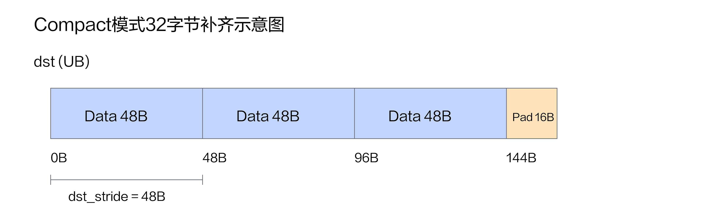
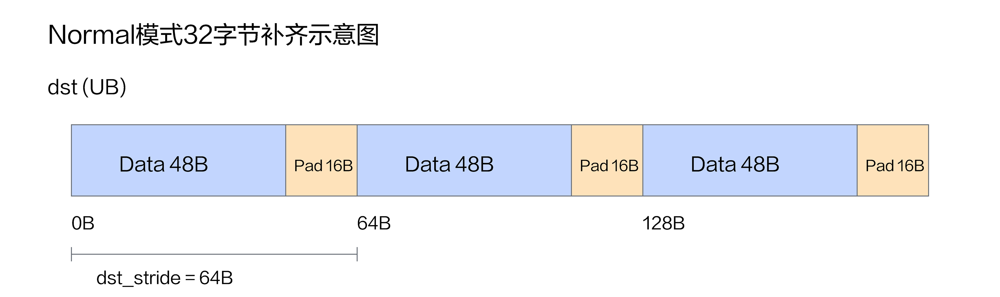
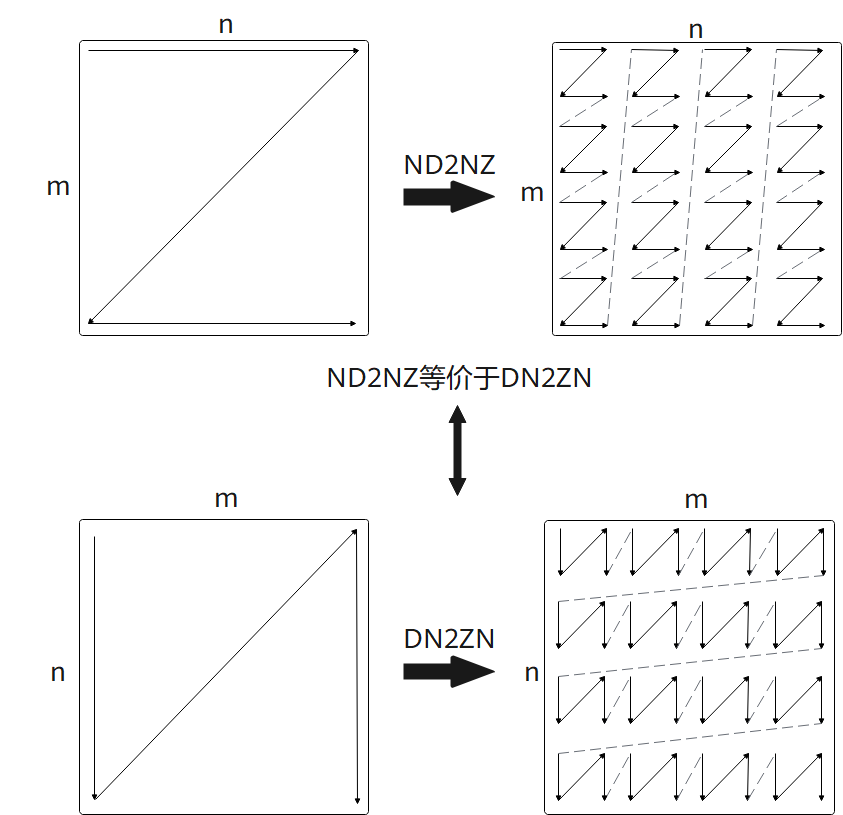
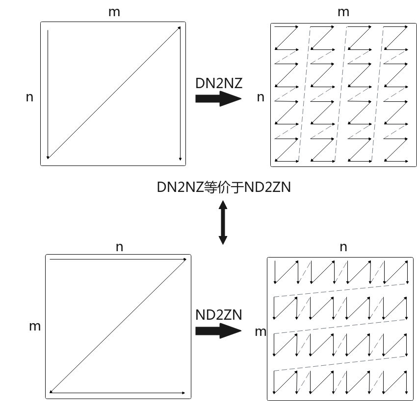
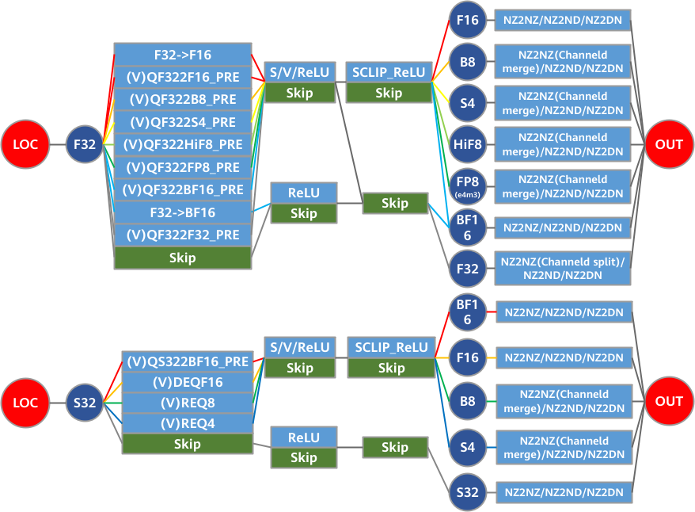

# mem_copy

## 产品支持情况

- Ascend 950PR&950DT系列产品：支持

## 功能说明

将 `src` 描述的数据，按照 `copy_options` 配置的控制项，搬运到 `dst` 指定的存储区域。

## 函数原型

```python
mem_copy(
    dst: Tensor | tuple[Tensor, ...] | list[Tensor],
    src: Tensor | tuple[Tensor, ...] | list[Tensor],
    options: CopyOptions | None = None,
) -> None
```

## 参数说明

| 参数 | 输入/输出 | 说明 |
| --- | --- | --- |
| `dst` | 输入/输出 | 目标 [Tensor](../data-structures/tensor/overview.md)，或非空 `Tensor` tuple/list。<br>调用前须声明目标`Tensor`的布局及访问范围，保证内存足够；本接口不分配或扩容目标。启用原子累加时，会读取目标原值作为累加基数。 |
| `src` | 输入 | 源 `Tensor`，或非空 `Tensor` tuple/list。 <br>调用前须声明源`Tensor`的布局及访问范围，保证内存足够；本接口不分配或扩容目标。|
| `options` | 输入 | 已创建的 `CopyOptions` 对象，默认值为`None`。`CopyOptions`各选项的含义、取值及适用方向见[copy_options](copy-options.md)。 |

## 搬运方向

`mem_copy` 根据源、目标 `Tensor` 的存储位置选择搬运通路，根据逻辑形状确定有效数据范围，根据布局、步长及视图变换确定读写地址和是否需要格式转换。

### GM→UB

支持搬运长度不是 32B 整数倍的数据，并在搬运过程中进行32B 对齐。

该接口支持8位/16位/32位数据类型搬运，支持以下两种数据搬运方式：Normal模式、Compact模式。以 dst `Tensor`的每行有效数据为一个数据块，`make_layout` 的 `stride` 以**元素**为单位。`stride`等于每行有效元素数时，为Compact模式；`stride`大于每行有效元素数且对应字节数对齐 32B 时，为Normal模式。

Compact 将多行有效数据看作一个整体，仅在整体末尾补齐到 32B；Normal 则按行补齐，各行起始位置由目标布局的行步长决定。对齐补齐不会增加 Tensor 的逻辑形状；通过 `Tensor.pad` 增加的左右元素则属于逻辑输出。

#### Compact 模式的填充



左右逻辑填充必须为零，各数据块紧凑排列，仅在整体末尾补齐到 32B。默认采用首元素补齐模式；也可通过 `copy_options` 的 `pad_val` 指定对齐尾部的常量填充值。尾部补齐不会增加 Tensor 的逻辑形状。

#### Normal 模式的填充



没有左右逻辑填充时，各块按目标行步长存放，分别补齐到 32B；默认用该块的首元素补齐，也可指定 `pad_val` 使用常量补齐。

需要左右逻辑填充时，通过源 `Tensor.pad` 指定填充宽度和值，目标逻辑形状须包含新增元素。框架自动设置底层填充值，左右填充和右侧对齐尾部使用同一常量；如果同时配置 `pad_val`，两处填充值和编码必须一致。

普通 DMA 只支持一个连续块轴上的常量填充，每侧填充量不超过 32B；目标行步长必须覆盖左右填充及对齐后的整块范围。具体布局声明与调用写法见后文[调用示例](#调用示例)。

需要多维搬运时，可显式选择 [NDDMA](copy-options.md#nddma)。

<a id="gm-ub-multi-source"></a>

#### 多源搬运

`src` 为 tuple/list 时，按输入顺序将多个 ND GM 视图沿第 0 维拼接，写入一个 ND UB 目标。

- 各源须为同类型、同维数的 ND Tensor，除第 0 维外其余维度长度一致；目标类型须与源一致，逻辑范围须覆盖拼接结果。
- 各源的布局和存储位置共同决定实际搬运区间，各源须为同一底层 GM 存储的 ND Tensor 视图，并按传入顺序组成等间隔访问；不支持将独立分配的多个 GM Buffer 作为一次多源搬运的源。
- 使用普通 DMA，不支持显式选择 `engine`，也不组合填充、分区、原子累加。
- 源、目标布局须满足前述 Compact 或 Normal 搬运条件，并预留实际对齐写入所需的 UB 空间。

完整写法见 [GM→UB 多源搬运示例](#gm-multi-ub-example)。

<a id="gm-ub-multi-destination"></a>

#### 多目标搬运

`dst` 含多个 Tensor 时，将单个 ND GM 源复制到每个 ND UB 目标。

- 所有目标须采用相同的存储位置、数据类型、逻辑布局和物理布局。
- 源与各目标的数据类型须相同，不做随路数据类型转换。
- 各目标须为同一底层存储的 Tensor 视图，并按传入顺序组成等间隔访问；不支持将独立分配的多个 Tensor 作为一次多目标搬运的目标。
- 仅支持默认搬运控制及 `l2_cache_ctl`，不组合填充、分区、原子累加或缩放，不接受 NDDMA。

完整写法见 [GM→UB 多目标搬运示例](#gm-multi-dst-ub-example)。

### GM→L1

底层接口按以下三种布局路径选择。

搬运方式由源 GM 的实际排布和目标 L1 的布局共同决定，源、目标数据类型须相同。普通搬运、ND→NZ 和 DN→NZ 均由 Tensor 描述，无需用 `options` 选择格式转换。

#### 高维切分数据搬运

触发高维切分数据搬运，分为两种情况：

- GM 源和 L1 目标都采用 ND 布局，L1 的默认格式为 NZ，因此需要显式声明 `data_format="nd"`：

```python
# src_nd 已是形状 (M, K)、类型 float16 的 ND GM Tensor。
l1_nd = cb.Buffer(cb.MemLoc.L1, cb.dtypes.float16,
                  cb.make_layout((M, K)), data_format="nd")
cb.mem_copy(l1_nd, src_nd)
```

- GM 源 `Tensor` 已存储为 NZ排布，并且源 `Tensor` 的格式与物理布局也声明为该 NZ 排布，详细使用见后文[GM->L1搬运示例](#gm-l1-copy-example)。

与 [GM→UB](#gmub) 类似，按规则数据块的个数、有效长度以及源、目标步长进行搬运。ND→ND 路径同样支持 Compact 整体补齐和 Normal 逐块补齐。

#### ND→NZ

GM 源采用普通行连续排布，L1 目标声明为 NZ 时，在搬入过程中把矩阵分为小块并按 NZ 顺序存放。逻辑坐标对应的元素值保持不变，改变的是物理存储顺序。二维矩阵通常按 16 行和一个 C0 宽度组成分形；标准 C0 对应 32 字节，其元素个数由数据类型决定。L1 目标须容纳分形对齐后的物理范围。

下图上半部分展示行连续矩阵到 NZ 的分块排布，下半部分展示交换逻辑轴后等价的 DN→ZN 解释。



相关示例见 [ND→NZ 搬运示例](#gm-l1-nd2nz-example)。

#### DN→NZ

DN 表示相对于所讨论的矩阵，行、列的连续方向与 ND 相反。搬入 L1 时，按该轴关系重排为 NZ；等价地，也可将其理解为普通 ND 输入搬入 ZN 布局。目标采用哪一种分形方向，由目标 Tensor 的布局及逻辑轴顺序表达。

框架通过 NZ Tensor 的 `permute(1, 0)` 视图表达 ZN。例如，为逻辑形状 `(M, N)` 的输入准备 ZN 目标时，可先声明逻辑形状为 `(N, M)` 的 NZ L1 Tensor，再对目标调用 `permute(1, 0)`，使其逻辑形状与输入一致。

下图分别展示 DN→NZ 及其等价的 ND→ZN 排布关系。选择这种目标布局会在搬入时执行相应转换，`permute` 视图本身不搬运数据。



相关示例见 [DN→NZ 搬运示例](#gm-l1-dn2nz-example)。

<a id="gm-l1-multi-source"></a>

#### 多源搬运

`src` 为 tuple/list 时，按输入顺序将多个 ND GM 视图沿第 0 维拼接，写入一个 ND 或 NZ L1 目标。

- 各源须为同类型、同维数的 ND Tensor，除第 0 维外其余维度长度一致；源、目标类型须相同。
- 各各源的布局和存储位置共同决定实际搬运区间，各源须为同一底层 GM 存储的 ND Tensor 视图，并按传入顺序组成等间隔访问；不支持将独立分配的多个 GM Buffer 作为一次多源搬运的源。
- 仅使用默认搬运控制或 `copy_options(l2_cache_ctl=...)`，不支持组合填充、分区、原子累加。
- 目标起点须按 32B 对齐；多个数据块写入时，目标块起始间距须按 32B 对齐。

完整写法见 [GM→NZ L1 多源搬运示例](#gm-multi-l1-nz-example)。

<a id="gm-l1-multi-destination"></a>

#### 多目标搬运

`dst` 含多个 Tensor 时，将单个 ND GM 源复制到每个 ND 或 NZ L1 目标。

- 所有目标须采用相同的存储位置、数据类型、逻辑布局和物理布局。
- 源与各目标的数据类型须相同，不做随路数据类型转换。
- 各目标须为同一底层存储的 Tensor 视图，并按传入顺序组成等间隔访问；不支持将独立分配的多个 Tensor 作为一次多目标搬运的目标。
- 源和每个目标须具有相同的二维逻辑形状，最后一维连续。
- 各 L1 目标起始地址等间隔排列，相邻目标起点之间的字节距离须为 32B 的整数倍。
- 仅支持默认搬运控制及 `l2_cache_ctl`，不组合填充、分区、原子累加或缩放。

完整写法见 [NZ L1 多目标搬运示例](#gm-multi-dst-l1-nz-example)。

### UB→GM

与 [GM→UB 的普通 DMA](#gmub) 类似，按连续数据块搬运，块长和块间距由源、目标 Tensor 的形状与步长确定；源、目标数据类型须相同。区别是此处从 UB 读取有效数据并写入 GM，默认覆盖目标原值。

UB 源可以紧凑存放有效数据，也可以在块间保留间隔，应通过源 Tensor 的布局和步长描述实际排布；GM 目标步长独立指定。有效数据长度不要求为 32B 整数倍，但 UB 源须提供对齐读取所需的空间。UB 中用于对齐的尾部数据不写入 GM，GM 目标块间未被本次视图覆盖的数据保持不变。

可通过 `copy_options(atomic_add=True)` 将有效数据原子累加到目标原值，具体要求见 [copy_options 参数说明](copy-options.md#参数说明)。

### UB→UB

在 UB 内将源 Tensor 的有效数据复制到目标 Tensor。源、目标数据类型和存储格式须相同，不支持 ND↔NZ 等分形格式转换、随路数据类型转换或随路转置。

搬运范围和地址由源、目标视图的形状及步长确定。源、目标 `Tensor` 的相邻行之间步长应对齐32B，每行有效数据长度可以不是32B的整数倍。支持每行有效数据之间连续，也支持跨行间隔搬运。

目标须覆盖源视图的有效数据范围，并为实际访问的数据提供足够的存储空间。

### UB→L1

#### 单源搬运

按源 UB 和目标 L1 已声明的排布复制数据，源、目标数据类型须相同。连续存储可整段搬运；有规则间隔的布局按数据块及其间距搬运，起始地址、块长和块间隔须满足 32B 粒度。

- **ND→ND**：源 UB Tensor 和目标 L1 Tensor 均采用 ND。L1 默认格式为 NZ，因此创建 ND L1 目标时须显式指定 `data_format="nd"`。
- **NZ→NZ**：源 UB Tensor 和目标 L1 Tensor 均声明为 NZ，且 UB 中的数据已经按与目标匹配的 NZ 分形顺序存放。本次搬运保持该排布，不执行格式转换。

本通路不支持 **ND→NZ 随路转换**。不能把普通 ND 数据仅通过设置 `data_format="nz"` 当作 NZ 数据搬运：格式声明不会重排已有数据。使用 NZ→NZ 前须先准备真实的 NZ 数据，再以匹配的 NZ Tensor 视图描述该存储。

相关示例见 [单源搬运示例](#ub-l1-copy-example)。

#### 多源搬运

`src` 为 Tuple / List 时，按输入顺序将多个 ND UB 视图写入一个 ND L1 目标 `Tensor`，从而实现沿第 0 维拼接多源矩阵后，再搬运目标矩阵。

 - 起始地址、块长和块间隔须满足 32B 粒度；

 - 各源位于同一存储空间，均为同类型、同维数的 ND Tensor，除第 0 维外其余维度长度一致；

 - 各源的布局和存储位置共同决定实际搬运区间，各源须为同一底层 UB 存储的 ND Tensor 视图，并按传入顺序组成等间隔访问；不支持将独立分配的多个 UB Buffer 作为一次多源搬运的源。

 - 连续搬运区间作为“数据块”，数据块个数范围为 [1, 4095]；每个数据块长度范围为 [1, 65535]，单位：32B；源块间空隙范围为 [0, 65535]，单位：32B；目标块间空隙范围为 [0, 65535]，单位：32B。编译期检查参数合法性，超过范围时编译报错；运行期参数超出范围时，会触发截断，引起未定义行为。

相关示例见 [UB→L1 多源搬运示例](#ub-l1-multi-source-example)。

### L1→L0A/L0B

负责完成矩阵计算所需的2D格式数据的搬运，搬运粒度为大小为512字节的数据分形，支持非转置与转置矩阵从L1 Buffer到L0B buffer的数据搬运。源、目标数据类型须一致。L1 源起点须按 32B 对齐，L0A/L0B 目标起点须按 512B 对齐。对于不同的数据类型，对应的分形矩阵如下：

 - 对于b4数据类型，每个数据分形在L0B Buffer中为一个64x16的矩阵;
 - 对于b8数据类型，每个数据分形在L0B Buffer中为一个32×16的矩阵;
 - 对于b16数据类型，每个数据分形为一个16×16的矩阵;
 - 对于b32数据类型，每个数据分形在L0B Buffer中为一个8×16的矩阵。

`src.permute(1, 0)` 使能 `mem_copy` 在将 L1 中的 Tensor 搬运到 L0 时进行矩阵转置。

以计算 $C = A \times B$ 为例，$A$ 的形状为 `(M, K)`，$B$ 为 `(K, N)`。本框架的 L0A 操作数按 `(M, K)` 描述，L0B 操作数按 `(N, K)` 描述：

| 输入数据及 L1 源视图 | L0 目标 | 调用方式 |
| --- | --- | --- |
| L1 中存放 A，逻辑形状 `(M, K)` | L0A `(M, K)` | `mem_copy(l0a, l1_a)` |
| L1 中存放 Aᵀ，逻辑形状 `(K, M)` | L0A `(M, K)` | `mem_copy(l0a, l1_at.permute(1, 0))` |
| L1 中存放 B，逻辑形状 `(K, N)` | L0B `(N, K)` | `mem_copy(l0b, l1_b.permute(1, 0))` |
| L1 中存放 Bᵀ，逻辑形状 `(N, K)` | L0B `(N, K)` | `mem_copy(l0b, l1_bt)` |

相关示例见 [L1→L0A/L0B 转置加载与矩阵乘示例](#l1-l0-transpose-matmul-example)。加载 MX 矩阵时可组合 `copy_options(mx_scale=...)`，详见 [MX 量化矩阵](copy-options.md#mx-量化矩阵)。

### L1→BIAS

将 L1 中的一维偏置向量加载到 BIAS（BiasTable Buffer），供 Mmad 计算作为偏置输入使用。

仅支持连续一维源、目标视图，不支持通过行间隔拼接多个偏置块。L1 源起始地址须按 32B 对齐，BIAS 目标起始地址须按 64B 对齐。支持 L1 源数据类型为 `float16`、`bfloat16`、`float32` 或 `int32`。其中，`float16`、`bfloat16` 在搬运时随路转换为 `float32`；`float32` 和 `int32` 保持数据类型与数值不变。不支持其他源、目标类型组合。搬运的有效元素个数由源视图决定，目标逻辑长度须由用户保证空间足够。

搬运包含对齐后的完整数据块：

- `float16`、`bfloat16` 源：按 16 个元素向上补齐读取范围，即 32B 的整数倍；转换后的目标占用为 64B 的整数倍。
- `float32`、`int32` 源：按 16 个元素向上补齐读取范围，即 64B 的整数倍；目标占用相同。

有效元素之外的对齐空间必须真实存在，不能仅声明一个较大的逻辑视图；参与后续计算的填充元素还须具有正确的值。BIAS 总容量为 4096B，目标起始偏移与本次对齐后写入大小之和不得超过该容量，也不得超过实际分配范围。

相关示例见 [转置加载与带偏置矩阵乘示例](#l1-l0-transpose-matmul-example)。

### L1→UB

将 L1 中的数据复制到指定 AIV 的 UB，不支持分型转换、数据类型转换或矩阵转置。

从源视图起始地址连续读取，搬运字节数由**目标视图的物理跨度**确定，只生成一个连续数据块。物理跨度是视图起点到其最后一个物理元素末尾的地址范围，包括布局中的间隔和填充，不一定等于逻辑元素个数乘以元素字节数。本通路不会按逻辑行逐行跳过空隙，也不会因 UB 声明为 ND 而将 NZ 数据还原为 ND。

源、目标数据类型须相同。两端起始地址均须按 32B 对齐；目标物理跨度范围是 [1, 65535]，单位为 32B。源、目标实际分配的存储空间也须覆盖本次连续访问的全部字节。

默认写入 AIV0 的 UB，可通过 `copy_options(dst_subblock=0/1)` 选择目标V核。配置要求见 [单目标与双目标搬运](copy-options.md#单目标与双目标搬运)及 [copy_options 约束说明](copy-options.md#约束说明)。

### L0C→GM/UB/L1

将 L0C 中的矩阵计算结果搬出到 GM、UB 或 L1。搬运过程中可同步支持随路量化、随路激活、随路格式转换（Nz2ND/Nz2DN）等能力组合。

完整写法见 [L0C→UB 搬运示例](#l0c-ub-example)。

#### L0C→GM

支持写入 ND 或 NZ 目标，底层随路功能组合如下图。



目标须声明与输出数据类型及通道拆分方式匹配的布局。写入 GM 可组合原子累加或 [L2 Cache 策略](copy-options.md#l2-cache-策略)。

#### L0C→UB

支持写入 ND 或 NZ 目标，底层随路功能组合如下图；NZ 目标的框架限制见图后说明。


ND 目标矩阵，可组合受支持的类型转换、量化和 ReLU。

NZ 目标仅支持 `float32`→`float32`，不能组合随路量化 或 ReLU。默认写入 AIV0，可选择目标V核或使用双目标模式；双目标不能组合 ReLU 或通道拆分重排，见 [单目标与双目标搬运](copy-options.md#单目标与双目标搬运)。

#### L0C→L1

当前框架仅支持 NZ 目标，底层随路功能组合如下图。


框架当前要求源、目标具有明确的 NZ 分形排布，不支持 ND L1 目标。

需要量化系数时使用 `src.convert(dtype, scale=...)`，ReLU 使用 `src.relu()`；搬出控制项见 [copy_options](copy-options.md#参数说明)。

## 返回值说明

返回 `None`，包括目标为 tuple/list 的情况。搬运不修改已有 Tensor 的形状或布局；后续继续使用事先声明的目标 Tensor，需要访问局部结果时显式取得相应视图。

## 约束说明

- 不支持直接 GM→GM 搬运；需要经受支持的片上存储中转。
- 对同一存储区域，写入完成后才能读取；读取完成前不得覆盖或释放。跨流水或跨核访问须按数据依赖同步。

## 调用示例

以下 Kernel 接收两个形状均为 `(16,)`、类型均为 `float32` 的 GM Tensor，经 UB 将 `src` 复制到 `dst`。

```python
# Copyright (c) 2026 Huawei Technologies Co., Ltd.
# Licensed under the CANN Open Software License Agreement Version 2.0.
import cannbotdsl as cb
import torch
import torch_npu


@cb.kernel
def copy_kernel(src: cb.Tensor, dst: cb.Tensor):
    slots = cb.RingBuffer(
        cb.MemLoc.UB, cb.dtypes.float32, cb.make_layout((16,)), depth=1
    )
    cb.mem_copy(slots.next_write(), src)
    cb.mem_copy(dst, slots.next_read())


@cb.host
def copy(src: cb.Tensor, dst: cb.Tensor):
    copy_kernel[1](src, dst)


def main():
    src = torch.arange(16, dtype=torch.float32).to("npu:0")
    dst = torch.empty_like(src)
    copy(src, dst)
    torch.npu.synchronize()
    torch.testing.assert_close(dst.cpu(), src.cpu(), rtol=0, atol=0)
    print("mem_copy example passed")


if __name__ == "__main__":
    main()
```

预期结果：目标与源逐元素一致，校验通过后输出 `mem_copy example passed`。

### GM→UB 搬运示例

使用 `(3, 5)` 的 `float16` 输入，演示 Compact、Normal 模式及常量填充，并校验有效输出。Compact 行步长为 5，Normal 行步长为 16；左右填充使用 `Tensor.pad`。

```python
import cannbotdsl as cb
import torch
import torch_npu

def run(case):
    padded = case == "normal_pad"
    compact = case.startswith("compact")
    shape = (3, 8) if padded else (3, 5)
    @cb.kernel
    def kernel(src: cb.Tensor, dst: cb.Tensor):
        if cb.const_expr(compact):
            ub = cb.Buffer(cb.MemLoc.UB, cb.dtypes.float16, cb.make_layout(shape))
        else:
            ub = cb.Buffer(cb.MemLoc.UB, cb.dtypes.float16,
                cb.make_layout(shape, stride=(16, 1)),
                physical_layout=cb.make_layout((3, 16), stride=(16, 1)))
        if cb.const_expr(padded):
            cb.mem_copy(ub, src.pad((2, 1), value=-7))
        elif cb.const_expr(case.endswith("const")):
            cb.mem_copy(ub, src, options=cb.copy_options(pad_val=-7))
        else:
            cb.mem_copy(ub, src)
        cb.mem_copy(dst, ub)
    @cb.host
    def launch(src: cb.Tensor, dst: cb.Tensor):
        kernel[1](src, dst)
    x = torch.arange(15, dtype=torch.float16).reshape(3, 5)
    out = torch.empty(shape, dtype=torch.float16, device="npu:0")
    launch(x.to("npu:0"), out)
    torch.npu.synchronize()
    expected = torch.nn.functional.pad(x, (2, 1), value=-7) if padded else x
    torch.testing.assert_close(out.cpu(), expected, rtol=0, atol=0)
    print(case, "passed")

if __name__ == "__main__":
    for case in ("compact_first", "compact_const", "normal_first", "normal_const", "normal_pad"):
        run(case)
```

预期结果：五个用例分别输出对应的 `passed`，有效数据与参考结果一致。

<a id="gm-multi-ub-example"></a>

#### 多源搬运

从同一 GM Tensor 中选取第 0～7 行和第 16～23 行，按顺序拼接搬入目标，并写回校验。

```python
# Copyright (c) 2026 Huawei Technologies Co., Ltd.
# Licensed under the CANN Open Software License Agreement Version 2.0.
import cannbotdsl as cb
import torch
import torch_npu

@cb.kernel
def copy_kernel(src: cb.Tensor, out: cb.Tensor):
    ub = cb.Buffer(cb.MemLoc.UB, cb.dtypes.float16, cb.make_layout((16, 32)))
    first = src[0:8, 0:32]
    second = src[16:24, 0:32]
    cb.mem_copy(ub, (first, second))
    if cb.get_subblock_id() == 0:
        cb.mem_copy(out, ub)

@cb.host
def launch(src: cb.Tensor, out: cb.Tensor):
    copy_kernel[1](src, out)

def main():
    x = torch.arange(32 * 32, dtype=torch.float16).reshape(32, 32)
    src = x.to("npu:0")
    out = torch.empty((16, 32), dtype=torch.float16, device="npu:0")
    launch(src, out)
    torch.npu.synchronize()
    reference = torch.cat((x[0:8], x[16:24]), dim=0)
    torch.testing.assert_close(out.cpu(), reference, rtol=0, atol=0)
    print("multi-source GM->ub passed")

if __name__ == "__main__":
    main()
```

预期结果：校验通过，输出 `multi-source GM->ub passed`。

<a id="gm-multi-dst-ub-example"></a>

#### 多目标搬运

将同一个 `(16, 32)` GM 矩阵复制到同一底层存储的两个目标视图，分别写回并校验。

```python
# Copyright (c) 2026 Huawei Technologies Co., Ltd.
# Licensed under the CANN Open Software License Agreement Version 2.0.
import cannbotdsl as cb
import torch
import torch_npu

@cb.kernel
def copy_kernel(src: cb.Tensor, out0: cb.Tensor, out1: cb.Tensor):
    storage = cb.Buffer(cb.MemLoc.UB, cb.dtypes.float16,
                        cb.make_layout((32, 32)), data_format="nd")
    dst0 = storage[0:16, 0:32]
    dst1 = storage[16:32, 0:32]
    cb.mem_copy((dst0, dst1), src)
    cb.mem_copy(out0, dst0)
    cb.mem_copy(out1, dst1)

@cb.host
def launch(src: cb.Tensor, out0: cb.Tensor, out1: cb.Tensor):
    copy_kernel[1](src, out0, out1)

def main():
    x = torch.arange(512, dtype=torch.float16).reshape(16, 32)
    src = x.to("npu:0")
    out0 = torch.empty_like(src)
    out1 = torch.empty_like(src)
    launch(src, out0, out1)
    torch.npu.synchronize()
    reference = x
    torch.testing.assert_close(out0.cpu(), reference, rtol=0, atol=0)
    torch.testing.assert_close(out1.cpu(), reference, rtol=0, atol=0)
    print("multi-destination GM->ub passed")

if __name__ == "__main__":
    main()
```

预期结果：两个目标均校验通过，输出 `multi-destination GM->ub passed`。

<a id="gm-l1-copy-example"></a>

### GM->L1搬运示例

<a id="gm-l1-2d-copy-example"></a>

#### 高维切分数据搬运

先在 Host 将矩阵重排为 NZ，再按 NZ→NZ 搬入 L1，写回后校验原始排布。

```python
import cannbotdsl as cb
from cannbotdsl.tensor import make_pointer
import torch
import torch_npu

M = K = 32

@cb.kernel
def kernel(src_addr: cb.dtypes.uint64, out: cb.Tensor):
    src_nz = cb.make_tensor(make_pointer(cb.dtypes.float16, src_addr, cb.MemLoc.GM),
                            cb.make_layout((M, K)), data_format="nz")
    l1 = cb.Buffer(cb.MemLoc.L1, cb.dtypes.float16,
                   cb.make_layout((M, K)), data_format="nz")
    ub = cb.Buffer(cb.MemLoc.UB, cb.dtypes.float16, cb.make_layout((M, K)))
    cb.mem_copy(l1, src_nz)
    cb.mem_copy(ub, l1)
    if cb.get_subblock_id() == 0:
        cb.mem_copy(out, ub)

@cb.host
def launch(src_addr: cb.dtypes.uint64, out: cb.Tensor):
    kernel[1](src_addr, out)

def main():
    x = torch.arange(M * K, dtype=torch.float16).reshape(M, K)
    # ND (M1,M0,K1,K0) -> NZ (K1,M1,M0,K0), C0=16 for float16.
    packed = x.reshape(M // 16, 16, K // 16, 16).permute(2, 0, 1, 3).contiguous().flatten()
    src = packed.to("npu:0")
    out = torch.empty((M, K), dtype=torch.float16, device="npu:0")
    launch(src.data_ptr(), out)
    torch.npu.synchronize()
    torch.testing.assert_close(out.cpu().flatten(), packed, rtol=0, atol=0)
    restored = out.cpu().reshape(K // 16, M // 16, 16, 16).permute(1, 2, 0, 3).reshape(M, K)
    torch.testing.assert_close(restored, x, rtol=0, atol=0)
    print("NZ GM->L1 copy passed")

if __name__ == "__main__":
    main()
```

预期结果：NZ 原始数据及还原后的矩阵均校验通过，输出 `NZ GM->L1 copy passed`。

<a id="gm-l1-nd2nz-example"></a>

#### ND→NZ 搬运

将 `(32, 48)` 的 ND GM 矩阵搬入 NZ L1，再写回原始物理数据并校验 NZ 排布。

```python
# Copyright (c) 2026 Huawei Technologies Co., Ltd.
# Licensed under the CANN Open Software License Agreement Version 2.0.
import cannbotdsl as cb
import torch
import torch_npu


@cb.kernel
def copy_kernel(src: cb.Tensor, out: cb.Tensor):
    l1 = cb.Buffer(cb.MemLoc.L1, cb.dtypes.float16,
                   cb.make_layout((32, 48)), data_format="nz")
    ub = cb.Buffer(cb.MemLoc.UB, cb.dtypes.float16, cb.make_layout((32, 48)))
    cb.mem_copy(l1, src)
    # L1 -> UB copies physical bytes for host-side layout verification.
    cb.mem_copy(ub, l1)
    if cb.get_subblock_id() == 0:
        cb.mem_copy(out, ub)


@cb.host
def launch(src: cb.Tensor, out: cb.Tensor):
    copy_kernel[1](src, out)


def pack_nz(x):
    m, n = x.shape
    return x.reshape(m // 16, 16, n // 16, 16).permute(2, 0, 1, 3).contiguous().flatten()


def main():
    x = torch.arange(32 * 48, dtype=torch.float16).reshape(32, 48)
    src = x.to("npu:0")
    out = torch.empty((32, 48), dtype=torch.float16, device="npu:0")
    launch(src, out)
    torch.npu.synchronize()
    torch.testing.assert_close(out.cpu().flatten(), pack_nz(x), rtol=0, atol=0)
    print("ND->NZ example passed")


if __name__ == "__main__":
    main()
```

预期结果：物理排布校验通过，输出 `ND->NZ example passed`。

<a id="gm-l1-dn2nz-example"></a>

#### DN→NZ 搬运

采用等价的 ND→ZN 写法：对 `(48, 32)` 的 NZ L1 目标调用 `permute(1, 0)`，接收 `(32, 48)` 的 ND GM 输入，写回后校验物理排布。

```python
# Copyright (c) 2026 Huawei Technologies Co., Ltd.
# Licensed under the CANN Open Software License Agreement Version 2.0.
import cannbotdsl as cb
import torch
import torch_npu


@cb.kernel
def copy_kernel(src: cb.Tensor, out: cb.Tensor):
    l1 = cb.Buffer(cb.MemLoc.L1, cb.dtypes.float16,
                   cb.make_layout((48, 32)), data_format="nz")
    ub = cb.Buffer(cb.MemLoc.UB, cb.dtypes.float16, cb.make_layout((48, 32)))
    cb.mem_copy(l1.permute(1, 0), src)
    # L1 -> UB copies physical bytes for host-side layout verification.
    cb.mem_copy(ub, l1)
    if cb.get_subblock_id() == 0:
        cb.mem_copy(out, ub)


@cb.host
def launch(src: cb.Tensor, out: cb.Tensor):
    copy_kernel[1](src, out)


def pack_nz(x):
    m, n = x.shape
    return x.reshape(m // 16, 16, n // 16, 16).permute(2, 0, 1, 3).contiguous().flatten()


def main():
    x = torch.arange(32 * 48, dtype=torch.float16).reshape(32, 48)
    src = x.to("npu:0")
    out = torch.empty((48, 32), dtype=torch.float16, device="npu:0")
    launch(src, out)
    torch.npu.synchronize()
    torch.testing.assert_close(out.cpu().flatten(), pack_nz(x.t().contiguous()), rtol=0, atol=0)
    print("DN->NZ example passed")


if __name__ == "__main__":
    main()
```

预期结果：物理排布校验通过，输出 `DN->NZ example passed`。

<a id="gm-multi-l1-nz-example"></a>

#### 多源搬运（NZ 目标）

从同一 GM Tensor 中选取第 0～7 行和第 16～23 行，按顺序拼接搬入目标，并写回校验。L1 目标为 NZ，写回后校验原始 NZ 排布。

```python
# Copyright (c) 2026 Huawei Technologies Co., Ltd.
# Licensed under the CANN Open Software License Agreement Version 2.0.
import cannbotdsl as cb
import torch
import torch_npu

@cb.kernel
def copy_kernel(src: cb.Tensor, out: cb.Tensor):
    ub = cb.Buffer(cb.MemLoc.UB, cb.dtypes.float16, cb.make_layout((16, 32)))
    l1 = cb.Buffer(cb.MemLoc.L1, cb.dtypes.float16, cb.make_layout((16, 32)), data_format="nz")
    first = src[0:8, 0:32]
    second = src[16:24, 0:32]
    cb.mem_copy(l1, (first, second))
    cb.mem_copy(ub, l1)
    if cb.get_subblock_id() == 0:
        cb.mem_copy(out, ub)

@cb.host
def launch(src: cb.Tensor, out: cb.Tensor):
    copy_kernel[1](src, out)

def main():
    x = torch.arange(32 * 32, dtype=torch.float16).reshape(32, 32)
    src = x.to("npu:0")
    out = torch.empty((16, 32), dtype=torch.float16, device="npu:0")
    launch(src, out)
    torch.npu.synchronize()
    reference = torch.cat((x[0:8], x[16:24]), dim=0)
    reference = reference.reshape(1, 16, 2, 16).permute(2, 0, 1, 3).contiguous().reshape(16, 32)
    torch.testing.assert_close(out.cpu(), reference, rtol=0, atol=0)
    print("multi-source GM->l1_nz passed")

if __name__ == "__main__":
    main()
```

预期结果：校验通过，输出 `multi-source GM->l1_nz passed`。

<a id="gm-multi-dst-l1-nz-example"></a>

#### 多目标搬运（NZ 目标）

将同一个 `(16, 32)` GM 矩阵复制到同一底层存储的两个目标视图，分别写回并校验。NZ 目标通过 `from_tensor` 声明，`offset` 以字节为单位；写回结果按原始 NZ 排布校验。

```python
# Copyright (c) 2026 Huawei Technologies Co., Ltd.
# Licensed under the CANN Open Software License Agreement Version 2.0.
import cannbotdsl as cb
import torch
import torch_npu

@cb.kernel
def copy_kernel(src: cb.Tensor, out0: cb.Tensor, out1: cb.Tensor):
    storage = cb.Buffer(cb.MemLoc.L1, cb.dtypes.float16,
                        cb.make_layout((32, 32)), data_format="nz")
    layout = cb.make_layout((16, 32))
    physical = cb.make_layout((2, 1, 16, 16))
    dst0 = cb.from_tensor(storage, layout=layout, physical_layout=physical,
                          data_format="nz")
    dst1 = cb.from_tensor(storage, layout=layout, physical_layout=physical,
                          offset=1024, data_format="nz")
    cb.mem_copy((dst0, dst1), src)
    ub0 = cb.Buffer(cb.MemLoc.UB, cb.dtypes.float16, cb.make_layout((16, 32)))
    ub1 = cb.Buffer(cb.MemLoc.UB, cb.dtypes.float16, cb.make_layout((16, 32)))
    cb.mem_copy(ub0, dst0)
    cb.mem_copy(ub1, dst1)
    if cb.get_subblock_id() == 0:
        cb.mem_copy(out0, ub0)
        cb.mem_copy(out1, ub1)

@cb.host
def launch(src: cb.Tensor, out0: cb.Tensor, out1: cb.Tensor):
    copy_kernel[1](src, out0, out1)

def main():
    x = torch.arange(512, dtype=torch.float16).reshape(16, 32)
    src = x.to("npu:0")
    out0 = torch.empty_like(src)
    out1 = torch.empty_like(src)
    launch(src, out0, out1)
    torch.npu.synchronize()
    reference = x
    reference = x.reshape(1, 16, 2, 16).permute(2, 0, 1, 3).contiguous().reshape(16, 32)
    torch.testing.assert_close(out0.cpu(), reference, rtol=0, atol=0)
    torch.testing.assert_close(out1.cpu(), reference, rtol=0, atol=0)
    print("multi-destination GM->l1_nz passed")

if __name__ == "__main__":
    main()
```

预期结果：两个目标均校验通过，输出 `multi-destination GM->l1_nz passed`。

### UB→L1 搬运示例

<a id="ub-l1-copy-example"></a>

#### 单源搬运

将 `(16, 16)` 的 `float16` 数据经 UB 搬入 L1，再写回校验。L1 目标显式设置 `data_format="nd"`，执行 ND→ND 搬运。

```python
# Copyright (c) 2026 Huawei Technologies Co., Ltd.
# Licensed under the CANN Open Software License Agreement Version 2.0.
import cannbotdsl as cb
import torch
import torch_npu


@cb.kernel
def copy_kernel(src: cb.Tensor, out: cb.Tensor):
    shape = (16, 16)
    ub_src = cb.Buffer(cb.MemLoc.UB, cb.dtypes.float16, cb.make_layout(shape))
    l1 = cb.Buffer(cb.MemLoc.L1, cb.dtypes.float16,
                   cb.make_layout(shape), data_format="nd")
    ub_out = cb.Buffer(cb.MemLoc.UB, cb.dtypes.float16, cb.make_layout(shape))
    cb.mem_copy(ub_src, src)
    cb.mem_copy(l1, ub_src)
    cb.mem_copy(ub_out, l1)
    if cb.get_subblock_id() == 0:
        cb.mem_copy(out, ub_out)


@cb.host
def launch(src: cb.Tensor, out: cb.Tensor):
    copy_kernel[1](src, out)


def main():
    expected = torch.arange(256, dtype=torch.float16).reshape(16, 16)
    src = expected.to("npu:0")
    out = torch.empty_like(src)
    launch(src, out)
    torch.npu.synchronize()
    torch.testing.assert_close(out.cpu(), expected, rtol=0, atol=0)
    print("UB->L1 example passed")


if __name__ == "__main__":
    main()
```

预期结果：输出与输入逐元素一致，校验通过后输出 `UB->L1 example passed`。

<a id="ub-l1-multi-source-example"></a>

#### 多源搬运

从同一 ND UB 中选取第 0～7 行和第 16～23 行，依次写入 `(16, 32)` 的 ND L1，再写回校验拼接结果。

```python
# Copyright (c) 2026 Huawei Technologies Co., Ltd.
# Licensed under the CANN Open Software License Agreement Version 2.0.
import cannbotdsl as cb
import torch
import torch_npu


@cb.kernel
def copy_kernel(src: cb.Tensor, out: cb.Tensor):
    shape = (32, 32)
    ub_src = cb.Buffer(cb.MemLoc.UB, cb.dtypes.float16, cb.make_layout(shape))
    l1 = cb.Buffer(cb.MemLoc.L1, cb.dtypes.float16,
                   cb.make_layout((16, 32)), data_format="nd")
    ub_out = cb.Buffer(cb.MemLoc.UB, cb.dtypes.float16, cb.make_layout((16, 32)))
    cb.mem_copy(ub_src, src)
    # Two ND views share one UB allocation and have equal start intervals.
    first = ub_src[0:8, 0:32]
    second = ub_src[16:24, 0:32]
    cb.mem_copy(l1, (first, second))
    cb.mem_copy(ub_out, l1)
    if cb.get_subblock_id() == 0:
        cb.mem_copy(out, ub_out)


@cb.host
def launch(src: cb.Tensor, out: cb.Tensor):
    copy_kernel[1](src, out)


def main():
    expected = torch.arange(1024, dtype=torch.float16).reshape(32, 32)
    src = expected.to("npu:0")
    out = torch.empty((16, 32), dtype=torch.float16, device="npu:0")
    launch(src, out)
    torch.npu.synchronize()
    reference = torch.cat((expected[0:8], expected[16:24]), dim=0)
    torch.testing.assert_close(out.cpu(), reference, rtol=0, atol=0)
    print("multi-source UB->L1 example passed")


if __name__ == "__main__":
    main()
```

预期结果：输出前 8 行等于输入第 0～7 行，后 8 行等于输入第 16～23 行，校验通过后输出 `multi-source UB->L1 example passed`。

<a id="l1-l0-transpose-matmul-example"></a>

### L1→L0A/L0B 转置加载与矩阵乘示例

演示 L1→L0A/L0B 转置加载和 L1→BIAS 偏置加载，再执行带偏置的矩阵乘。结果与 Host 的 `a_t.T @ b + bias` 比较；`float16` 偏置在加载到 BIAS 时转换为 `float32`。

```python
# Copyright (c) 2026 Huawei Technologies Co., Ltd.
# Licensed under the CANN Open Software License Agreement Version 2.0.
import cannbotdsl as cb
import torch
import torch_npu

M, K, N = 32, 64, 48

@cb.kernel
def transpose_matmul_kernel(a_t: cb.Tensor, b: cb.Tensor, bias: cb.Tensor, out: cb.Tensor):
    l1_a = cb.Buffer(cb.MemLoc.L1, cb.dtypes.float16, cb.make_layout((K, M)))
    l1_b = cb.Buffer(cb.MemLoc.L1, cb.dtypes.float16, cb.make_layout((K, N)))
    l0a = cb.Buffer(cb.MemLoc.L0A, cb.dtypes.float16, cb.make_layout((M, K)))
    l0b = cb.Buffer(cb.MemLoc.L0B, cb.dtypes.float16, cb.make_layout((N, K)))
    l0c = cb.Buffer(cb.MemLoc.L0C, cb.dtypes.float32, cb.make_layout((M, N)))
    l1_bias = cb.Buffer(cb.MemLoc.L1, cb.dtypes.float16, cb.make_layout((N,)), data_format="nd")
    bias_table = cb.Buffer(cb.MemLoc.BIAS, cb.dtypes.float32, cb.make_layout((N,)))
    cb.mem_copy(l1_bias, bias)
    cb.mem_copy(bias_table, l1_bias)
    cb.mem_copy(l1_a, a_t)
    cb.mem_copy(l1_b, b)
    cb.mem_copy(l0a, l1_a.permute(1, 0))
    cb.mem_copy(l0b, l1_b.permute(1, 0))
    cb.matmul(l0c, l0a, l0b, bias=bias_table, init=True)
    cb.mem_copy(out, l0c)

@cb.host
def launch(a_t: cb.Tensor, b: cb.Tensor, bias: cb.Tensor, out: cb.Tensor):
    transpose_matmul_kernel[1](a_t, b, bias, out)

def main():
    a_t_cpu = ((torch.arange(K * M).reshape(K, M) % 7) - 3).to(torch.float16)
    b_cpu = ((torch.arange(K * N).reshape(K, N) % 5) - 2).to(torch.float16)
    a_t, b = a_t_cpu.to("npu:0"), b_cpu.to("npu:0")
    out = torch.empty((M, N), dtype=torch.float32, device="npu:0")
    bias_cpu = (torch.arange(N) % 11 - 5).to(torch.float16)
    bias = bias_cpu.to("npu:0")
    launch(a_t, b, bias, out)
    torch.npu.synchronize()
    reference = a_t_cpu.float().t() @ b_cpu.float() + bias_cpu.float()
    torch.testing.assert_close(out.cpu(), reference, rtol=0, atol=0)
    print("L1->L0A/L0B transpose matmul with bias passed")

if __name__ == "__main__":
    main()
```

预期结果：输出与 `a_t_cpu.float().t() @ b_cpu.float() + bias_cpu.float()` 完全一致，校验通过后输出 `L1->L0A/L0B transpose matmul with bias passed`。

<a id="l0c-ub-example"></a>

### L0C→UB 搬运示例

将矩阵乘结果从 L0C 搬入 ND UB，再写回 GM，与 Host 参考结果比较。

```python
# Copyright (c) 2026 Huawei Technologies Co., Ltd.
# Licensed under the CANN Open Software License Agreement Version 2.0.
import cannbotdsl as cb
import torch
import torch_npu

M = K = N = 32

@cb.kernel
def store_kernel(a: cb.Tensor, b: cb.Tensor, out: cb.Tensor):
    l1_a = cb.Buffer(cb.MemLoc.L1, cb.dtypes.float16, cb.make_layout((M, K)))
    l1_b = cb.Buffer(cb.MemLoc.L1, cb.dtypes.float16, cb.make_layout((N, K)))
    l0a = cb.Buffer(cb.MemLoc.L0A, cb.dtypes.float16, cb.make_layout((M, K)))
    l0b = cb.Buffer(cb.MemLoc.L0B, cb.dtypes.float16, cb.make_layout((N, K)))
    l0c = cb.Buffer(cb.MemLoc.L0C, cb.dtypes.float32, cb.make_layout((M, N)))
    ub = cb.Buffer(cb.MemLoc.UB, cb.dtypes.float32, cb.make_layout((M, N)))
    cb.mem_copy(l1_a, a)
    cb.mem_copy(l1_b, b)
    cb.mem_copy(l0a, l1_a)
    cb.mem_copy(l0b, l1_b)
    cb.matmul(l0c, l0a, l0b, init=True)
    cb.mem_copy(ub, l0c)
    if cb.get_subblock_id() == 0:
        cb.mem_copy(out, ub)

@cb.host
def launch(a: cb.Tensor, b: cb.Tensor, out: cb.Tensor):
    store_kernel[1](a, b, out)

def main():
    a_cpu = (torch.arange(M * K).reshape(M, K) % 7 - 3).to(torch.float16)
    b_cpu = (torch.arange(N * K).reshape(N, K) % 5 - 2).to(torch.float16)
    a, b = a_cpu.to("npu:0"), b_cpu.to("npu:0")
    out = torch.empty((M, N), dtype=torch.float32, device="npu:0")
    launch(a, b, out)
    torch.npu.synchronize()
    reference = a_cpu.float() @ b_cpu.float().t()
    torch.testing.assert_close(out.cpu(), reference, rtol=0, atol=0)
    print("L0C->UB example passed")

if __name__ == "__main__":
    main()
```

预期结果：校验通过，输出 `L0C->UB example passed`。
