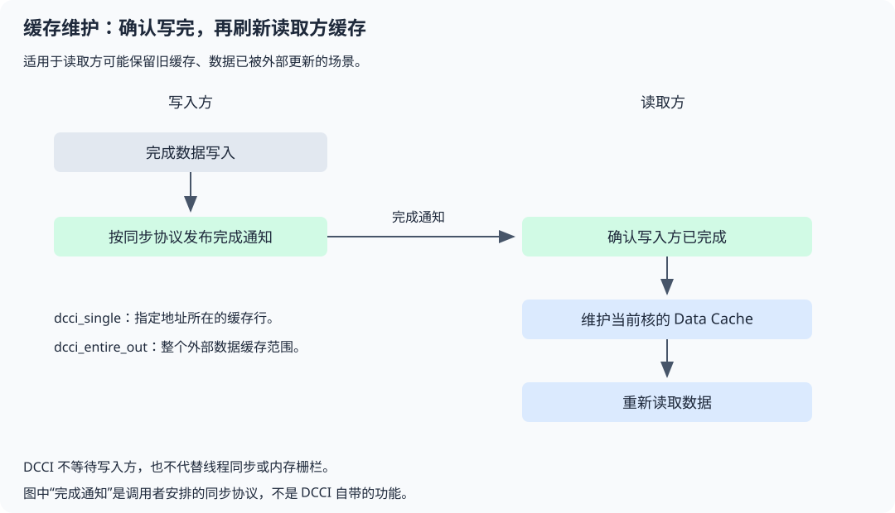

# simt.dcci_single

## 产品支持情况

- Ascend 950PR&950DT系列产品：支持

## 功能说明

维护point所在的一条Data Cache缓存行，使后续读取能够获取GM中被外部更新的数据；粒度是缓存行。



先通过同步协议确认外部更新已完成，再维护读取方缓存并读取。下面的调用示例只演示接口用法，不包含跨核通知流程。

## 函数原型

```python
simt.dcci_single(point) -> None
```

## 参数说明

| 参数 | 输入/输出 | 说明 |
| --- | --- | --- |
| point | 输入 | 由`tensor.ptr(...)`获取的GM有类型指针；本接口按地址维护缓存行，不读取或转换该指针指向的元素，不要求特定元素dtype。 |

## 返回值说明

无

## 约束说明

- point必须为GM指针，UB和通用指针会被拒绝；操作不遍历整个Tensor，多条缓存行应逐行覆盖或采用全范围接口。
- DCCI处理缓存一致性，不是线程屏障，也不代替内存栅栏或原子操作。外部写入方必须先按同步协议完成更新，再由读取方维护缓存并读取；不能仅刷新缓存就假定其他线程已完成。
- 缓存维护作用于当前核，不负责其他核的脏数据写回。

## 调用示例

维护指定地址所在的缓存行，再读取并打印该地址的数据。

```python
import torch
import torch_npu
from cannbotdsl import simt, dtypes, dim3
from cannbotdsl.lang.host import host
from cannbotdsl.lang.kernel import kernel
from cannbotdsl.lang.vf import vf
from cannbotdsl.tensor import Tensor


@kernel
def demo(src: Tensor, dst: Tensor):
    with vf(mode='simt'):
        simt.dcci_single(src.ptr(0))
        dst[0] = src[0]


@host
def run(src, dst):
    demo[dim3(1), dim3(1)](src, dst)


def main():
    src = torch.tensor([17], device='npu', dtype=torch.int32)
    dst = torch.zeros(1, device='npu', dtype=torch.int32)
    run(src, dst)
    torch.npu.synchronize()
    assert dst.cpu().tolist() == [17]
    print(dst.cpu().tolist())


if __name__ == "__main__":
    main()
```

预期结果：

```text
[17]
```
