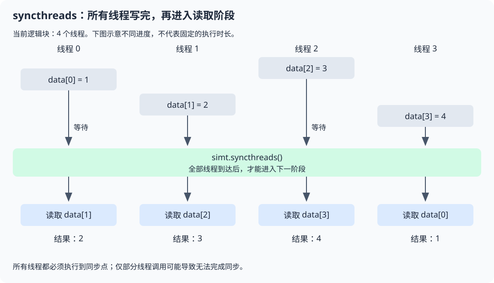

# simt.syncthreads

## 产品支持情况

- Ascend 950PR&950DT系列产品：支持

## 功能说明

在当前逻辑块内建立同步点，等待该逻辑块中的所有线程到达后再继续执行，并保证同步前的内存操作对块内线程可见。它不等待其他逻辑块。

### 为什么需要同步点

同一逻辑块中的线程执行进度可能不同。如果每个线程先写入一份数据，随后读取其他线程的结果，执行较快的线程可能读到尚未更新的数据。

将`simt.syncthreads()`放在写入阶段和读取阶段之间：先到达的线程在同步点等待，直到所有线程完成前一阶段，再进入下一阶段。



图中的等待表示执行进度不同；所有线程都必须到达同一个同步点。该同步点只协调当前逻辑块，不是整个Kernel的同步点。

### 典型用途

- **交换数据**：各线程写入自己的数据后，读取相邻线程的数据。
- **分阶段计算**：一阶段共同准备数据，下一阶段使用准备好的结果。

### 与相关接口的区别

| 接口 | 主要作用 | 是否等待其他线程到达 |
| --- | --- | --- |
| [`simt.syncthreads`](./syncthreads.md) | 同一逻辑块中的线程到达同步点后再继续执行 | 是 |
| [`simt.threadfence_block`](./threadfence-block.md) | 在同一逻辑块范围内建立调用线程的内存访问顺序 | 否 |
| [`simt.threadfence`](./threadfence.md) | 建立调用线程的内存访问顺序，可用于不同逻辑块之间的数据交接 | 否 |

## 函数原型

```python
simt.syncthreads() -> None
```

## 参数说明

无

## 返回值说明

无

## 约束说明

- 同一逻辑块中的所有线程必须到达同一个同步点。不能只让部分线程进入含有该调用的分支，或让部分线程提前返回。
- 在循环中调用时，所有线程必须按一致的迭代顺序到达同步点，不能因循环次数不同而遗漏同步。
- 多个线程同时更新同一地址时，仍需原子操作或调整写入分工；同步点不能修复同步前已经发生的并发写冲突。

## 调用示例

启动一个包含4个线程的逻辑块，各线程写入自己的数据，同步后读取下一个线程的数据。

```python
import torch
import torch_npu
from cannbotdsl import dim3, host, simt
from cannbotdsl.lang.kernel import kernel
from cannbotdsl.lang.vf import vf
from cannbotdsl.tensor import Tensor


@kernel
def exchange(data: Tensor, result: Tensor):
    with vf(mode="simt"):
        i = simt.thread_idx()[0]
        data[i] = i + 1
        simt.syncthreads()  # 全部线程写完后，再读取相邻线程的数据
        result[i] = simt.l2cache_load(data.ptr((i + 1) % 4))


@host
def run(data, result):
    exchange[dim3(1), dim3(4)](data, result)


def main():
    data = torch.zeros(4, dtype=torch.int32, device="npu")
    result = torch.zeros(4, dtype=torch.int32, device="npu")
    run(data, result)
    torch.npu.synchronize()
    values = result.cpu().tolist()
    assert values == [2, 3, 4, 1]
    print(values)


if __name__ == "__main__":
    main()
```

每个线程只写自己的位置，所有线程均执行同步。示例通过`l2cache_load`读取全局内存中的结果；它负责读取路径，同步点负责等待所有写入完成。

预期结果：

```text
[2, 3, 4, 1]
```
