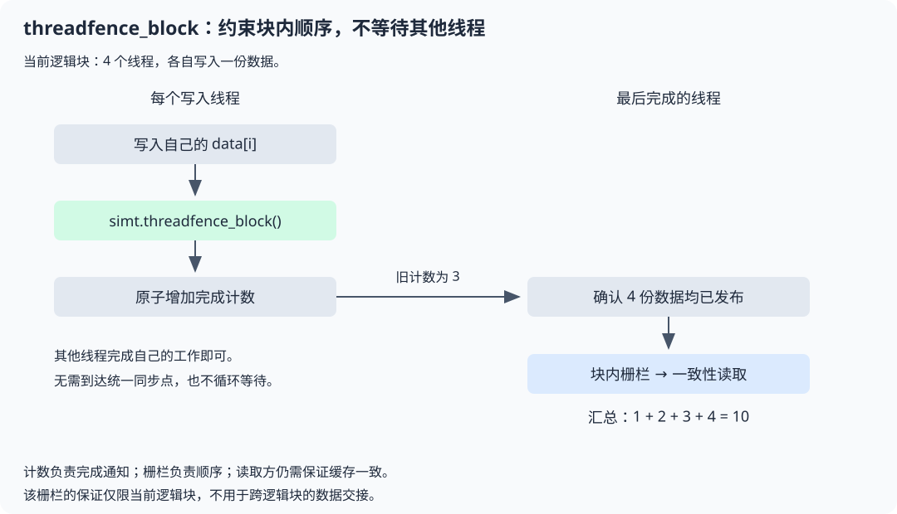

# simt.threadfence_block

## 产品支持情况

- Ascend 950PR&950DT系列产品：支持

## 功能说明

在当前逻辑块范围内，为调用线程的内存读写建立可见性顺序。用于块内线程交接数据时，保证先写数据、后发布完成通知；它不会等待其他线程到达同一位置。

### 为什么需要块内内存栅栏

同一逻辑块中的线程也可能以不同进度执行。某个线程写入数据后发布完成通知，读取方需要确保看到通知时能够正确读取对应的数据。

在写数据和发布通知之间调用`simt.threadfence_block()`，并配合原子通知和读取方的内存顺序、缓存处理，构成块内数据交接流程。仅调用栅栏，不能判断其他线程是否已经完成。



图中每个线程只约束自己的内存访问。最后完成者通过原子计数确认数据已由所有写入者发布；栅栏本身不负责等待或计数。

### 典型用途

- **块内发布数据**：写入共享结果后，再原子更新完成状态。
- **块内完成计数**：多个线程分别写入结果，由最后完成的线程汇总。

如果只需要所有线程完成写入后再统一读取，优先使用`simt.syncthreads()`，无需为这一简单场景额外维护完成计数。

### 与相关接口的区别

| 接口 | 主要作用 | 是否等待其他线程到达 |
| --- | --- | --- |
| [`simt.syncthreads`](./syncthreads.md) | 同一逻辑块中的线程到达同步点后再继续执行 | 是 |
| [`simt.threadfence_block`](./threadfence-block.md) | 在同一逻辑块范围内建立调用线程的内存访问顺序 | 否 |
| [`simt.threadfence`](./threadfence.md) | 建立调用线程的内存访问顺序，可用于不同逻辑块之间的数据交接 | 否 |

## 函数原型

```python
simt.threadfence_block() -> None
```

## 参数说明

无

## 返回值说明

无

## 约束说明

- 作用范围仅限当前逻辑块。不同逻辑块交接数据时，应使用`simt.threadfence()`并配合完成通知等协作机制。
- 读取其他线程的数据前，必须通过通知或同步机制确认其已经完成写入；栅栏不能替代这一步。
- 多个线程更新同一计数或标志时，应使用原子操作，不能用栅栏代替原子更新。
- 使用全局内存交接数据时，还应保证读取方的缓存一致性。示例使用`simt.l2cache_load`读取已发布的数据；栅栏不能代替缓存维护。

## 调用示例

启动一个包含4个线程的逻辑块，分别写入1、2、3、4，由最后完成的线程求和。

```python
import torch
import torch_npu
from cannbotdsl import dim3, host, simt
from cannbotdsl.lang.kernel import kernel
from cannbotdsl.lang.vf import vf
from cannbotdsl.tensor import Tensor


@kernel
def publish_and_sum(data: Tensor, count: Tensor, result: Tensor):
    with vf(mode="simt"):
        i = simt.thread_idx()[0]
        data[i] = i + 1
        simt.threadfence_block()  # 先发布数据，再更新完成计数
        old = simt.atomic_add(count.ptr(0), 1)
        if old == 3:  # 第四个完成的线程负责汇总
            simt.threadfence_block()  # 在确认完成后，再读取数据
            a = simt.l2cache_load(data.ptr(0))
            b = simt.l2cache_load(data.ptr(1))
            c = simt.l2cache_load(data.ptr(2))
            d = simt.l2cache_load(data.ptr(3))
            result[0] = a + b + c + d


@host
def run(data, count, result):
    publish_and_sum[dim3(1), dim3(4)](data, count, result)


def main():
    data = torch.zeros(4, dtype=torch.int32, device="npu")
    count = torch.zeros(1, dtype=torch.int32, device="npu")
    result = torch.zeros(1, dtype=torch.int32, device="npu")
    run(data, count, result)
    torch.npu.synchronize()
    value = result.cpu().item()
    assert value == 10
    print(value)


if __name__ == "__main__":
    main()
```

`atomic_add`返回更新前的计数，只有一个线程得到3并执行汇总。其他线程无需循环等待；每次运行前需将计数清零。

预期结果：

```text
10
```
