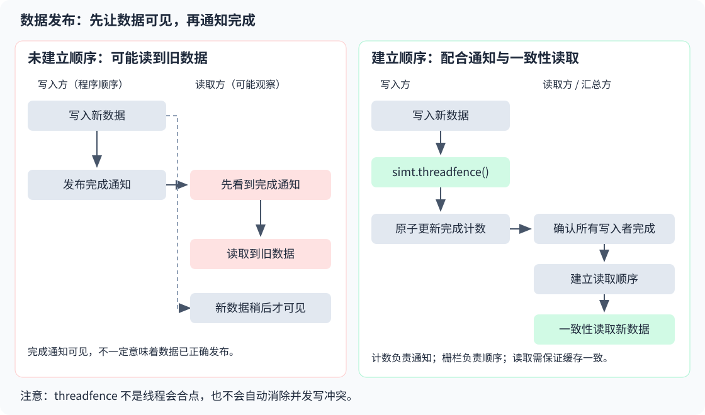

# simt.threadfence

## 产品支持情况

- Ascend 950PR&950DT系列产品：支持

## 功能说明

为当前线程的内存访问建立顺序，保证栅栏前的数据写入先于栅栏后的完成通知被其他线程观察到。可用于不同逻辑块通过全局内存（Global Memory，GM）交接数据；它不会等待其他线程到达同一位置。

### 为什么需要内存栅栏

假设一个线程先写入数据，再更新“已完成”标志。另一个线程看到标志后读取数据。如果没有正确的内存顺序保证，读取方可能先看到标志更新，却还没有看到对应的新数据。

应将`simt.threadfence()`放在“写数据”和“发布完成通知”之间。通知可采用原子标志或原子计数；读取方还需要正确检查通知，并采用保证缓存一致性的读取方式。



图中左侧表示一种可能出现的错误观察顺序，并非每次运行都会发生。右侧的正确交接需要栅栏、完成通知及读取方的内存顺序和缓存处理共同配合，不能只增加一次栅栏就省略其余步骤。

### 典型用途

- **发布数据**：写入结果后再发布完成标志，让读取方知道何时可以使用数据。
- **完成计数**：多个逻辑块分别写入结果，写入后再原子增加计数，由最后完成者汇总。

### 与相关接口的区别

| 接口 | 主要作用 | 是否等待其他线程到达 |
| --- | --- | --- |
| `simt.threadfence` | 建立内存访问顺序，可用于不同逻辑块之间的GM数据交接 | 否 |
| [`simt.threadfence_block`](./threadfence-block.md) | 在同一逻辑块范围内建立内存访问顺序 | 否 |
| [`simt.syncthreads`](./syncthreads.md) | 让同一逻辑块中的线程到达同步点后再继续执行 | 是 |

## 函数原型

```python
simt.threadfence() -> None
```

## 参数说明

无

## 返回值说明

无

## 约束说明

- 栅栏只约束调用线程的内存访问，不表示其他线程已经完成工作。跨线程交接数据时，应使用完成通知等协作机制。
- 多个线程更新同一计数或标志时，应使用原子操作；栅栏不能替代原子操作来解决并发写冲突。
- 读取其他逻辑块更新的数据时，还需处理缓存一致性。例如，使用 [`simt.l2cache_load`](../memory/l2cache-load.md) 避免读取当前核Data Cache中的旧值；内存栅栏不能代替缓存维护。

## 调用示例

启动两个逻辑块，每块包含1个线程，分别写入1和2，由最后完成的逻辑块计算总和。

每个逻辑块先写数据，再调用`simt.threadfence()`，最后原子增加完成计数。`atomic_add`返回更新前的计数：返回1的线程是第二个完成者，负责读取两份数据并求和。

```python
import torch
import torch_npu
from cannbotdsl import dim3, host, simt
from cannbotdsl.lang.kernel import kernel
from cannbotdsl.lang.vf import vf
from cannbotdsl.tensor import Tensor


@kernel
def publish_and_sum(data: Tensor, count: Tensor, result: Tensor):
    with vf(mode="simt"):
        block = simt.block_idx()[0]
        data[block] = block + 1
        simt.threadfence()  # 先发布数据，再更新完成计数
        old = simt.atomic_add(count.ptr(0), 1)
        if old == 1:  # 第二个完成的逻辑块负责汇总
            simt.threadfence()  # 将完成通知的读取与后续数据读取分隔
            a = simt.l2cache_load(data.ptr(0))
            b = simt.l2cache_load(data.ptr(1))
            result[0] = a + b


@host
def run(data, count, result):
    publish_and_sum[dim3(2), dim3(1)](data, count, result)


def main():
    data = torch.zeros(2, dtype=torch.int32, device="npu")
    count = torch.zeros(1, dtype=torch.int32, device="npu")
    result = torch.zeros(1, dtype=torch.int32, device="npu")
    run(data, count, result)
    torch.npu.synchronize()
    value = result.cpu().item()
    assert value == 3
    print(value)


if __name__ == "__main__":
    main()
```

两个逻辑块的完成顺序不固定，但只有一个线程会进入汇总分支。示例使用`l2cache_load`读取已发布的数据，不依赖当前核Data Cache中的缓存副本，也不通过循环等待另一个逻辑块。

预期结果：

```text
3
```
