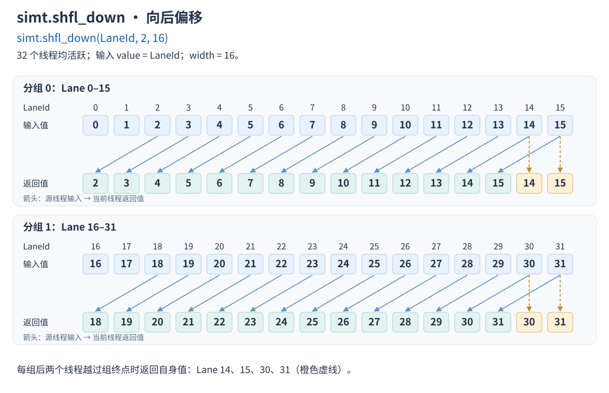

# simt.shfl_down

## 产品支持情况

- Ascend 950PR&950DT系列产品：支持

## 功能说明

获取Warp内当前线程向后偏移delta（当前线程LaneId+delta）的线程输入的用于交换的value值；如果目标线程是非活跃状态，获取到寄存器中未初始化的值。其中，参数width用于划分Warp内线程的分组。参数width设置参与交换的32个线程的分组宽度，默认值为32，即所有线程分为1组。

在多个分组场景（width小于32）下，每个分组交换操作是独立的，每个线程获取本组内当前线程向后偏移delta的线程的value值。如果当前线程向后偏移delta的线程编号，即LaneId+delta，大于所在分组的最大LaneId，则返回当前线程的value值。

例如，Warp内32个活跃线程调用simt.shfl_down(LaneId, 2, 16)接口，每个线程的返回值为当前线程LaneId+2对应线程的value值，或者当前线程的value值。



## 函数原型

```python
simt.shfl_down(
    value: ScalarValue | float16x2 | bfloat16x2 | int | float,
    delta: int32 | int,
    width: int = 32,
) -> ScalarValue | float16x2 | bfloat16x2
```

`ScalarValue`为公开标量类型，支持的数据类型见参数说明。

## 参数说明

| 参数 | 输入/输出 | 说明 |
| --- | --- | --- |
| value | 输入 | 待交换的值。标量支持`int32`、`int64`、`float16`、`bfloat16`、`float32`；短向量支持`float16x2`（两个`float16`分量）、`bfloat16x2`（两个`bfloat16`分量），两个分量来自同一个源线程。也接受Python整数或浮点数，分别按`int32`、`float32`处理。 |
| delta | 输入 | 源线程相对当前线程的向后偏移量，类型为`int32`标量或可表示为`int32`的Python整数，取值为非负数。 |
| width | 输入 | 分组的线程数，必须是编译期Python整数，可选`1`、`2`、`4`、`8`、`16`、`32`，默认`32`。 |

## 返回值说明

返回指定源线程的`value`，数据类型与输入相同。输入为短向量时，返回相同类型的短向量。

## 约束说明

- 如果目标线程是非活跃状态，获取到寄存器中未初始化的值。
- 若delta >=width， 所有线程都返回当前线程的value值。
- `width`不满足参数说明中的类型或取值要求时，抛出`ValueError`。

## 调用示例

在一个Warp中调用`simt.shfl_down`，校验结果并打印前8个线程的输出。

```python
import torch
import torch_npu
from cannbotdsl import dim3, host, simt
from cannbotdsl.lang.kernel import kernel
from cannbotdsl.lang.vf import vf
from cannbotdsl.tensor import Tensor


@kernel
def example_kernel(src: Tensor, dst: Tensor):
    with vf(mode='simt'):
        i = simt.thread_idx()[0]
        value = src[i] * 2
        dst[i] = simt.shfl_down(value, 1)


@host
def run(src, dst):
    example_kernel[dim3(1), dim3(32)](src, dst)


def main():
    src = torch.arange(32, dtype=torch.int32, device='npu')
    dst = torch.empty((32,), dtype=torch.int32, device='npu')
    run(src, dst)
    torch.npu.synchronize()
    expected = torch.tensor([2 * (i + 1 if i < 31 else i) for i in range(32)], dtype=torch.int32)
    assert torch.equal(dst.cpu(), expected)
    print(dst.cpu().tolist()[:8])


if __name__ == "__main__":
    main()
```

预期结果：

```text
[2, 4, 6, 8, 10, 12, 14, 16]
```
