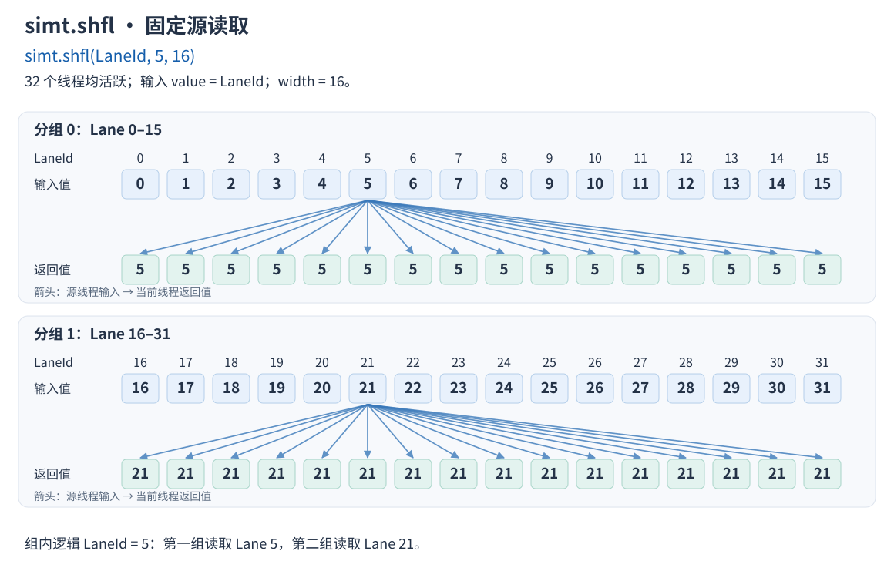

# simt.shfl

## 产品支持情况

- Ascend 950PR&950DT系列产品：支持

## 功能说明

Warp Shfl类接口主要实现Warp级数据交换，能够实现直接读取某个线程的数据，而不需要通过共享内存。这类接口主要通过Warp分组实现组内线程间的数据交换操作。

- **Warp分组**

Warp内的线程可分为多个组，用户通过参数width配置分组宽度（分组的线程数），分组内的线程可进行数据交换，组内线程通过相对组内起始线程位置来标识索引，称为逻辑LaneId。

- **数据交换**

本接口主要是获取分组内指定线程持有的value值，用户通过参数src_lane指定线程。如果src_lane大于等于width，指定线程的逻辑LaneId是src_lane%width。

**主要使用场景**

- 数据分发：将固定位置的线程数据广播给其他线程；
- 动态数据交换：每个线程从不同的源线程读取数据；

例如，Warp内32个活跃线程调用simt.shfl(LaneId, 5, 16)接口，每个线程的返回值为当前线程所在分组内线程编号为5的value值。



## 函数原型

```python
simt.shfl(
    value: ScalarValue | float16x2 | bfloat16x2 | int | float,
    src_lane: int32 | int,
    width: int = 32,
) -> ScalarValue | float16x2 | bfloat16x2
```

`ScalarValue`为公开标量类型，支持的数据类型见参数说明。

## 参数说明

| 参数 | 输入/输出 | 说明 |
| --- | --- | --- |
| value | 输入 | 待交换的值。标量支持`int32`、`int64`、`float16`、`bfloat16`、`float32`；短向量支持`float16x2`（两个`float16`分量）、`bfloat16x2`（两个`bfloat16`分量），两个分量来自同一个源线程。也接受Python整数或浮点数，分别按`int32`、`float32`处理。 |
| src_lane | 输入 | 源线程在分组内的编号，类型为`int32`标量或可表示为`int32`的Python整数，取值为非负数；大于或等于`width`时按`src_lane % width`选择源线程。 |
| width | 输入 | 分组的线程数，必须是编译期Python整数，可选`1`、`2`、`4`、`8`、`16`、`32`，默认`32`。 |

## 返回值说明

返回指定源线程的`value`，数据类型与输入相同。输入为短向量时，返回相同类型的短向量。

## 约束说明

- 如果目标线程是非活跃状态，获取到寄存器中未初始化的值。
- `width`不满足参数说明中的类型或取值要求时，抛出`ValueError`。

## 调用示例

在一个Warp中调用`simt.shfl`，校验结果并打印前8个线程的输出。

```python
import torch
import torch_npu
from cannbotdsl import dim3, host, simt
from cannbotdsl.lang.kernel import kernel
from cannbotdsl.lang.vf import vf
from cannbotdsl.tensor import Tensor


@kernel
def example_kernel(src: Tensor, dst: Tensor):
    with vf(mode='simt'):
        i = simt.thread_idx()[0]
        value = src[i] * 2
        dst[i] = simt.shfl(value, 7)


@host
def run(src, dst):
    example_kernel[dim3(1), dim3(32)](src, dst)


def main():
    src = torch.arange(32, dtype=torch.int32, device='npu')
    dst = torch.empty((32,), dtype=torch.int32, device='npu')
    run(src, dst)
    torch.npu.synchronize()
    expected = torch.tensor([14] * 32, dtype=torch.int32)
    assert torch.equal(dst.cpu(), expected)
    print(dst.cpu().tolist()[:8])


if __name__ == "__main__":
    main()
```

预期结果：

```text
[14, 14, 14, 14, 14, 14, 14, 14]
```
