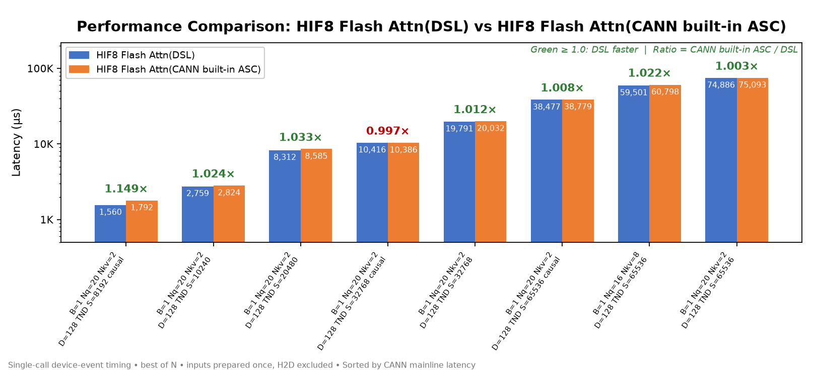

# HIF8 全量化 Flash Attention

基于 CANNBotDSL 在已验证的 FP8 全量化调度（`flash_attn_fp8_fullquant`）上实现的原生 HIF8 Attention：Q/K/V 全程保持单字节 HIF8，Q/K/V 反量化均为 per-tensor 标量，支持可选 P scale，无 block-wise microscaling，面向 Ascend 950PR / 950DT。

## 算子介绍

计算过程：

$$
S = (Q_{hif8} @ K_{hif8}^{T}) \cdot softmax\_scale \cdot deqQ \cdot deqK
$$

$$
P_{hif8} = cast_{hif8}(exp(S - m)), \qquad O = acc \cdot deqV / l
$$

其中 `m`、`l`、`acc` 按 KV 块在线更新。`p_scale` 通过最大值偏移折入 `m`：实现中维护 `m = m_0 - log(p_scale)`（`m_0` 为未偏移的块最大值），因此 `exp(S - m) = p_scale · exp(S - m_0)`；分母 `l` 使用量化前的指数和，使 `p_scale` 在 `O = acc / l` 中精确抵消。

| 特性与约束 | 说明 |
| :--- | :--- |
| 数据类型 | Q/K/V：int8 存储的 HIF8 码元；输出：BF16；LSE：FP32 |
| D | 128 |
| Layout | BNSD `[B,N,S,D]`、BSND `[B,S,N,D]`、TND `[T,N,D]` |
| GQA | 支持，`Nq` 须为 `Nkv` 的整数倍 |
| mask_mode | `0`：全注意力（仍屏蔽 KV 尾块 padding）；`3`：右下对齐 causal |
| KV cache | Dense，不支持分页 cache |
| p_scale | 可选，须为正有限值 |
| 合成 QK scale | `softmax_scale · deqQ · deqK` 须为正，非正值入口报错 |
| 分块 | Q tile 128 行，KV tile 256 行 |
| 变长输入 | TND 通过 `seqused_q` / `seqused_kv` 描述每个 batch 的长度，支持非整块尾部 |
| Flash Decode | `q_len ≤ 128` 且 `batch × Nq` 填不满核、KV ≥ 2 个 tile 时自动切 KV（≤ 32 片），partial O/LSE 由 merge kernel 合并 |
| 支持架构 | Ascend 950PR / 950DT |

本算子文件包含：

- [flash_atten_hif8_fullquant.py](flash_atten_hif8_fullquant.py)：公开入口、kernel 与 launcher、内部 workspace 规划，以及 Flash Decode 的 merge kernel。
- [hif8_check.py](hif8_check.py)：输入规格、布局、长度向量与 scale 校验。

实现细节：

- AIC：HIF8 K（L0A）× HIF8 Q（L0B）累加进 FP32 L0C；`softmax_scale * deqQ * deqK` 作为**编译期常量**折入 FP32 softmax，值为 1.0 时不发射乘加。
- AIV：FP32 在线 softmax（max 状态携带 `-log(p_scale)`）；概率块经四槽寄存器打包（`RegLayout.ZERO..THREE` + uint8 `vor` + 字节 gather）转成 HIF8 并写入 NZ 布局，再拼回共享 L1 的 P tile。
- AIC：HIF8 P^T（L0A）× HIF8 V（L0B）累加进 FP32 L0C。
- AIV：`acc = acc * corr + PV * deqV`，最终 `O = acc / l` 输出 BF16；FP32 的 `l` 使 p_scale 因子精确抵消。
- TND 的 Q/K/V 按 head-major 跨步视图读取，输出保持 head-major，返回前一次性 permute 回 token-major。
- wrapper 按 `layout`、`in_layout`、mask、scale 与 dense 输入的 tile 对齐几何编译动态 AOT 契约并缓存；batch、序列长度、head 数与 block 数走运行期参数，换 scale 或 dense padding 会编译新产物（缓存上限 64 条）。
- Flash Decode（decode 形态）：当 `q_len ≤ 128`、`batch × Nq` 少于核数且每个序列至少 2 个 KV tile 时，host 把每个 `(batch, head)` 的 KV 均分成 `min(核数/(batch×Nq), KV tile 数, 32)` 片。主 kernel 每个 slice 写 FP32 partial `O_i = acc_i / l_i` 与 `LSE_i = m_i + log l_i` 到按 `(batch, split)` 补齐到 128 行的 workspace（partial LSE 初值为 `-1e30`，未覆盖行权重为 0）；`merge kernel` 按 `O = Σ exp(LSE_i − LSE)·O_i`、`LSE = logsumexp_i(LSE_i)` 合并，输出 BF16 O 与 FP32 LSE。切分是纯算术，仍在 host 完成，不引入 AICPU。

## 快速开始

加载实际安装的 CANN 环境，并确保已安装 CANNBotDSL、PyTorch 与 torch_npu；在仓库根目录执行：

```bash
source /path/to/Ascend/cann/set_env.sh
export PYTHONPATH="$PWD${PYTHONPATH:+:$PYTHONPATH}"
```

下面的示例构造一个 BNSD、GQA 2:1、右下对齐 causal 的用例。Q/K/V 必须是 HIF8 码元（int8 存储），示例用随机字节演示接口，数值本身没有意义；真实数据用 `torch_npu._C._cd.cast_to_fp8_noalloc(..., DType.hifloat8)` 生成。

```python
import math

import torch
import torch_npu

from samples.attention.flash_attn_hif8_fullquant.flash_atten_hif8_fullquant import (
    npu_flash_atten_hif8_fullquant,
)

torch.manual_seed(0)
batch, n_q, n_kv, s_q, s_kv, d = 1, 2, 1, 256, 512, 128

q = torch.randint(-128, 128, (batch, n_q, s_q, d), dtype=torch.int8).npu()
k = torch.randint(-128, 128, (batch, n_kv, s_kv, d), dtype=torch.int8).npu()
v = torch.randint(-128, 128, (batch, n_kv, s_kv, d), dtype=torch.int8).npu()
deq_q = torch.tensor([0.5], dtype=torch.float32).npu()
deq_k = torch.tensor([0.25], dtype=torch.float32).npu()
deq_v = torch.tensor([2.0], dtype=torch.float32).npu()

output, lse = npu_flash_atten_hif8_fullquant(
    q, k, v, deq_q, deq_k, deq_v,
    softmax_scale=1.0 / math.sqrt(d),
    mask_mode=3,
    layout="BNSD",
    return_softmax_lse=True,
)
# output: [1, 2, 256, 128], torch.bfloat16
# lse:    [1, 2, 256],        torch.float32
```

TND 变长输入示例（两段长度不同的序列首尾相接，沿用上例的 `deq_q` / `deq_k` / `deq_v`）：

```python
q = torch.randint(-128, 128, (384, 2, 128), dtype=torch.int8).npu()
k = torch.randint(-128, 128, (512, 1, 128), dtype=torch.int8).npu()
v = torch.randint(-128, 128, (512, 1, 128), dtype=torch.int8).npu()
output, lse = npu_flash_atten_hif8_fullquant(
    q, k, v, deq_q, deq_k, deq_v,
    softmax_scale=1.0 / math.sqrt(d),
    mask_mode=0,
    layout="TND",
    seqused_q=torch.tensor([256, 128], dtype=torch.int32).npu(),
    seqused_kv=torch.tensor([384, 128], dtype=torch.int32).npu(),
    return_softmax_lse=True,
)
# output: [384, 2, 128], torch.bfloat16
# lse:    [2, 384],      torch.float32   (AscendC 约定：TND 为 (N, T))
```

## 接口说明

### `npu_flash_atten_hif8_fullquant()`

`query` 到 `descale_v` 可按位置传入，其余参数只能按名称传入。

| 参数 | 类型 | 默认值 | 说明 |
| :--- | :--- | :---: | :--- |
| `query / key / value` | int8 | — | HIF8 码元，按 `layout` 组织 |
| `descale_q / descale_k / descale_v` | float32 Tensor | — | per-tensor 反量化标量（1 个元素），须有限且为正 |
| `p_scale` | float32 Tensor | `None` | P 量化 scale，`None` 等价于 1.0 |
| `softmax_scale` | float | `None` | softmax 缩放，`None` 等价于 1.0；与 `descale_q`、`descale_k` 的合成值须为正 |
| `mask_mode` | int | `0` | `0` 全注意力，`3` 右下对齐 causal |
| `layout` | str | `"BNSD"` | `BNSD` / `BSND` / `TND` |
| `seqused_kv` | int32/int64 Tensor | `None` | TND 必填；dense 布局可选 |
| `seqused_q` | int32/int64 Tensor | `None` | TND 可选，缺省时若 Q 的 token 数与 KV 长度和一致则复用 `seqused_kv` |
| `return_softmax_lse` | bool | `False` | 为真时返回 FP32 LSE |

返回 `output`，或在 `return_softmax_lse=True` 时返回 `(output, lse)`。LSE 跟随 AscendC 的输出约定：TND 为 `(N, T)`，BNSD/BSND 均为 `(B, N, S)`。

- BNSD/BSND 的 batch 由 4 维张量给出，`seqused_kv` 用于逐 batch 的有效 KV 长度；物理批间距始终按补齐后的存储 token 数计算。
- TND 的 Q/K/V 是 token-major 的 `[T, N, D]`，`seqused_*` 之和不得超过对应的 token 存储长度。
- 合成 QK scale `softmax_scale · deqQ · deqK` 须为正，非正值在入口抛 `ValueError`（AscendC 同样只要求 `softmax_scale > 0`）。该值作为编译期常量折入 softmax，并用于 masked-row 哨兵缩放；大于 1 时 FP32 哨兵饱和为 `-inf`，全 mask 行仍按初始值 `NEG_MAX` 清零。极大值受 logits 的 FP32 表示范围约束，与 AscendC 一致。
- 输入不满足约束时入口抛出 `TypeError` / `ValueError`，见 [hif8_check.py](hif8_check.py)。

## 精度测试

在仓库根目录执行：

```bash
python -m pytest test/attention/flash_attn_hif8_fullquant/test_flash_atten_hif8_fullquant.py -v
```

- **21 条 NPU 精度用例**：BNSD/BSND/TND、MHA/GQA（含 10:1）、causal、`p_scale`、LSE、ragged varlen、BSND 多 batch 变长 KV、合成 QK scale>1（含全 mask 行）、尾块与 Flash Decode。输出与 CPU golden 比对（HIF8 P 量化、BF16 容差 0.08/0.15，允许 2% 元素超差），LSE 容差 5e-2。
- **29 条 CPU 契约用例**：dtype、layout、mask、D=128、GQA 整除、K/V 形状、batch 一致、`seqused` 越界、scale 合法性以及合成 QK scale 的正值边界，无需 NPU 即可运行。

## 性能对比



图中展示 8 个用例的单次调用性能，按 CANN 主线耗时从小到大排列。
加速比为 CANN built-in ASC / DSL，大于 1 表示 DSL 更快；
耗时单位为 μs（设备事件计时，best of N，含 host 启动，不含 H2D）。
