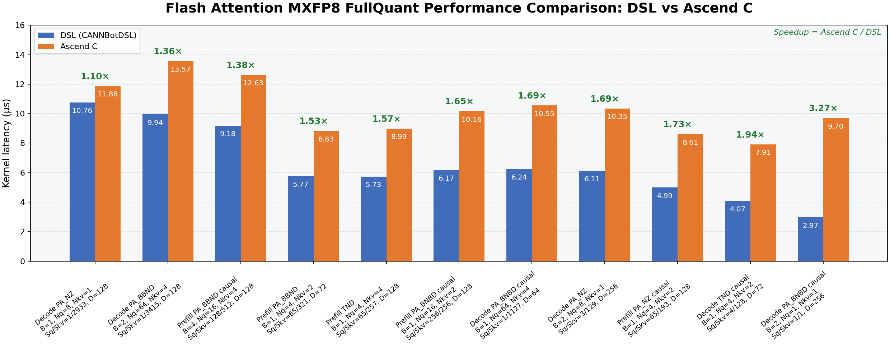

# Flash Attention MXFP8 FullQuant

基于 CANNBotDSL 实现的 GQA MXFP8 全量化 Flash Attention 算子，支持 Prefill 和 Decode 场景、Paged Attention KV cache、全注意力和右下对齐因果注意力，面向 Ascend Arch35 NPU。

## 算子介绍

计算公式：

$$
O = \operatorname{softmax}(QK^T \cdot \mathrm{softmax\_scale})V
$$

其中 Q、K、V 是按组反量化后的值。Q/K 沿头维度分组，V 沿 KV token 轴分组，每 32 个元素共享一个 E8M0 scale。

算子按 KV 块执行在线 Softmax。归一化前的指数值经 p_scale 缩放并转换为 FP8，再与 V 做矩阵乘法。

| 特性与约束 | 说明 |
| :--- | :--- |
| 数据类型 | Q/K/V 使用 FP8 E4M3FN，分组 scale 使用 E8M0，输出使用 BF16，可选 FP32 LSE |
| N | `Nq`、`Nkv` 均为正整数，`Nq` 必须是 `Nkv` 的整数倍 |
| D | Q/K/V 使用相同的头维度，支持 `64`、`72`、`128`、`256` |
| Layout | Q 固定使用 TND [T,N,D]。K/V 支持 TND、`PA_BNBD`、`PA_BBND`、`PA_NZ` |
| Paged KV | PA_BNBD、PA_BBND、PA_NZ，`D=72` 不支持 `PA_NZ`；`block_size` 支持 `64`、`128`、`256`、`512`、`1024` |
| 分块 | Q Cube tile 固定为 128 行。`D=256` 时，KV macro tile = 256 ，`D=64/72/128` KV macro tile = 512 |
| `mask_mode` | `0` 为全注意力，`3` 为右下对齐因果注意力 |
| 执行场景 | 由 Q scale 的维数选择场景。4 维为 Prefill，5 维为 Decode |

本算子文件包含：

- [flash_attn_mxfp8_fullquant.py](flash_attn_mxfp8_fullquant.py)：公开入口、Prefill/Decode kernel、内部 workspace 分配和启动。
- [mxfp8_check.py](mxfp8_check.py)：输入规格、布局和长度向量校验，以及测试数据契约检查。
- [mxfp8_metadata.py](mxfp8_metadata.py)：AICPU 调度 metadata 生成与缓存复用。

入口内部生成 metadata，并根据序列和调度情况使用 Flash Decode 分割 KV。调用方不需要自行构造调度表或分配内部 workspace。

## 快速开始

准备与设备兼容的 CANN、CANNBotDSL、PyTorch 和 torch_npu。在仓库根目录执行以下命令，将环境脚本路径替换为实际安装路径。

```bash
source /path/to/CANN/set_env.sh
export PYTHONPATH="$PWD${PYTHONPATH:+:$PYTHONPATH}"
```

下面构造一个 Prefill 用例，使用 `TND` 的 Q、两页 `PA_BNBD` KV cache 和右下对齐因果注意力。示例在 CPU 上准备 MXFP8 数据和 scale，再将输入移到 NPU。

```python
import math

import torch
import torch_npu

from samples.attention.flash_attn_mxfp8_fullquant.flash_attn_mxfp8_fullquant import (
    npu_flash_atten_mxfp8_fullquant,
)

def quantize_last_axis(x):
    """Quantize 32 elements per group and return FP8 data and E8M0 scales."""
    groups = x.reshape(*x.shape[:-1], -1, 32)
    amax = groups.abs().amax(dim=-1).clamp_min(2.0**-125)
    exponent = (amax / 448.0).log2().ceil().clamp(-127, 127)
    scale = torch.exp2(exponent).unsqueeze(-1)
    data = (groups / scale).clamp(-448.0, 448.0).to(torch.float8_e4m3fn)
    scale_e8m0 = (exponent + 127).to(torch.uint8).view(torch.float8_e8m0fnu)
    return data.reshape(x.shape), scale_e8m0

torch.manual_seed(0)
sq, skv, nq, nkv, d = 64, 256, 4, 2, 128
block_size = 128
num_pages = skv // block_size
page_shape = (num_pages, nkv, block_size, d)

# Q/K scale 沿头维度分组，每两个 scale 打包为一对。
q, q_scale = quantize_last_axis(torch.randn(sq, nq, d))
k, k_scale = quantize_last_axis(torch.randn(page_shape))
q_scale = q_scale.reshape(sq, nq, d // 64, 2)
k_scale = k_scale.reshape(num_pages, nkv, block_size, d // 64, 2)

# V scale 沿页内 KV token 轴分组。
v = torch.randn(page_shape)
v, v_scale = quantize_last_axis(v.transpose(-1, -2))
v = v.transpose(-1, -2).contiguous()
v_scale = v_scale.reshape(num_pages, nkv, d, block_size // 64, 2)
v_scale = v_scale.permute(0, 1, 3, 2, 4).contiguous()

# 掩码由 mask_mode 和有效长度决定，此处只提供所需形状的张量。
attn_mask = torch.zeros((1, sq, skv), dtype=torch.float32).npu()
block_table = torch.tensor([[0, 1]], dtype=torch.int32).npu()
seqused_q = torch.tensor([sq], dtype=torch.int64).npu()
seqused_kv = torch.tensor([skv], dtype=torch.int64).npu()
p_scale = torch.tensor([1.0], dtype=torch.float32).npu()

output, lse = npu_flash_atten_mxfp8_fullquant(
    q.npu(), k.npu(), v.npu(),
    q_scale.npu(), k_scale.npu(), v_scale.npu(), p_scale,
    softmax_scale=1.0 / math.sqrt(d),
    attn_mask=attn_mask,
    block_table=block_table,
    seqused_kv=seqused_kv,
    seqused_q=seqused_q,
    mask_mode=3,
    q_layout="TND",
    paged=True,
    block_size=block_size,
    kv_layout="PA_BNBD",
    return_softmax_lse=True,
    max_seqlen_q=sq,
)
```

## 接口说明

### `npu_flash_atten_mxfp8_fullquant()`

`query` 到 `p_scale_gm` 可按位置或名称传入，其余参数只能按名称传入。默认值为「—」的参数必填，所有输入 Tensor 须位于同一 NPU。

| 参数 | 类型 | 默认值 | 说明 |
| :--- | :--- | :---: | :--- |
| `query / key / value` | `float8_e4m3fn` | — | 查询 Q、键 K、值 V。Q 使用 `TND`，K/V 共用 `kv_layout` 指定的布局 |
| `q_scale_gm / k_scale_gm / v_scale_gm` | `float8_e8m0fnu` | — | 接收 E8M0 Tensor，Q scale 为 4 维时使用 Prefill，为 5 维时使用 Decode |
| `p_scale_gm` | `float32` | — | P 的量化缩放因子，形状为 `(1,)`。调用方保证值有限且大于 0 |
| `softmax_scale` | `float` | — | Python 标量，常用 `1/sqrt(D)` 缩放 QK 分数。转换为 FP32 后须有限且大于 0 |
| `attn_mask` | `float32` | — | 形状为 `[B,Sq_mask,Skv_mask]`。`mask_mode=0` 和 `3` 均须传入。接口检查形状和类型，张量内容不用于指定掩码 |
| `block_table` | `int32` | — | 分页模式下形状为 `[B,max_blocks]`，将逻辑页映射到物理页。有效页号须在 `[0,block_num)` 内。非分页模式传入占位张量，例如形状为 `(1,)` 的零张量 |
| `seqused_kv / seqused_q` | `int64` | — | 各为长度为 `B` 的连续一维向量，分别保存每个 batch 的有效 KV/Q 长度。`B` 必须大于 0。若原始数据是 `cu_seqlens`，按相邻元素作差得到逐批长度 |
| `mask_mode` | `int` | `0` | `0` 为全注意力，仅计算有效 KV。`3` 为右下对齐因果注意力。 |
| `q_layout` | `str` | `"TND"` | 仅支持 `TND` |
| `paged` | `bool` | `False` | `TND` 对应 `False`，三种 PA 布局对应 `True` |
| `block_size` | `int` | `128` | 分页模式下为物理页 token 数，支持 `64`、`128`、`256`、`512`、`1024`。非分页模式只要求正整数 |
| `kv_layout` | `str` | — | 支持 `TND`、`PA_BNBD`、`PA_BBND`、`PA_NZ`。`D=72` 时不支持 `PA_NZ` |
| `return_softmax_lse` | `bool` | `False` | 是否返回 FP32 LSE |
| `max_seqlen_q` | `int` | `-1` | 最大 Q 长度上界。`-1` 按 Q 的存储容量估算调度上界，`0` 跳过注意力计算，正值须满足 `max(seqused_q) ≤ max_seqlen_q ≤ attn_mask.shape[1]`，非空 Decode 还须 ≤ 128 |
| `output_token_count` | `int` | `None` | 仅 Decode 使用。传入时须等于 `sum(seqused_q)`，且在 `[0, query.shape[0]]` 内。为 `None` 时从设备读取长度和，会产生 Host 同步 |
| `metadata_state` | `AttentionMetadataState` | `None` | 传入调用方持有的对象可跨调用复用 metadata。为 `None` 时，算子需要调度时为本次调用生成 metadata |
| `lengths_epoch` | `int` | `None` | 长度更新版本号，取值为 `None` 或 `[0, 2**63-1]` 内的整数。复用推理模式创建的长度向量时必填；外部写入未更新 Tensor 版本时须递增 |

Host 校验会检查参数类型、Tensor 的 dtype、shape、设备和长度向量的连续性。调用方须保证有效长度、页号和 `p_scale_gm` 的值符合约束。Decode 显式传入 `output_token_count` 时，Host 检查取值范围，由调用方保证它等于设备上的长度和。

### 数据与 scale 布局

`B` 为 batch 数，`Nq` 和 `Nkv` 为 Q 和 KV 的头数，`D` 为共同的头维度。两种头数均为正数，且 `Nq` 是 `Nkv` 的整数倍。`D` 支持 `64`、`72`、`128`、`256`。记 `G=Nq/Nkv`。`block_num` 为物理页数。Q/K 沿头维度分组，V 沿 KV token 轴分组。每 32 个元素共享一个 scale，两个相邻 scale 打包成最后一维的 `2`。

`Tq`（有效 Q token 数）等于 `sum(seqused_q)`。Prefill 输入和 Decode 输出按有效 token 紧凑存放，第一维均为 `Tq`。
`Tq_storage`（Decode 输入的存储行数）是 Decode 输入 Q 的第一维。每个 batch 预留 128 行，因此常规 Decode 输入至少有 `B*128` 行。

| 执行场景 | Q 数据 | Q scale |
| :--- | :--- | :--- |
| Prefill | `[Tq,Nq,D]`，按 batch 紧凑拼接有效 token | `[Tq,Nq,ceil(D/64),2]` |
| Decode | `[Tq_storage,Nq,D]`，每个 batch 从第 `b*128` 行开始存放有效 token | `[Nkv,Tq_storage,G,ceil(D/64),2]`，`Tq_storage` 和 `G` 两轴须能合并，连续存储即可 |

| KV 布局 | K / V | K scale | V scale |
| :--- | :--- | :--- | :--- |
| `TND` | `[Tkv_storage,Nkv,D]` | `[Tkv_storage,Nkv,ceil(D/64),2]` | `[Gv,Nkv,D,2]` |
| `PA_BNBD` | `[block_num,Nkv,block_size,D]` | `[block_num,Nkv,block_size,ceil(D/64),2]` | `[block_num,Nkv,block_size/64,D,2]` |
| `PA_BBND` | `[block_num,block_size,Nkv,D]` | `[block_num,block_size,Nkv,ceil(D/64),2]` | `[block_num,block_size/64,Nkv,D,2]` |
| `PA_NZ` | `[block_num,Nkv,D/32,block_size,32]` | `[block_num,Nkv,block_size/16,ceil(D/64),16,2]` | `[block_num,Nkv,D/16,block_size/64,16,2]` |

TND 的 K/V 和 K scale 按 batch 紧凑拼接有效 KV token。`Tkv_storage` 是存储行数，至少为 `sum(seqused_kv)`，额外容量留在末尾。

TND 的 V scale 按 batch 分组后拼接。每个 batch 占 `ceil(seqused_kv[b]/64)` 对 scale，`Gv` 至少为这些组数之和，且至少为 1。例如 KV 长度为 `[65,1]` 时，`Gv` 至少为 3。

### 变长序列与掩码

- `seqused_q[b]` 和 `seqused_kv[b]` 分别是 batch `b` 的有效 Q 和 KV 长度。长度须非负，并与对应的存储容量和页表匹配。
- `mask_mode=0` 时，每个有效 Q 可见该 batch 的所有有效 KV。`mask_mode=3` 时使用右下对齐因果掩码，有效 KV 的可见条件为 `kv_index <= q_index + seqused_kv[b] - seqused_q[b]`，两个下标均从该 batch 的第 0 个 token 起算。`attn_mask` 用于接口校验，可见范围由模式和有效长度决定。
- `max_seqlen_q=-1` 时，调度上界在 Prefill 取 `query.shape[0]`，在 Decode 取 128。传入正值时，须满足 `max(seqused_q) <= max_seqlen_q <= attn_mask.shape[1]`。Decode 的 Q 存储非空时，正值还须不超过 128。

### Metadata 复用

通过 `metadata_state` 多次传入同一个 [`AttentionMetadataState`](mxfp8_metadata.py) 对象，可在长度张量、版本和调度配置一致时复用 AICPU 调度表。常规 PyTorch 原地更新长度张量后，算子会重新生成调度表。

复用推理模式下创建的长度张量时，须显式传入 `lengths_epoch`，可从 `0` 开始。外部 kernel 等操作写入长度、且未更新 Tensor 版本时，须递增 `lengths_epoch`，并确保长度写入先于算子读取。

## 精度测试

加载 CANN 环境后，在仓库根目录运行 [精度测试脚本](../../../test/attention/flash_attn_mxfp8_fullquant/test_flash_attn_mxfp8_fullquant.py)。

```bash
python -m pytest test/attention/flash_attn_mxfp8_fullquant/test_flash_attn_mxfp8_fullquant.py -v -s
```

- **15 项 CPU 测试**覆盖 MXFP8 分组量化、在线 Softmax 参考实现和接口类型校验。
- **11 项 NPU 用例**与 CPU golden 比对，覆盖 Prefill 和 Decode、非分页和三种分页布局、两种掩码、变长序列、跨页读取、尾块和 LSE。

## 性能对比



性能图涵盖精度测试中的 11 条 NPU 用例，按加速比（Ascend C 耗时除以 DSL 耗时）升序排列。
在 Ascend 950PR 上对比两种实现的 Attention 主核耗时（μs）。两侧均预热 3 次，使用 `msprof` 采集 10 次并取最小值。
