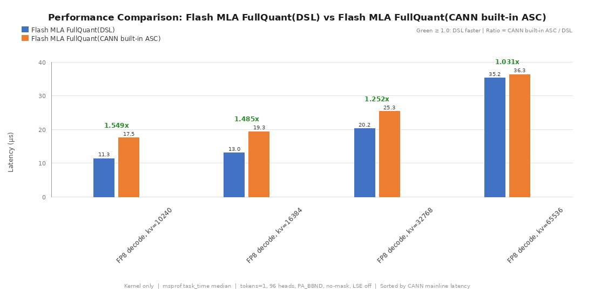

# Flash MLA FullQuant

基于 CANNBot-DSL 实现的 FP8 E4M3 / HIF8 全量化 MLA（Multi-Head Latent Attention）decode 样例，面向 Ascend 950PR / 950DT。覆盖 FP8 E4M3（`quant_mode=1`）与 HIF8（`quant_mode=0`）两条 8-bit 全量化路径，`head_dim_qk=576`、`head_dim_v=512`、KV head 数为 1。

## 算子介绍

计算过程：

$$
S = (Q_{8} @ K_{8}^{T}) \cdot softmax\_scale \cdot deqQ \cdot deqK
$$

$$
P_{8} = cast_{8}(\exp(S - m)), \qquad O = acc \cdot deqV / l
$$

`m`、`l`、`acc` 按 KV 块在线更新；P 在块内量化回 8-bit 后参与 PV。MLA 的 V 复用 K 的 nope 部分，因此 `deqV = deqK`，接口只接收一个 `k_descale`。

| 特性与约束 | 说明 |
| :--- | :--- |
| 数据类型 | Q / K cache：FP8 E4M3 或 HIF8（单字节）；输出：BF16；LSE：FP32 |
| 量化 | Q per-token-head 动态量化；KV per-tensor 静态量化，Q/K 反量化独立 |
| D | QK = 576，V = 512，KV head = 1 |
| Layout | Q：`BSND` / `BNSD` / `TND` / `TND_NTD`；KV：`PA_BBND` / `PA_BNBD`（`PA_NZ` 暂未实现）；输出：`BSND` / `BNSD` / `TND` / `NTD` |
| mask_mode | `0`：全注意力；`3`：右下对齐 causal（分析式，不读取 `attn_mask` 内容） |
| KV cache | 分页，完全由 `block_table` 寻址，支持任意页重排与页尾块 |
| LSE | 可选返回 FP32 softmax LSE |
| Flash Decode | KV ≥ 4096 时按 KV 自动分片，partial O/LSE 由独立 `FdMergeKernel` 合并 |
| 分块 | M=64 双 tile（默认）；`FLA_FULLQUANT_WIDE_M=1` 使用 M=128 单 tile，KV 读减半 |
| 支持架构 | Ascend 950PR / 950DT |

本算子文件包含：

- [flash_mla_fullquant_fp8.py](flash_mla_fullquant_fp8.py)：FP8 E4M3（`quant_mode=1`）入口、kernel、launcher 与 FD 合并内核。
- [flash_mla_fullquant_hif8.py](flash_mla_fullquant_hif8.py)：HIF8（`quant_mode=0`）实现，结构与 FP8 一致。
- [golden_fp8.py](golden_fp8.py) / [golden_hif8.py](golden_hif8.py)：独立 FP32 golden 与用例构造（真实页重排、两种 quant mode、causal、LSE）。
- [flash_mla_fullquant_checker.py](flash_mla_fullquant_checker.py)：入口 scale 合同（有限、正数、合成 qk_scale 合法）。

实现细节：

- AIC：`S = Q @ K^T`，FP32 L0C 以 `(M, S2)` 排布（KV 轴作为向量 lane）；`softmax_scale * deqQ * deqK` 折入 FP32 softmax。
- AIV：FP32 在线 softmax（逐行 max/sum）；P 按 KV 序用 4 个 `RegLayout` 打包成 8-bit，经字节 gather 还原 KV 序后写入 NZ 布局的 UB 暂存区，每块一次 `mem_copy` 发布到共享 L1 P tile。
- PV：4 个 128 宽 N band 写入同一块 `(M, 512)` L0C，每块仅 1 次 fixpipe；bmm2 直接复用 bmm1 已搬入的 K L1 槽，省去每块一次 576×256 的重复 GM→L1 拷贝。KV 保持 3 槽预取距离，Q 降为 1 槽。
- 页表寻址：`block_table` 直接进 kernel，wrapper 不做全量 KV 稠密化；每页按 16 行 stripe 搬运。
- Layout：TND 的 Q/输出按 head-major 跨步视图读写，返回前一次性 permute；BSND/BNSD/TND_NTD 在 wrapper 侧规整。
- Flash Decode：host 纯算术切分 KV，主 kernel 写 FP32 partial `m/l/acc`；`FdMergeKernel` 按 `LSE_i` 加权合并，输出 BF16 O 与 FP32 LSE。`FLA_FULLQUANT_FD_KGROUP`（1/2/4）、`FLA_FULLQUANT_FD_ROW_SPLITS`、`FLA_FULLQUANT_FD_MAX_SLICES` 可调。

## 快速开始

加载实际安装的 CANN 环境，并确保已安装 CANNBot-DSL、PyTorch 与 torch_npu；在仓库根目录执行：

```bash
source /path/to/Ascend/cann/set_env.sh
export PYTHONPATH="$PWD${PYTHONPATH:+:$PYTHONPATH}"
export TORCH_DEVICE_BACKEND_AUTOLOAD=0
```

下面的示例构造一个 TND、96 头、KV=512 的 FP8 decode 用例：

```python
import math

import torch
import torch_npu

from samples.attention.flash_mla_fullquant.flash_mla_fullquant_fp8 import (
    flash_mla_fullquant_fp8,
    flash_mla_fullquant_fp8_metadata,
)

torch.manual_seed(0)
B, Q_T, Q_N, D = 1, 1, 96, 576
KV, PAGE, NBLK = 512, 128, 4

# Q：per-token-head 动态量化
q_f32 = torch.randn(Q_T, Q_N, D) * 0.3
q_scale = 448.0 / q_f32.abs().amax(dim=-1, keepdim=True).clamp_min(1e-8)
q = (q_f32 * q_scale).clamp(-448, 448).to(torch.float8_e4m3fn).npu()
q_descale = (1.0 / q_scale).squeeze(-1).npu()  # (Q_T, Q_N)

# KV：per-tensor 静态量化；MLA 的 V 复用 K 的 nope 部分
k_f32 = torch.randn(NBLK * PAGE, D) * 0.3
k_scale = torch.tensor([448.0 / k_f32.abs().max()])
k_cache = (k_f32 * k_scale).clamp(-448, 448).to(torch.float8_e4m3fn)
k_cache = k_cache.reshape(NBLK, PAGE, 1, D).npu()  # PA_BBND: (Bn, Bs, 1, 576)
k_descale = (1.0 / k_scale).npu()  # (1,)

block_table = torch.arange(NBLK, dtype=torch.int32).reshape(B, NBLK).npu()
cache_seqlens = torch.tensor([KV], dtype=torch.int32).npu()

metadata = flash_mla_fullquant_fp8_metadata(
    cache_seqlens, Q_N, 1, 1, max_seqlen_q=Q_T, max_seqlen_kv=KV, layout_q="TND"
)

attn, lse = flash_mla_fullquant_fp8(
    q,
    k_cache,
    q_descale,
    k_descale,
    block_table,
    cache_seqlens,
    1,
    metadata=metadata,
    softmax_scale=1.0 / math.sqrt(512),
    mask_mode=0,
    max_seqlen_q=Q_T,
    max_seqlen_kv=KV,
    layout_q="TND",
    layout_kv="PA_BBND",
    layout_out="TND",
    return_softmax_lse=True,
)
# attn: (Q_T, Q_N, 512), bfloat16
# lse:  (Q_N, Q_T),      float32
```

HIF8 使用同一套接口，入口从 `flash_mla_fullquant_hif8` 导入，`quant_mode=0`，Q/K cache 的 dtype 为 HIF8（本机 torch_npu 可用等宽 `int8` 承载码元，用 `torch_npu._C._cd.cast_to_fp8(..., DType.hifloat8)` 生成）：

```python
from samples.attention.flash_mla_fullquant.flash_mla_fullquant_hif8 import (
    flash_mla_fullquant_hif8,
)

attn, lse = flash_mla_fullquant_hif8(
    q_hif8,
    k_cache_hif8,
    q_descale,
    k_descale,
    block_table,
    cache_seqlens,
    0,
    softmax_scale=1.0 / math.sqrt(512),
    mask_mode=0,
    layout_q="TND",
    layout_kv="PA_BBND",
    layout_out="TND",
    return_softmax_lse=True,
)
```

## 接口说明

### `flash_mla_fullquant_fp8_metadata()` / `flash_mla_fullquant_hif8_metadata()`

```python
flash_mla_fullquant_fp8_metadata(
    cache_seqlens, num_heads_q, num_heads_kv, quant_mode, *,
    cu_seqlens_q=None, seqused_q=None,
    max_seqlen_q=-1, max_seqlen_kv=-1,
    head_dim_qk=576, head_dim_v=512,
    mask_mode=0, layout_q="BSND",
) -> Tensor[int32]
```

返回 int32 bundle：第 0 行为 header `[B, Q_N, tasks, quant_mode, mask_mode, layout_q_code, cores]`，第 1~4 行为 tile 元数据，第 5~6 行为每核任务区间。`flash_mla_fullquant_fp8` / `flash_mla_fullquant_hif8` 可直接复用该结果，跳过 host 侧重算。

### `flash_mla_fullquant_fp8()` / `flash_mla_fullquant_hif8()`

```python
flash_mla_fullquant_fp8(
    q, k_cache, q_descale, k_descale,
    block_table, cache_seqlens, quant_mode, *,
    cu_seqlens_q=None, seqused_q=None, attn_mask=None,
    metadata=None, head_dim_v=512, softmax_scale=None,
    mask_mode=0, max_seqlen_q=-1, max_seqlen_kv=-1,
    layout_q="BSND", layout_kv="PA_BNBD", layout_out="BSND",
    return_softmax_lse=False,
) -> (attn_out, softmax_lse)
```

| 参数 | 类型 | 默认值 | 说明 |
| :--- | :--- | :---: | :--- |
| `q` | FP8 / HIF8 Tensor | — | Q，按 `layout_q` 组织，最后一维 576 |
| `k_cache` | FP8 / HIF8 Tensor | — | 分页 KV cache，按 `layout_kv` 组织 |
| `q_descale` | FP32 Tensor | — | per-token-head 反量化因子，形状随 `layout_q` |
| `k_descale` | FP32 Tensor | — | per-tensor 反量化因子，形状 `(1,)` |
| `block_table` | int32 Tensor | — | 逻辑页到物理页的映射，`(B, max_blocks)` |
| `cache_seqlens` | int32 Tensor | — | 每个 batch 的有效 KV 长度，`(B,)` |
| `quant_mode` | int | — | `0` HIF8，`1` FP8 E4M3 |
| `cu_seqlens_q` | int32 Tensor | `None` | TND 变长 Q 的累计长度 |
| `seqused_q` | int32 Tensor | `None` | 每个 batch 实际输出的 Q 行数 |
| `attn_mask` | int8 Tensor | `None` | `mask_mode=3` 时必填，形状 `(2048, 2048)` |
| `metadata` | int32 Tensor | `None` | `flash_mla_fullquant_fp8_metadata` / `flash_mla_fullquant_hif8_metadata` 的返回值 |
| `softmax_scale` | float | `None` | 默认 `1/sqrt(512)` |
| `mask_mode` | int | `0` | `0` 全注意力，`3` 右下对齐 causal |
| `layout_q` | str | `"BSND"` | `BSND` / `BNSD` / `TND` / `TND_NTD` |
| `layout_kv` | str | `"PA_BNBD"` | `PA_BBND` / `PA_BNBD`（`PA_NZ` 暂未实现） |
| `layout_out` | str | `"BSND"` | `BSND` / `BNSD` / `TND` / `NTD` |
| `return_softmax_lse` | bool | `False` | 为真时返回 FP32 LSE |

返回 `attn_out`，或在 `return_softmax_lse=True` 时返回 `(attn_out, softmax_lse)`。LSE 遵循官方约定：`BSND` / `BNSD` 为 `(B, Q_N, Q_S)`，`TND` / `NTD` 均为 `(Q_N, Q_T)`。

输入不满足约束时入口抛出 `TypeError` / `ValueError`：`q_descale` / `k_descale` 必须有限且为正，`softmax_scale * k_descale` 也必须有限且为正（见 [flash_mla_fullquant_checker.py](flash_mla_fullquant_checker.py)）。

## 精度测试

在仓库根目录执行：

```bash
python -m pytest test/attention/flash_mla_fullquant -v
```

判据与 AscendC 实现对齐：

```text
abs(err) <= 0.02 + 0.01 * |ref|  的坏点占比 <= 0.5%
LSE: abs(err) <= 0.05
全掩码行: out = 0, LSE = +inf
```

- **46 条官方接口用例（FP8 36 + HIF8 10）**：decode、页表重排、page tail、多 batch 变长 KV、多 head / 多 token、causal、四种 Q layout、FD 分片、LSE 开关、metadata 复用、scale 合同与参数校验，全部通过。
- **随机泛化 5000/5000**（FP8 与 HIF8 各 5000 例）：flat / causal / layout / large 四类；FP8 worst max_err 4.60e-04，HIF8 worst max_err 5.51e-03，bad 全为 0。
- **高风险泛化 48/48**：KV 2049~65536、FD 16/32 片、宽 tile、causal、LSE 关闭、多 layout、页乱序。

测试需要真实 NPU；Golden 为独立 FP32 实现，包含真实页重排、两种量化模式、causal 与 LSE，不依赖待测算子。已验证环境：CANNBot-DSL 0.8.2、CANN 9.3.0、torch_npu 2.10.0。

## 性能对比



图中展示 4 个 decode 用例的主 kernel 耗时，按 CANN 主线耗时从小到大排列。
加速比为 CANN built-in ASC / DSL，大于 1 表示 DSL 更快；
耗时单位为 μs（msprof `task_time` 中位数，tokens=1、96 heads、PA_BBND、no-mask、LSE 关），
不含 `FdMergeKernel` 与端到端开销。端到端在 64K 约为 AscendC 的 1.09~1.12x。

## 文件说明

| 文件 | 说明 |
| :--- | :--- |
| `flash_mla_fullquant_fp8.py` | FP8 E4M3 实现（`quant_mode=1`），含 metadata、主算子与 FD 合并内核 |
| `flash_mla_fullquant_hif8.py` | HIF8 实现（`quant_mode=0`），结构与 FP8 一致 |
| `golden_fp8.py` / `golden_hif8.py` | 独立 FP32 Golden 与用例构造 |
| `flash_mla_fullquant_checker.py` | 入口 scale 合同（有限、正数、合成 qk_scale 合法） |
| `test/attention/flash_mla_fullquant/` | 精度用例（FP8 / HIF8 各一个文件） |
