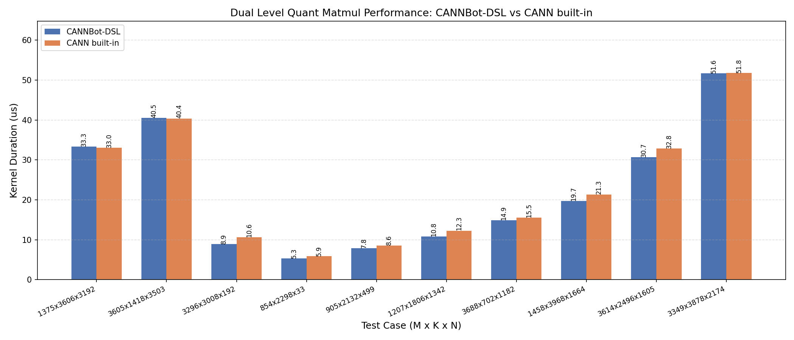

# DualLevelQuantMatmul MXFP4

基于 CANNBot-DSL 实现的双层 Scale MXFP4 矩阵乘算子，面向 Ascend NPU。
使用 ND 输入 A 和 FRACTAL_NZ 权重 B，支持 float16、bfloat16 输出及可选
float32 Bias。

## 算子介绍

K 轴每 32 个 FP4 数据共享一个 Level1 E8M0 Scale，每 512 个数据共享一个
Level0 FP32 Scale。Cube 使用 Level1 Scale 计算各 Level0 分组的 FP32 局部
结果，Vector 再应用 Level0 行列 Scale、跨组累加、融合 Bias 并转换输出类型。

$$
C = \sum_g ((A_g \cdot ScaleA1_g) @ (B_g \cdot ScaleB1_g)^T)
    \cdot ScaleA0_g \cdot ScaleB0_g + Bias
$$

| 特性与约束 | 说明 |
| :--- | :--- |
| 数据类型 | A 为 float4_e2m1fn_x2 ND Tensor；B 为承载 FP4 字节的 int8 FRACTAL_NZ Tensor；输出为 float16 或 bfloat16 |
| Level0 Scale | ScaleA0 为 `(M, ceil(K / 512))`，ScaleB0 为 `(ceil(K / 512), N)`，均为 float32 |
| Level1 Scale | float8_e8m0fnu 三维 paired-scale Tensor，分组轴长度为 `ceil(K / 64)`，末轴长度为 2 |
| transpose | 固定 FT 布局：A 非转置、B 转置 |
| FP4 打包 | 连续 K 轴每个字节保存两个 FP4 元素，K 必须为偶数 |
| 输入 | 二维 A/B、二维 Level0 Scale 与三维 Level1 Scale Tensor |
| Bias | 可选一维 float32 Bias，长度为 N，在 Vector 后处理阶段融合 |
| 多核并行 | 自适应滑动窗口多核调度、边缘基本块重均衡及尾轮再切分 |
| Cube/Vector 流水 | FP32 局部结果经跨核 UB 缓冲交给 Vector 累加，避免中间结果写回 GM |
| 支持架构 | NPU ARCH 3510（Ascend 950PR / Ascend 950DT） |

数据流为 `GM -> L1 -> L0A/L0B -> MMAD -> L0C -> UB -> GM`。
B 的 GM -> L1 搬运保留 FRACTAL_NZ 排布，Torch 层不重排或补齐用户输入。

## 快速开始

```python
import torch
import torch_npu

from dual_level_quant_matmul import npu_dual_level_quant_matmul

M, N, K = 256, 256, 1024
a = torch.randn(M, K, dtype=torch.float16, device="npu")
b = torch.randn(N, K, dtype=torch.float16, device="npu")
a_data, scale_a0, scale_a1 = torch_npu.npu_dynamic_dual_level_mx_quant(a)
b_data, scale_b0, scale_b1 = torch_npu.npu_dynamic_dual_level_mx_quant(b)
b_nz = torch_npu.npu_format_cast(b_data.view(torch.int8), 29)

c = npu_dual_level_quant_matmul(
    a_data.view(torch.float4_e2m1fn_x2),
    b_nz,
    scale_a0,
    scale_b0.T.contiguous(),
    scale_a1.view(torch.float8_e8m0fnu),
    scale_b1.view(torch.float8_e8m0fnu),
    output_dtype=torch.float16,
)
```

`29` 表示 FRACTAL_NZ。B 使用 int8 作为 NZ 存储的字节容器，数据仍为
E2M1 FP4，Kernel 按 FP4 类型解释这些字节。ND 权重须在调用前转换为 NZ。

`npu_dual_level_quant_matmul()` 输入/输出说明：

| 参数 | shape | dtype | 说明 |
| :--- | :---: | :---: | :--- |
| `a` | (M, K / 2) | float4_e2m1fn_x2 | A，左矩阵，ND 存储；shape 为物理打包 shape |
| `b` | (N, K / 2) | int8 | B，右矩阵，FRACTAL_NZ 存储，承载打包 FP4 字节 |
| `scale_a0` | (M, ceil(K / 512)) | float32 | A 的 Level0 Scale |
| `scale_b0` | (ceil(K / 512), N) | float32 | B 的 Level0 Scale |
| `scale_a1` | (M, ceil(K / 64), 2) | float8_e8m0fnu | A 的 Level1 paired-scale |
| `scale_b1` | (N, ceil(K / 64), 2) | float8_e8m0fnu | B 的 Level1 paired-scale |
| `bias` | (N,) | float32 | 可选 Bias |
| `output_dtype` | - | torch.dtype | 输出类型：float16 或 bfloat16，默认 float16 |
| 返回值 `c` | (M, N) | output_dtype | 双层反量化后的矩阵乘结果 |

## 精度测试

测试代码位于 `test/matmul/dual_level_quant_matmul/test_dual_level_quant_matmul.py`，
使用 pytest 驱动，在仓库根目录运行：

```bash
pytest test/matmul/dual_level_quant_matmul/test_dual_level_quant_matmul.py -v
```

用例覆盖 NZ 权重、FP16/BF16 输出、Bias、M/N/K 尾块及大 Shape。

## 性能数据

本 Sample 与 built-in `aclnnDualLevelQuantMatmulWeightNz` 在部分用例上的
性能对比结果如下。测试平台为 Ascend 950，采用 MXFP4 输入、NZ 权重、
FP16/BF16 输出和可选 Bias，覆盖对齐与非对齐 Shape。
两者均使用固定 Shape ACLGraph，每次调用前进行 L2 缓存清理准备，预热
3 次后重复 30 次，取 msprof Kernel Task Duration 中位数；图中不包含
编译、Launch、Host 同步、缓存清理和输入构造时间。


