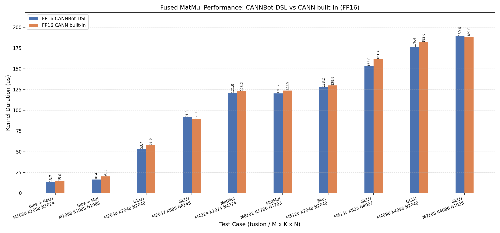

# Fused MatMul

基于 CANNBot-DSL 实现的融合矩阵乘算子，在 Cube 矩阵乘的基础上融合 Add / Mul / GELU / ReLU 逐元素 epilogue，支持 fp32 输出 case，面向 Ascend NPU。

计算公式：

$$
C[M,N] = \mathrm{act}(A[M,K] @ B[N,K]^T + add[N]) * mul[N]
$$

其中 `act` ∈ {none, relu, gelu(tanh 近似)}，`add` / `mul` 为可选的 per-column 向量，四类融合特性可任意组合。数值语义对标 built-in `fused_matmul_gelu`（gelu-tanh 常数 0.044715 / -1.5957691）。

| 特性与约束 | 说明 |
| :--------- | :--- |
| 数据类型 | 输入 fp16/bf16；输出同输入 dtype 或 fp32（`out_dtype` case） |
| 融合 epilogue | Add（per-column）/ Mul（per-column）/ GELU（tanh）/ ReLU，任意组合 |
| transpose | 核内仅支持 transpose_a=False、transpose_b=True |
| 输入 | 二维 contiguous 矩阵，add/mul 为 (N,) 向量 |
| Shape 范围 | M、N、K 均为 16～16384，支持非对齐尾块 |
| 多核并行 | AIC 滑动窗口多核调度 + AIV epilogue，单 mixed kernel |
| 核间流水 | cv_ub 跨核 RingBuffer 按 UB 容量选择 1/2 Buffer，逐 Tile 传递 FP32 中间结果 |
| 支持架构 | NPU ARCH 3510（Ascend 950PR / Ascend 950DT） |

## 实现结构

单 mixed kernel 内按 host 侧编译期 `const_expr` 分双通路（一份代码）：

- **Cube 路径**（act∈{none,relu} 且无 mul）：有 add 时，经 `GM → L1 → BIAS` 搬运并在 MMAD 初始化时融合 Bias；结果通过 `L0C → FIXPIPE（ReLU 可选）→ GM` 输出。
- **Cube-Vector 路径**（GELU 或 mul）：AIC 计算 MMAD，经跨核 UB RingBuffer（FP32，1/2 Buffer）交给 AIV 做 `add → act → mul → cast`，然后写 GM。

Cube 段数据流为 GM → L1（MTE2, nd2nz, L2 cache 控制）→ L0A/L0B（MTE1）→ MMAD（M）→ L0C；host 侧 `FusedMatmulTiling` 复用 `MatmulTiling` 模型，按 Vector UB 容量约束基本块（base_m≥32、BM×BN≤UB 预算），并修正尾轮核间负载不均衡。实现详见 `fused_matmul.py`。

## 快速开始

```python
import torch
import torch_npu
from fused_matmul import fused_matmul

M, K, N = 1024, 1024, 1024
dtype = torch.float16

a = torch.randn(M, K, dtype=dtype).npu()      # (M, K)
b = torch.randn(N, K, dtype=dtype).npu()      # (N, K)
add = torch.randn(N, dtype=dtype).npu()       # (N,)
mul = torch.randn(N, dtype=dtype).npu()       # (N,)

# gelu(a @ b^T + add) * mul
c = fused_matmul(a, b, add=add, mul=mul, activation="gelu")

# fp32 输出 case
c32 = fused_matmul(a, b, activation="relu", out_dtype=torch.float32)
```

`fused_matmul()` 参数说明：

| 参数 | shape | dtype | 说明 |
| :--- | :---: | :---: | :--- |
| `a` | (M, K) | fp16/bf16 | 左矩阵 |
| `b` | (N, K) | fp16/bf16 | 右矩阵 |
| `add` | (N,) | fp16/bf16 | per-column 加法项（可选） |
| `mul` | (N,) | fp16/bf16 | per-column 乘法项（可选） |
| `activation` | - | - | `"none"` / `"relu"` / `"gelu"`（tanh 近似） |
| `out_dtype` | - | - | `None`（同输入）/ `torch.float32` |
| 返回值 `c` | (M, N) | 同输入或 fp32 | 融合计算结果 |

## 精度测试

测试代码位于 `test/matmul/fused_matmul/test_fused_matmul.py`，使用 pytest 驱动，运行命令如下：

```bash
pytest test/matmul/fused_matmul/test_fused_matmul.py -v
```

覆盖编译、Host Tiling、融合功能、FP16/BF16/FP32 输出、非对齐尾块及输入校验。
Golden 使用独立的 Torch FP64 实现，精度标准为
`max(abs(actual - golden)) < 1e-2 * max(max(abs(golden)), 1.0)`。

## 性能数据

基于 CANNBot-DSL 实现的 fused_matmul 算子与 built-in 在部分用例上的性能对比结果如下：



测试条件：Ascend 950，FP16 输入输出；相同输入下，Sample 使用 AOT，built-in 使用 ACLGraph；每次调用前清理 L2，msprof 采集 Kernel Duration，重复 15 次取中位数。
