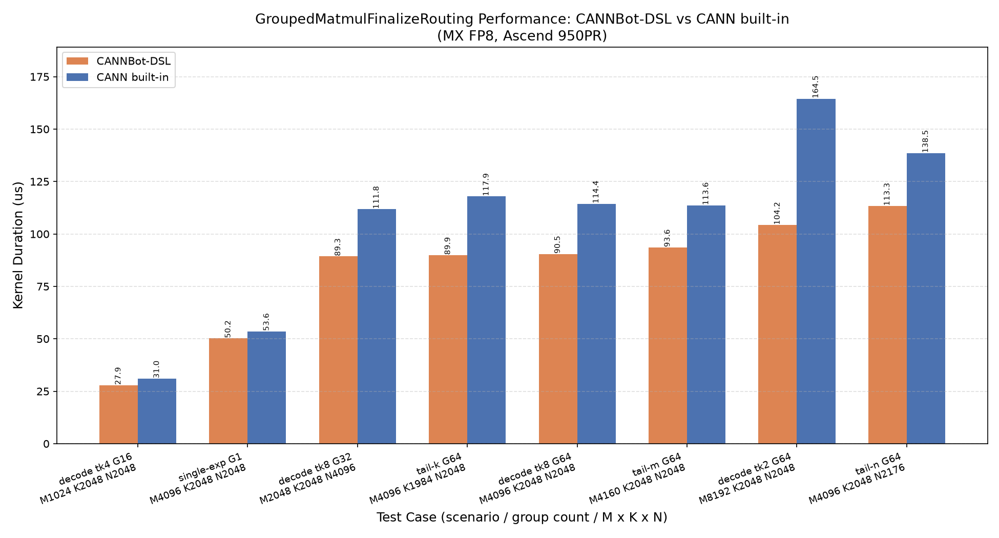

# GroupedMatmulFinalizeRouting (MX, Ascend 950PR/DT)

GroupedMatmul 与 MoeFinalizeRouting 的融合算子（MXFP8 量化），支持 Ascend 950PR/950DT。

## 功能

```
1) MX 反量化分组矩阵乘（per expert g，行窗口来自 groupList）：
     gmm_out[i, :] = dequant(x1)[i, :] @ dequant(x2)[g]  (FP32 累加, bias 走 BT)
2) 路由 combine（scatter-add）： y[rowIndex[i], :] += logit[i] * gmm_out[i, :]
3) 共享专家融合：               y[off:off+len, :] = sharedInputWeight * sharedInput
                                 （y 其余行清零）
```

实现要点：
- AIC 侧 MX MMAD（`copy_options(mx_scale=...)` paired E8M0 + `matmul(mx_mode=True)`），
  L0C FP32 累加，bias 走 BT 通路；
- FIXPIPE drain L0C→UB 跨核 handoff（`partition(dim=0)` split-M 双目的）；
- AIV 侧逐行 logit 乘 + `copy_options(atomic_add=True)` MTE3 原子加（默认非确定性）；
- y 初始化（清零 + 共享专家写入）由 wrapper 在同 stream 上完成，stream 序保证
  先于一切原子加。

## 接口

```python
from grouped_matmul_finalize_routing import grouped_matmul_finalize_routing

y = grouped_matmul_finalize_routing(
    x1,               # (m, k)  FP8 E4M3FN / E5M2
    x2,               # (e, k, n) FP8 E4M3FN / E5M2（非转置，k-major）
    scale,            # (e, ceil(k/64), n, 2) E8M0（uint8 / float8_e8m0fnu 存储）
    pertoken_scale,   # (m, ceil(k/64), 2)    E8M0
    group_list,       # (e,) INT64（cumsum/count 两种模式）
    logit,            # (m,) FP32
    row_index,        # (m,) INT64，取值 [0, batch)
    bias=None,        # (e, n) BF16，可选
    shared_input=None,        # (bsdp, n) BF16，可选
    *,
    shared_input_weight=1.0,  # float
    shared_input_offset=0,    # int，0 <= off，off+len <= batch
    group_list_type=1,        # 0: cumsum，1: count
    out=None,                 # (batch, n) FP32，可传入复用（会被清零重写）
    batch_size=None,          # out/batch_size 缺省时由 row_index.max()+1 推断
)
```

固定语义：输出恒 FP32；`rowIndex` 仅 INT64；`transposeX1` 恒 false；
groupList 总和 ≤ m（多余 x1 行忽略）；支持 M=0 / N=0 / 空 group / E8M0=0x00。

## Kernel 结构（MIX AIC:AIV = 1:2，单前向跨核边）

```
[Host/wrapper] y 初始化（zero + shared×w）
        ↓ stream 序
[AIC] GM→L1(数据+paired scale)→L0A/L0B(mx_scale)→MMAD(mx_mode, bias=BT)→L0C
        ═ fixpipe L0C→UB, partition(dim=0) split-M, depth=2 ═►
[AIV×2] 全半区遍历(cv_ub)→vmuls(logit)→out_ub→逐行 MTE3 原子加→y(GM)
```

- tile：`base_m=128, base_n=256, base_k=128`；`k_l1` 按 L1 预算取最大 step（流式 ≤4，
  full_load 模式按剩余预算 ≤3）；
- 调度：全局 tile 流的**连续段**分块（段间至多差 1 tile 保负载均衡），AIC/AIV 同序列
  迭代（ring FIFO 配对）；full_load 模式下同一 (g, m-tile) 的全部 n-tile 落同一核，
  A 面板与 paired scale 常驻 L1 跨 n-tile 复用（k 为 64 倍数且 L1 可容纳时启用）；
- 尾块：M 尾 pad 到 32（fractal 对半 + 槽容量），N/K 尾按实际 extent 裁剪，
  B 的 K 尾 `cube_fill_l1_zero` 清零（数据×有限 scale 湮灭）；
- **AIV 恒遍历完整半区**（空半区也产生消费握手，否则跨核 ring 死锁）。

## 精度

CPU golden（torch，`E8M0 = 2^(byte-127)`，与 kernel 实现独立）；
FP32 输出，`rtol=atol=2e-2`。
测试见 `test/grouped_matmul_finalize_routing/`（28 用例：dtype 矩阵 / 尾块 / 空轴 /
极值 scale / 乱序 rowIndex / 校验拒绝 / validate 开关）。

## 性能数据

本 Sample 与 built-in `aclnnGroupedMatmulFinalizeRoutingV3`
在 decode / prefill / 尾块等泛化用例（M 512~32768、K 2048~7168、
E 8~256）上的性能对比结果如下：几何均值 DSL 快 1.23×，绝大多数用例
更优（最高 1.58×，极端不均匀分组场景为 0.83×），图示时长相近的 DSL
占优用例（decode / 单专家 / 尾块）。使用 msprof 采集 AI Core Kernel
Task Duration，每例预热 1 次后重复 15 次取最小值，DSL 侧计入 y 清零
kernel；图中不含编译、Launch、同步和输入构造时间。


