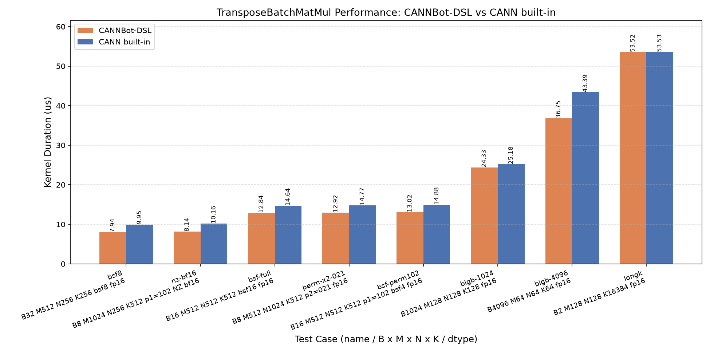

# TransposeBatchMatMul

基于 CANNBot-DSL 实现的三维批矩阵乘 + 转置寻址算子，支持 float16、bfloat16、float32 数据类型与 WeightNZ 分形权重输入，面向 Ascend NPU。

## 算子介绍

计算公式（输出按 permY=[1,0,2] 存储布局直接写出，不落地显式转置）：

$$
r[b, m, n] = \sum_k A[b, m, k] \cdot B[b, k, n], \qquad
\begin{cases}
\texttt{bsf}=1: & out[m, b, n] = r[b, m, n] \\[2pt]
\texttt{bsf}>1\ (inner=B/\texttt{bsf}): & out[s, m, j \cdot N + n] = r[s \cdot inner + j, m, n]
\end{cases}
$$

其中 `A = x1.permute(perm_x1)`、`Bmat = x2.permute(perm_x2)`；全部转置语义由 GM 侧带行距的 tile 读写（getitem 视图 + tile_slice）承载。

| 特性与约束 | 说明 |
| :--------- | :--- |
| 数据类型   | float16、bfloat16、float32（核内 fp32 累加后 FIXPIPE 转回输入 dtype）；fp32 支持 HF32 快速模式（`cube_math_type=2/3`，TF32 档截断，scale-relative 误差 ~3e-4，仅 fp32 有效） |
| perm 组合  | `perm_x1 ∈ {[0,1,2], [1,0,2]}` × `perm_x2 ∈ {[0,1,2], [0,2,1]}` 四组合全支持；`perm_y` 仅支持 `(1,0,2)` |
| 跳读跳写   | perm_x1=[1,0,2]（x1 形状 (M,B,K)）：A 侧按 B·K 行距跳读；C 侧恒按 B·N（bsf=1）/inner·N（bsf>1）行距跳写；转置语义零拷贝、不落地 |
| x2 布局    | ND：3D 连续（(B,K,N) 或 (B,N,K)），或 perm_x2=(0,2,1) 下的 canonical `transpose(-1,-2)` 视图（零拷贝翻回）；NZ（`x2_format="nz"`）：FRACTAL_NZ 逻辑 (B,K,N) 张量或 5D panel (B, N1, K1, 16, c0)——panel 挂在 NZ 分配上零拷贝 rebind，挂在普通 ND 存储上经格式桥接 |
| NZ 约束    | 仅 `perm_x1=(1,0,2)` × `perm_x2=(0,1,2)` × `batch_split_factor=1`；要求 K%16==0、N%c0==0（c0=16 for fp16/bf16）、K>1、N>1；**fp32 NZ 不支持**（见下文差异清单） |
| batch_split_factor | 1 ≤ bsf ≤ B 且 B % bsf == 0；仅改变输出的合并视图分解（(M,B,N) 或 (bsf, M, B·N/bsf)），不改变 tile 网格 |
| bias / scale | 预留参数，必须 None（否则 ValueError） |
| 尾块处理   | nd2nz 随路零填充（列轴，c0 粒度：fp16/bf16=16、fp32=8）；K 尾块按 c0 对齐裁剪 L0 搬运与 MMAD 视图，K-major B 的 GM 侧补零到 ceil_c0(K)（消除 L1 行残留）；M/N 尾块由 FIXPIPE 源窗口裁剪到 actual extent（dst GM 窗口尾块感知），M/N/K 任意值 |
| 多核并行   | B×m_tiles×n_tiles tile 网格线性 stride 调度（grid = min(tile 总数, 平台 cube 核数)；bsf>1 用 [bsf, inner, m_tiles, n_tiles] 分解表重建批坐标，无运行时除法）；bsf=1 的 tile 访问序为 m 最内层（`[B, n_tiles, m_tiles]` 分解表，实测比 n 最内层快 8%——L2 局部性，语义透明） |
| 内轴上限   | perm_x1=[1,0,2] 时 B·K < 65536、其余 K < 65536（ND2NZ 随路转换上限的保守取值；DSL 引擎实测无此限） |
| 支持架构   | NPU ARCH 3510（Ascend 950PR / Ascend 950DT） |

### 已知限制（与 built-in 的差异）

| # | 差异 | 说明 |
|---|------|------|
| 1 | `cube_math_type=1`（USE_FP16）拒绝 | DSL cube API 无 "fp32 存储 → fp16 计算" 入口，报 ValueError；built-in 支持 |
| 2 | fp32 × NZ 拒绝 | fp32 NZ 存储变体（FRACTAL_NZ_C0_16，torch_npu format 50）不被 DSL runtime 接受（只收 format 29 的 16-bit 几何） |
| 3 | K-major B 路径 base_k 整除过滤 + GM 补零 | perm_x2=[0,1,2] ND 及 NZ 路径的 base_k 候选须整除 ceil_c0(K)——dav-3510 上 K 尾块在 L1→L0B 转置搬运上间歇性破坏离散 l0b 行（真机实测）；fp32 K%c0∈[1..8] 域无整除候选时回退 base_k=16，且 wrapper 将 K-major ND 的 x2 补零到 ceil_c0(K)，使尾行读真实零 |
| 4 | plain-ND 存储 5D NZ panel 桥接 | panel 挂普通 ND 存储时经 `permute+reshape → npu_format_cast(29)` 两次格式桥接（非语义转置）；NZ 分配上的 panel 仍零拷贝 |

完整组合支持矩阵见下方 dtype/模式矩阵与测试参数化清单。

### Tiling（对齐 dav-3510 主线）

host 侧 tiling 镜像主线 `transpose_batch_mat_mul_base_tiling` 的上界公式：

- base_m/base_n = min(ceil_align(M/N,16), 256)；L0C cap `base_m·base_n ≤ 32768` 的降 2 幂由并行度守卫控制——
  fp32/HF32 恒降档，fp16/bf16 仅在 tile 总数低于核数阈值时降档（避免小 tile 饥饿），否则保持 256×256
- base_k ≤ min(L0A,L0B)/2/dtype_size/max(BM,BN)，c0 对齐（fp16/bf16=16、fp32=8）；K-major B 路径
  候选额外整除 ceil_c0(K)（16-bit 网格无尾块；fp32 K%c0∈[1..8] 回退 base_k=16）
- k_l1 = base_k × step_k（step_k ≤ 8，L1 双缓冲预算 `(aL1+bL1)×2 ≤ 512KB`）
- L1/L0A/L0B 恒 depth=2；L0C 按守卫域取 depth——大 tile 降档域为 1（fp32 累加器双槽超 256KB L0C），
  其余为 2；无尾块且 db=1 的网格启用 MMAD unit_flag 链（硬件自动触发 FIXPIPE，消除 drain 串行）

### 数据流

device kernel 采用线性 stride 多核调度 + L1/L0 ping-pong 流水线：GM → L1（MTE2 + nd2nz / NZ identity 直读）→ L0A/L0B（MTE1，K-major B 侧以 `src.permute(1,0)` 表达转置）→ MMAD（M，fp32 累加）→ L0C → GM（FIXPIPE，NZ2ND + 行距跳写）。纯 AIC 单 kernel，无跨核通道。实现详见 `transpose_batch_matmul.py`。

## 快速开始

```python
import torch
import torch_npu
from transpose_batch_matmul import transpose_batch_mat_mul

B, M, K, N = 4, 256, 512, 128
dtype = torch.float16

# perm_x1=(0,1,2): x1 (B, M, K)；perm_x2=(0,1,2): x2 (B, K, N) K-major
x1 = torch.randn(B, M, K, dtype=dtype).npu()
x2 = torch.randn(B, K, N, dtype=dtype).npu()
out = transpose_batch_mat_mul(x1, x2)              # out (M, B, N)

# perm_x1=(1,0,2): x1 形状 (M, B, K)，A 侧 B*K 行距跳读（零拷贝）
x1 = torch.randn(M, B, K, dtype=dtype).npu()
out = transpose_batch_mat_mul(x1, x2, perm_x1=(1, 0, 2))

# perm_x2=(0,2,1): x2 形状 (B, N, K)（或其 canonical transpose(-1,-2) 视图）
x2 = torch.randn(B, N, K, dtype=dtype).npu()
out = transpose_batch_mat_mul(x1, x2, perm_x1=(1, 0, 2), perm_x2=(0, 2, 1))

# WeightNZ 权重：FRACTAL_NZ 逻辑 (B, K, N) 张量，或 5D panel (B, N1, K1, 16, c0)
x1 = torch.randn(M, B, K, dtype=dtype).npu()       # NZ 仅支持 perm_x1=(1,0,2)
x2k = torch.randn(B, K, N, dtype=dtype).npu()      # 逻辑 (B, K, N)
x2_nz = torch_npu.npu_format_cast(x2k, 29)         # 3-D FRACTAL_NZ
out = transpose_batch_mat_mul(x1, x2_nz, perm_x1=(1, 0, 2), x2_format="nz")
panel = x2_nz.view(B, N // 16, K // 16, 16, 16)    # 5D panel（fp16/bf16 c0=16）
out = transpose_batch_mat_mul(x1, panel, perm_x1=(1, 0, 2), x2_format="nz")

# batch_split_factor>1: 输出合并为 (bsf, M, B*N//bsf)
x1 = torch.randn(B, M, K, dtype=dtype).npu()
x2 = torch.randn(B, K, N, dtype=dtype).npu()
out = transpose_batch_mat_mul(x1, x2, batch_split_factor=2)   # (2, M, B*N//2)

# out= 原地写
out = torch.empty(M, B, N, dtype=dtype).npu()
transpose_batch_mat_mul(x1, x2, out=out)

# fp32 全精度 / HF32 快速模式
x1f = torch.randn(B, M, K, dtype=torch.float32).npu()
x2f = torch.randn(B, K, N, dtype=torch.float32).npu()
out = transpose_batch_mat_mul(x1f, x2f)                          # KEEP_DTYPE
out = transpose_batch_mat_mul(x1f, x2f, cube_math_type=2)        # HF32, ~3e-4
```

`transpose_batch_mat_mul()` 参数说明（aclnn 十参数顺序 + keyword-only `x2_format`）：

| 参数           | shape | dtype | 说明 |
| :------------- | :---: | :---: | :--- |
| `x1`          | (B, M, K) 或 (M, B, K) | float16/bfloat16/float32 | 左矩阵；perm_x1=(1,0,2) 时形状为 (M, B, K)（B·K 行距跳读，需 3D 连续） |
| `x2`          | ND：(B, K, N) 或 (B, N, K)；NZ：(B, K, N) FRACTAL_NZ 或 (B, N1, K1, 16, c0) | 同 x1 | 右矩阵（Bmat = x2.permute(perm_x2)）；perm_x2=(0,2,1) 允许 canonical transpose 视图 |
| `bias`        | — | — | 预留参数，必须 None |
| `scale`       | — | — | 量化输出不在 dtype 支持范围，必须 None |
| `perm_x1`     | — | — | (0,1,2) 或 (1,0,2) |
| `perm_x2`     | — | — | (0,1,2) 或 (0,2,1) |
| `perm_y`      | — | — | 仅 (1,0,2) |
| `cube_math_type` | — | int | 0 KEEP_DTYPE；2/3 HF32（仅 fp32；2 = NEAREST_EVEN，3 = NEAREST_AWAY）；1 拒绝；范围外拒绝 |
| `batch_split_factor` | — | int | 1 ≤ bsf ≤ B 且 B % bsf == 0 |
| `out`         | (M, B, N) 或 (bsf, M, B·N/bsf) | 同输入 | 可选预分配输出（原地写） |
| `x2_format`（kw-only） | — | str | "nd"（默认）或 "nz"（WeightNZ，约束见上表） |
| 返回值 `out`  | 同 `out` | 同输入 | 批矩阵乘 + 转置布局输出 |

## 精度测试

测试代码位于 `test/matmul/transpose_batch_matmul/test_transpose_batch_matmul.py`，pytest 驱动的三层结构（L0/L1/L2，85 个用例）：

- **L0 编译矩阵**（`ascendc_toolchain`）：11 个代码生成变体（4 计算模式 × 固定 perm + 全 perm 网格 + bsf=2 交叉 + NZ 2 模式），AOT 编译断言 .so 产物存在；
- **L1 功能精度**（`npu`）：24 case——4 perm × {fp16, bf16, fp32} 全对（B 交替 1/4）、NZ 5 种输入形态（含 plain-ND panel 桥接）、HF32 type 2/3、bsf ∈ {2, 4, B, 素因子}；CPU golden 独立实现（einsum + 显式 permute/reshape + fp32 upcast）；
- **L2 边界**（`npu`）：50 case——M/N/K 尾块（含 300×300×300 三重不齐）、K 多段/尾块、fp32 K%16 填充粒度、M=N=K=1、B=1/128、out= 原地写全 perm × 尾块抽样、26 条参数拒绝路径（每条校验规则一例）；

运行命令（先 `source /usr/local/Ascend/ascend-toolkit/set_env.sh`）：

```bash
python3 -m pytest test/matmul/transpose_batch_matmul/ -v
```

容差口径（实测校准）：fp16/bf16 `(rtol 1e-3, ptol 1e-3, atol 1e-8)`、fp32 `(3e-4, 3e-3, 1e-6)`、HF32 `(1e-2, 5e-2, 1e-3)`（element-wise isclose + 失配比例允许）。

## 性能数据

本 Sample 与 built-in `aclnnTransposeBatchMatMul` 在 GEMM / 尾块 /
bsf 切分 / NZ / HF32 等泛化用例上的性能对比结果如下：几何均值 DSL 快
1.05×（比值范围 0.51×~1.47×），图示时长相近的不劣于 built-in 的用例（含
bsf 全切分、NZ、大 B 与 perm 组合）。使用 msprof 采集 AI Core Kernel
Task Duration，每例每侧独立会话预热 2 次后重复 30 次取最小值；图中
不含编译、Launch、同步和输入构造时间。


