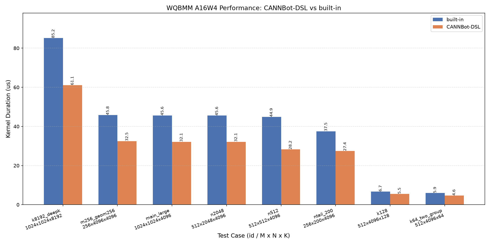

# WQBMM A16W4

基于 CANNBot-DSL 实现的权重量化矩阵乘算子（对齐主线 AscendC
`WeightQuantBatchMatmulV2` 的 antiquant-MX 路径），激活 FP16、权重
MXFP4（E2M1 + E8M0 per-32-group scale）、WeightNZ 布局，面向 Ascend 950。

## 算子介绍

计算公式：

$$
y[M,N] = x[M,K] \cdot \left(\mathrm{fp4\_to\_fp16}(w[K,N]) \times \mathrm{e8m0\_to\_fp16}(scale[\lfloor K/32 \rfloor, N])\right)
$$

其中权重 `w` 为 MXFP4（`fp4x2_e2m1` 打包，2 元素/字节），沿 K 轴每 32 个
数据共享一个 E8M0 Scale；`x` 为 FP16 激活。L0C FP32 累加，输出 FP16。

| 特性与约束 | 说明 |
| :--- | :--- |
| 数据类型 | x=FP16；w=MXFP4（int8/uint8 字节载体）；scale=E8M0；y=FP16 |
| 权重布局 | **WeightNZ**：`(ceil(N/16), K*8)` int8 物理布局（panel 主序，lo nibble=偶数列） |
| Scale 布局 | ND `(ceil(K/32), N)`（E8M0，可 uint8/int8 载体） |
| 约束 | K 为 32 的倍数；输入标准连续 ND；NPU 同 device；违规干净拒绝 |
| 架构 | AIC:AIV = 1:2 MIX（两 AIV 按 N 半区分工），GRID 设备感知择优：tiles ≤ 64 取设备核数（950PR 32 / 950DT 28），更大取 32 超配换 tile 均衡 |
| UB 多份载入 | 权重+scale GM→UB 输入环 depth=4（一次搬运 4 份，V 每次消费 1 份） |
| L1 双缓冲 | 权重 zn 双 slot 跨核 RingBuffer（0.7+ 框架 counter 自动推导 READY/FREE 与 AIV 归因） |
| 反量化 | AIV VF：`vreinterpret_lanes(fp4x2)` + 4×`vcast`(P0..P3→bf16→f16) 硬件解码 + E8M0 `shl(23)` 位构造 + mode B 分形直写 zn |
| 同步 | 框架 counter 系统从张量访问自动推导（0.5 时代手动 intra_block 屏障已废除） |
| 稳定性 | `WQBMM_MAX_GRID=N` 绝对覆盖 grid（实验档/保守回退） |
| 支持架构 | NPU ARCH 3510（Ascend 950PR / Ascend 950DT），cannbotdsl 0.8.0 |

数据流：A 走 AIC `nd2nz` GM→L1 直通；权重走 AIV
`GM→UB(4份环)→V反量化→UB(zn)→MTE3→L1(双slot)→MTE1→L0B`；
MMAD 后 FIXPIPE 写 GM。

## cannbotdsl 0.8 适配要点

- Buffer/RingBuffer 构造签名改为 `(mem_loc, dtype, make_layout(shape))`；
  `reinterpret(shape=)` → `layout=`；`.transpose` → `.permute`。
- 片上存储物理格式仅允许 nd/nz：原 `data_format="zn"` 的 UB/L1 环改为
  flat nd 分配 + `reinterpret(..., data_format="zn")` 视图（zn 网格
  k1-major，K 向行块为字节前缀/后缀，半区拆分语义不变）。
- 0.7 的 actual-extent 尾路径（K 尾 L0 前缀视图 / N 尾短 tile 部分列
  FIXPIPE）在 0.8 下不再可靠（MMAD 消费 L0 陈旧尾部 / h0 写出丢失，
  K=32/96、N=257/300 实测）：host 侧把 K/N 补零到 tiling 几何倍数，
  恒走满宽路径，输出按 (M, N) 裁剪返回（对齐 shape 零开销）。详见
  `weight_quant_batchmatmul_a16w4.py` 模块 docstring 与 `_pad_inputs`。

## 快速开始

```python
import torch
import torch_npu

from weight_quant_batchmatmul_a16w4 import npu_weight_quant_batchmatmul

M, K, N = 1024, 4096, 1024
x = torch.randn(M, K, dtype=torch.float16, device="npu")
# WeightNZ 物理布局 (ceil(N/16), K*8) uint8，fp4x2 打包
w = torch.randint(0, 256, ((N + 15) // 16, K * 8), dtype=torch.uint8, device="npu")
# E8M0 scale (K//32, N)
s = torch.randint(120, 136, (K // 32, N), dtype=torch.uint8,
                  device="npu").view(torch.float8_e8m0fnu)

y = npu_weight_quant_batchmatmul(x, w, s)   # -> (M, N) FP16
```

运行环境需先 `source <cann>/set_env.sh`（含 NPU runtime 与 bisheng）。

## 测试

```bash
# 仓根执行
pytest test/matmul/weight_quant_batchmatmul/test_weight_quant_batchmatmul_a16w4.py -v
```

CPU golden 为 torch FP32 独立参考（E2M1 位格式查表 × 2^(e-127)），
内联于测试文件，与 DSL 实现零共享代码。

## 已知限制

部分大 N 尾非对齐 shape 存在设备侧挂起（排查中）：N % 128 ≠ 0 且
N ≳ 2000（如 700×2800×5632），或 N 尾叠加 M ≥ 2048 的组合；单独的
M 尾 / K 尾 / 小 N 尾（如 ntail_200、ktail_2080）不受影响。遇到该类
shape 前先在小批次上验证，或临时改用对齐维度。

## 性能数据

本 Sample 与 built-in `npu_weight_quant_batchmatmul`（主线
`WeightQuantBatchMatmulV2` antiquant-MX 路径）在 20 例泛化用例（M/N/K
各维扫描、尾块组合与 LLM 推理 shape）上的性能对比结果如下，图示 DSL
更优的 8 例（更优档几何均值 1.40×，最高 1.60×）。使用 msprof 采集
AI Core Kernel Task Duration，每个 Shape 独立进程预热 3 次后重复
10 次取最小值；图中不包含编译、Launch、同步和输入构造时间。


